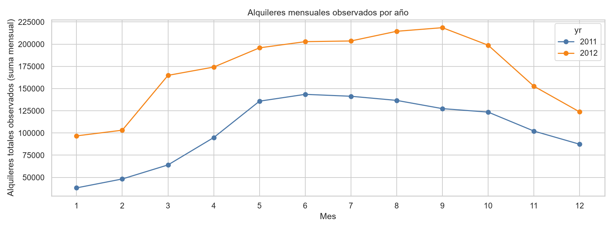
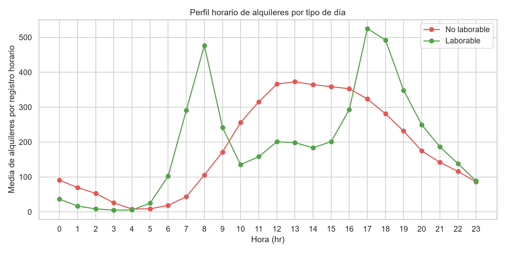
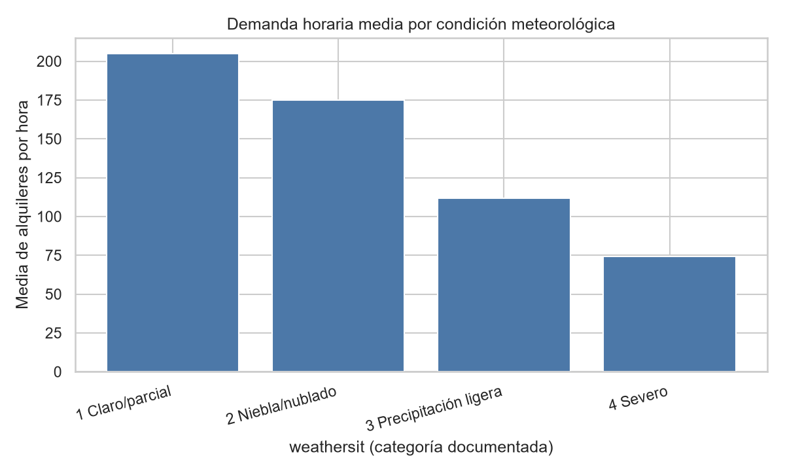
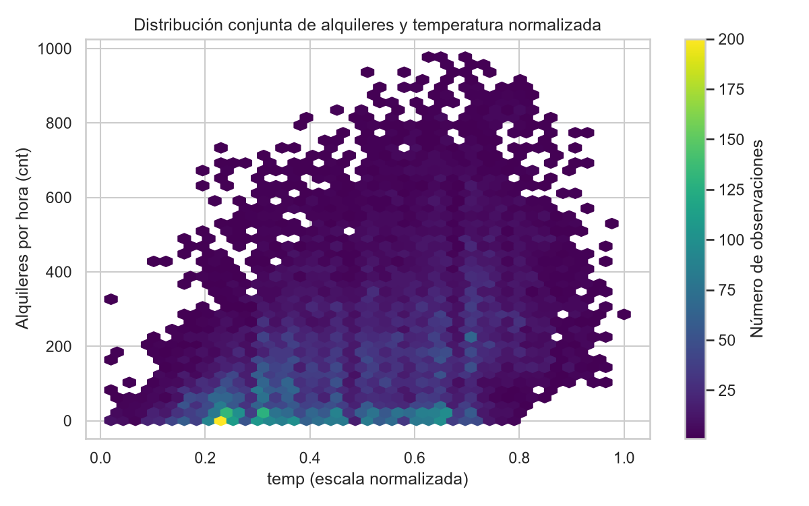
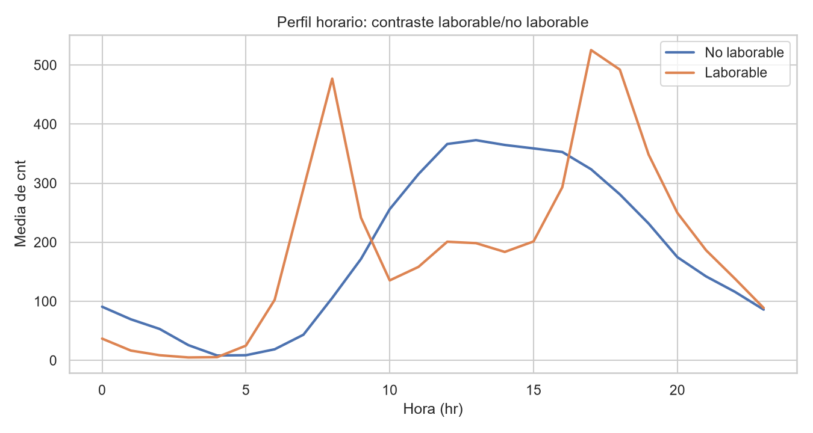

# Resumen ejecutivo

El dataset contiene 17.379 registros horarios de alquileres de bicicletas en Capital Bikeshare, Washington D.C., entre 2011-01-01 y 2012-12-31. Cada fila representa una hora calendario observada, no un viaje individual ni una estación. Se verificó que `cnt` coincide exactamente con `casual + registered` en todas las filas y no se detectaron valores ausentes ni duplicados. [STAT-001] [STAT-002] [STAT-003]

La demanda horaria presenta amplia dispersión: `cnt` tiene media de 189,46, mediana de 142, rango de 1 a 977 y desviación estándar de 181,39. La diferencia entre media y mediana es consistente con una distribución con cola superior. [STAT-005]

El promedio horario observado fue mayor en 2012 (234,67) que en 2011 (143,79); esto describe una diferencia entre los periodos registrados, sin identificar su causa. [STAT-006] Los patrones intradía también difieren por `workingday`: en días laborables, las medias máximas aparecen a las 08:00 (477,01) y 17:00 (525,29), mientras que en días no laborables el máximo medio se sitúa a las 13:00 (372,73). [STAT-007] [FIG-002]

Hay una limitación relevante de cobertura: faltan 165 franjas respecto de las 24 horas esperables en cada una de las 731 fechas; 76 días tienen menos de 24 registros. Por ello, las sumas diarias y mensuales se presentan como totales observados y no como estimaciones ajustadas por horas ausentes. [STAT-004] [ISSUE-001]

# Dataset y alcance

El archivo analizado es un CSV horario del dataset Bike Sharing documentado públicamente. La tabla fuente tiene 17 columnas y 17.379 filas: `instant`, `dteday`, variables de calendario (`season`, `yr`, `mnth`, `hr`, `holiday`, `weekday`, `workingday`), condiciones meteorológicas (`weathersit`, `temp`, `atemp`, `hum`, `windspeed`) y conteos (`casual`, `registered`, `cnt`). [STAT-001]

La unidad de análisis es una hora calendario disponible, identificable mediante la combinación de `dteday` y `hr`. El alcance es descriptivo: se examinan calidad, distribuciones, agregaciones temporales y asociaciones bivariadas. Los datos no permiten analizar trayectos individuales, ubicación de estaciones, disponibilidad de bicicletas o capacidad del sistema.

Las variables `temp`, `atemp`, `hum` y `windspeed` se mantienen en las escalas normalizadas documentadas; por tanto, sus valores no se interpretan directamente como grados Celsius, porcentaje físico o velocidad física sin una conversión adicional explícitamente justificada. [STAT-003] [STAT-005]

# Inspección, calidad y preparación

La carga confirmó una cobertura de 731 fechas, desde 2011-01-01 hasta 2012-12-31, y 17.379 combinaciones únicas de `dteday`–`hr`. [STAT-001] No se hallaron ausencias en ninguna de las 17 columnas fuente, duplicados exactos, duplicados de `instant` ni duplicados de fecha-hora. Además, `instant` cubre consecutivamente las posiciones 1 a 17.379. [STAT-002]

Los códigos revisados respetan los dominios documentados: `season` tiene cuatro categorías, `yr` dos, `mnth` va de 1 a 12, `hr` de 0 a 23, y `holiday` y `workingday` son binarios. No se detectaron valores fuera del intervalo [0, 1] para las variables normalizadas revisadas; sus máximos fueron 1,00 para `temp`, `atemp` y `hum`, y 0,8507 para `windspeed`. [STAT-003]

También se validó la identidad contable `cnt = casual + registered`: tuvo cero incumplimientos. Los códigos `yr`, `mnth` y `weekday` son coherentes con `dteday`; la correspondencia observada para `weekday` equivale a domingo codificado como 0. La comparación de `season` con trimestres de calendario no es exacta en todos los registros, por lo que no se simplificó la variable como un trimestre. [STAT-003]

Se creó `prepared_data.csv` como copia separada de trabajo con las 17.379 filas originales. Se convirtió `dteday` a fecha analítica y se serializó como ISO `YYYY-MM-DD`. Se añadieron `date_hour`, `casual_share` y `registered_share`, manteniendo intactas las columnas fuente y sin eliminar extremos ni registros. Las proporciones son interpretables porque no hubo horas con `cnt = 0`. [STAT-005]

La única incidencia de calidad sustantiva es temporal: se observaron 17.379 franjas frente a 17.544 horas esperables para 731 días completos, con 165 franjas ausentes y 76 días incompletos. Se decidió no imputar datos no observados. [STAT-004] [ISSUE-001]

# Estadística descriptiva

En las 17.379 horas preparadas, `cnt` tuvo media 189,46, mediana 142, primer cuartil 40, tercer cuartil 281, mínimo 1 y máximo 977. La mediana menor que la media y el rango amplio justifican informar cuantiles junto a promedios. [STAT-005]

Los usuarios `registered` aportaron, en promedio, 153,79 alquileres por hora, frente a 35,68 de `casual`. La fracción media de `casual` en el total horario fue 0,1721 y su mediana 0,1469, lo que describe una composición predominantemente `registered` en la hora típica observada. [STAT-005]

Las medias de las escalas normalizadas fueron 0,4970 para `temp`, 0,4758 para `atemp`, 0,6272 para `hum` y 0,1901 para `windspeed`. Sus respectivos rangos observados fueron 0,02–1,00, 0,00–1,00, 0,00–1,00 y 0,00–0,8507. [STAT-005]

Por año, se registraron 1.243.103 alquileres observados en 8.645 horas de 2011 y 2.049.576 en 8.734 horas de 2012. Los promedios horarios correspondientes fueron 143,79 y 234,67. [STAT-006]

Por `season`, la media horaria de `cnt` fue 111,11 en la categoría 1, 208,34 en la 2, 236,02 en la 3 y 198,87 en la 4. Por `weathersit`, las medias fueron 204,87 para categoría 1, 175,17 para categoría 2, 111,58 para categoría 3 y 74,33 para categoría 4; esta última solo reúne tres observaciones, por lo que su resumen es especialmente inestable. [STAT-006]

# Variables, agregaciones y relaciones

Las sumas mensuales observadas muestran estacionalidad descriptiva y diferencias entre años. Por ejemplo, enero totalizó 38.189 alquileres observados en 2011 y 96.744 en 2012; septiembre acumuló 127.418 y 218.573, respectivamente. Las horas observadas por mes no son siempre iguales, por lo que estas sumas deben leerse junto con la cobertura; las medias horarias mensuales facilitan comparaciones descriptivas complementarias. [STAT-007] [ISSUE-001]

El perfil por hora revela contrastes marcados según `workingday`. En jornadas laborables, el promedio de `cnt` alcanza 477,01 a las 08:00 y 525,29 a las 17:00. En días no laborables, el promedio aumenta desde la mañana hacia el mediodía y alcanza 372,73 a las 13:00. Son patrones de asociación entre calendario y conteos observados, no evidencia de que el tipo de día cause esos niveles. [STAT-007]

La composición también cambia dentro del patrón horario. En días laborables a las 17:00, el promedio de `registered` es 468,39 frente a 56,90 de `casual`; en días no laborables a las 13:00, los promedios son 236,31 y 136,42, respectivamente. [STAT-007] Esta lectura debe considerar que `casual`, `registered` y `cnt` están ligados por una identidad contable, no son resultados independientes. [STAT-003]

Las correlaciones de Spearman bivariadas entre `cnt` y las escalas ambientales fueron 0,4233 con `temp`, 0,4233 con `atemp`, −0,3596 con `hum` y 0,1266 con `windspeed`. [STAT-008] Estas cifras describen asociación monotónica en la muestra completa; no controlan por hora, estacionalidad, calendario ni dependencia temporal. Además, `temp` y `atemp` tienen correlación de Spearman 0,9896, por lo que representan información térmica muy redundante en este dataset. [STAT-008]

# Visualizaciones y hallazgos

La evolución de las sumas mensuales observadas por `yr` permite contextualizar el aumento descriptivo entre 2011 y 2012 y las diferencias de cobertura entre meses. [STAT-007] [STAT-004] [FIG-001]

El perfil horario muestra una concentración de demanda media en horas de desplazamiento de jornadas laborables y un máximo más centrado en la tarde de los días no laborables. [STAT-007] [FIG-002]

La comparación por `weathersit` visualiza que las categorías meteorológicas menos severas concentran más observaciones y presentan medias horarias de `cnt` superiores. La categoría 4 debe interpretarse con gran cautela debido a sus tres registros. [STAT-006] [FIG-003]

El diagrama de densidad para `temp` y `cnt` representa simultáneamente la dispersión de los conteos y su asociación positiva moderada de Spearman. No implica un efecto aislado de la temperatura. [STAT-005] [STAT-008] [FIG-004]

La figura complementaria del contraste laborable/no laborable facilita comparar la forma de ambos perfiles horarios sin confundir los valores con totales diarios. [STAT-007] [FIG-005]

# Problemas, riesgos y anomalías

No se detectaron ausencias, duplicados, códigos inválidos en los dominios revisados, rangos normalizados incompatibles ni incumplimientos de la identidad de los conteos. Estos controles se documentaron aunque no produjeran incidencias. [STAT-002] [STAT-003]

La cobertura horaria incompleta es un riesgo de interpretación de severidad media. Hay 165 franjas ausentes respecto de 731 días de 24 horas y 76 días con menos de 24 observaciones. Se conservaron los registros disponibles y no se imputaron conteos; en consecuencia, toda suma temporal se denomina explícitamente observada. [STAT-004] [ISSUE-001]

La regla IQR identificó 505 registros de `cnt` por encima de la cerca superior 642,5, equivalente al 2,91 % de las observaciones. El máximo fue 977, en `instant` 14774, correspondiente a 2012-09-12 a las 18:00, con 91 usuarios `casual` y 886 `registered`. [STAT-009] Estos casos se conservaron: cumplen los dominios revisados y la identidad de conteos, por lo que el criterio estadístico no aporta evidencia suficiente para tratarlos como errores. [ISSUE-002]

La consecuencia potencial de los extremos es una mayor sensibilidad de la media respecto de la mediana; por ello, el análisis informa ambas medidas y cuantiles. No puede determinarse con el archivo disponible si un extremo representa una demanda excepcional o una circunstancia operacional no registrada. [STAT-005] [ISSUE-002]

# Limitaciones e incertidumbres

Los registros están agregados por hora y no contienen trayectos individuales, origen, destino, estaciones, capacidad, disponibilidad de bicicletas ni características de personas usuarias. Esto impide atribuir los patrones a mecanismos concretos.

Las 165 horas no observadas limitan la comparabilidad directa de sumas diarias y mensuales. No se imputaron porque el dataset no permite reconstruir esos conteos de forma verificable. [STAT-004] [ISSUE-001]

Las relaciones con clima y calendario son bivariadas o descriptivas. Factores simultáneos como hora, estación, año, día laborable y dependencia entre horas pueden contribuir a las asociaciones observadas. [STAT-008]

La categoría `weathersit = 4` cuenta con solo tres registros, de modo que su promedio no debe generalizarse. [STAT-006] Las variables meteorológicas normalizadas se interpretan únicamente en su escala documentada. [STAT-003]

# Conclusiones

El archivo es adecuado para EDA horario tras conservar íntegramente sus 17.379 registros y añadir variables analíticas trazables. La calidad estructural es alta en términos de ausencias, duplicación, dominios e identidad contable. [STAT-002] [STAT-003]

La demanda horaria fue heterogénea: la media de `cnt` fue 189,46, la mediana 142 y los patrones por hora difirieron notablemente entre jornadas laborables y no laborables. [STAT-005] [STAT-007] Los registros de 2012 tuvieron un promedio horario superior al de 2011, y las categorías de `weathersit` exhibieron diferencias descriptivas de demanda. [STAT-006]

Las asociaciones con `temp`, `atemp`, `hum` y `windspeed` deben interpretarse como descriptivas, especialmente dada la alta redundancia entre `temp` y `atemp` y la ausencia de control de otros factores. [STAT-008]

Finalmente, el principal aspecto que condiciona análisis posteriores es la cobertura temporal incompleta. Para comparaciones de volumen agregado, conviene usar medias por hora observada o incorporar explícitamente la cantidad de horas disponibles, en lugar de interpretar sumas de periodos con diferente exposición como magnitudes directamente equivalentes. [STAT-004] [ISSUE-001]