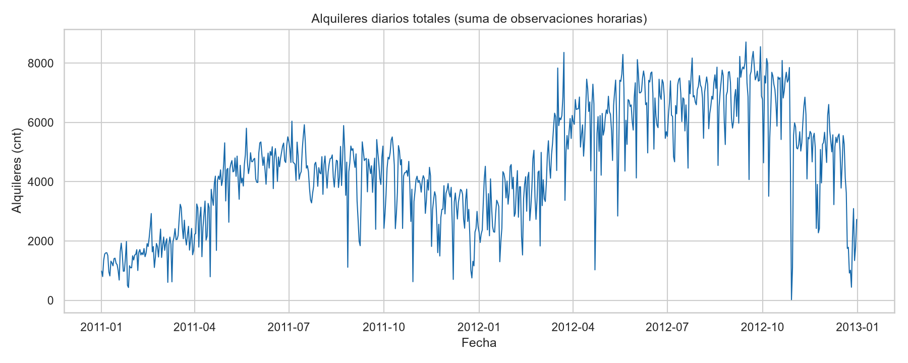
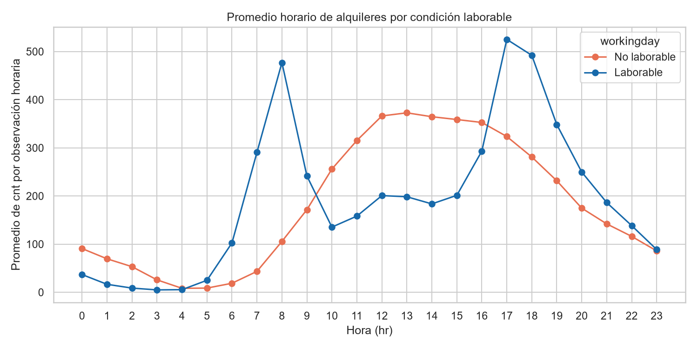
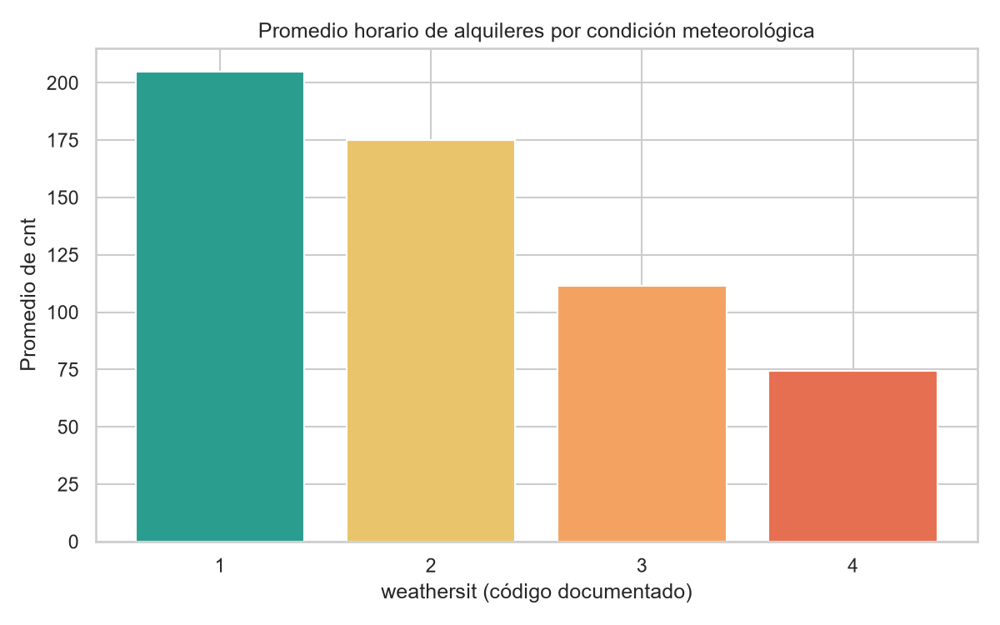
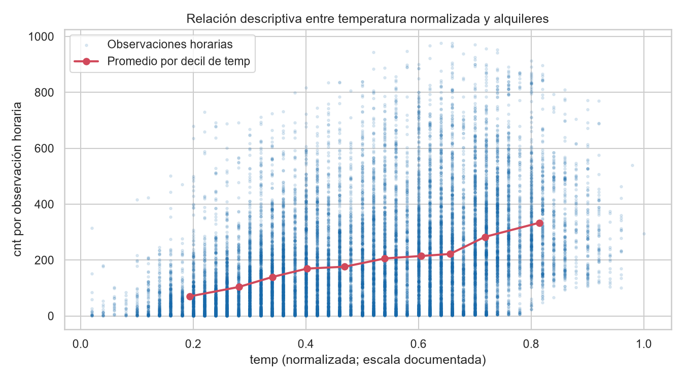

# Resumen ejecutivo

El análisis cubre 17.379 observaciones horarias de alquileres de Capital Bikeshare entre el 1 de enero de 2011 y el 31 de diciembre de 2012. La estructura observada es coherente con el conjunto horario descrito en la documentación: incluye `hr`, componentes de calendario, variables meteorológicas normalizadas y los componentes de demanda `casual`, `registered` y `cnt`. [STAT-001]

La calidad estructural es alta: no se detectaron valores ausentes, filas duplicadas, `instant` repetidos ni marcas temporales duplicadas; además, se verifica en todas las filas la identidad `cnt = casual + registered`. [STAT-002] [STAT-003] Sin embargo, la cobertura no contiene todas las horas calendario: faltan 165 de 17.544 franjas posibles y 76 fechas tienen un número de registros distinto de 24. Esto impide interpretar las sumas temporales como totales necesariamente completos de cada día, mes o año. [STAT-004] [ISSUE-001]

La demanda horaria de `cnt` presenta amplia dispersión: media 189,5, mediana 142, primer y tercer cuartil de 40 y 281, respectivamente, y máximo de 977 alquileres. En el periodo observado se registran 3.292.679 alquileres; 81,2% corresponde a `registered` y 18,8% a `casual`. [STAT-006] [STAT-008]

Los patrones descriptivos más marcados son temporales: la media por hora alcanza 461,5 a las 17:00, frente a 6,4 a las 04:00. El perfil cambia con `workingday`: las medias a las 08:00 y 17:00 son 477,0 y 525,3 en días laborables, mientras que los días no laborables concentran sus mayores medias entre las 12:00 y 16:00. [STAT-007] [STAT-009] También se observan promedios horarios mayores bajo `weathersit=1` (204,9) que bajo los códigos 2 (175,2), 3 (111,6) y 4 (74,3), pero estas diferencias son descriptivas y no aíslan la meteorología de la estacionalidad ni del calendario. [STAT-008]

# Dataset y alcance

El archivo analizado es un CSV con 17 columnas originales y 17.379 filas. Según la documentación pública, representa el registro histórico 2011–2012 de Capital Bikeshare en Washington D.C.; cada fila es una observación agregada de alquileres durante una hora, acompañada de fecha, calendario, clima y composición de usuarios. [STAT-001]

Las variables principales son:

- `cnt`: número total de alquileres de la hora.
- `casual` y `registered`: componentes de `cnt` por tipo de usuario.
- `dteday`, `yr`, `mnth`, `hr`, `weekday`, `holiday` y `workingday`: variables de calendario.
- `season` y `weathersit`: códigos categóricos documentados.
- `temp`, `atemp`, `hum` y `windspeed`: variables meteorológicas normalizadas.

El alcance es estrictamente descriptivo. Se analizaron estructura, calidad, distribuciones, agregaciones temporales y asociaciones observadas. No se entrenaron modelos predictivos ni se realizaron inferencias causales.

# Inspección, calidad y preparación

La tabla abarca 731 fechas distintas, desde `2011-01-01 00:00` hasta `2012-12-31 23:00`, e incluye las 24 categorías de `hr`, los 12 meses, los cuatro códigos de `season` y `weathersit`, y los dominios binarios esperados para `yr`, `holiday` y `workingday`. [STAT-001] [STAT-003]

Las comprobaciones de calidad no detectaron ausencias en ninguna de las 17 columnas originales: las 17.379 filas están completas. Tampoco se encontraron duplicados de fila completa, de `instant` ni de la combinación temporal derivada. [STAT-002] Los campos de calendario `mnth` y `yr` son coherentes con `dteday`; además, al comprobar el patrón de fechas se confirma que `weekday` usa el código domingo=0, sábado=6 y que `workingday` concuerda con la definición de día no festivo ni fin de semana. [STAT-003]

Los rangos revisados son consistentes con los dominios documentados: los recuentos no son negativos, `temp`, `atemp` y `hum` están entre 0 y 1, y `windspeed` está entre 0 y 0,8507. La identidad documentada `cnt = casual + registered` se cumple en las 17.379 filas. [STAT-003]

La excepción relevante es temporal. Entre los extremos de la serie deberían existir 17.544 franjas horarias, pero solo se observan 17.379: faltan 165 franjas y 76 días no contienen 24 observaciones. Por ejemplo, `2011-01-18` contiene 12 registros. [STAT-004] Esta situación se retuvo sin imputación, pues no hay evidencia autorizada que permita asignar valores a las horas ausentes. [ISSUE-001]

Se creó `prepared_data.csv` como una copia de trabajo independiente. No se eliminaron ni imputaron registros. `dteday` se convirtió a fecha para el análisis y se añadió la variable derivada `timestamp`, construida a partir de `dteday` y `hr`; la copia conserva las 17.379 filas, las 17 variables originales y una variable derivada, para un total de 18 columnas. [STAT-005]

# Estadística descriptiva

Sobre las 17.379 observaciones horarias, `cnt` tiene media de 189,5 alquileres y mediana de 142; el 50% central de las observaciones está entre 40 y 281 alquileres. El mínimo es 1 y el máximo 977, lo que confirma una distribución con gran variabilidad entre horas. [STAT-006]

La media horaria de `registered` es 153,8, mayor que la de `casual` (35,7). En las sumas observadas de todo el periodo, `registered` aporta 2.672.662 alquileres, frente a 620.017 de `casual`; las participaciones respectivas son 81,2% y 18,8%. [STAT-006] [STAT-008]

Las variables meteorológicas se mantuvieron en su escala normalizada. Sus medias son 0,497 para `temp`, 0,476 para `atemp`, 0,627 para `hum` y 0,190 para `windspeed`. [STAT-006] Estos valores no se convirtieron a unidades físicas, pues el análisis se centra en la escala documentada y evita introducir conversiones adicionales innecesarias.

Por estación, el promedio horario de `cnt` es menor para `season=1` (111,1) y mayor para `season=3` (236,0); `season=2` y `season=4` promedian 208,3 y 198,9, respectivamente. [STAT-007] Por mes, el promedio observado asciende desde 94,4 en `mnth=1` hasta valores cercanos a 240 en `mnth=6` y `mnth=9`, antes de descender a 142,3 en `mnth=12`. [STAT-007] Estas comparaciones se refieren a horas observadas y no corrigen la cobertura incompleta.

Las sumas de `cnt` observadas son 1.243.103 en `yr=0` y 2.049.576 en `yr=1`. La proporción de `casual` sobre el total observado pasa de 19,9% a 18,2% entre esos códigos anuales. [STAT-007] Estas cifras describen los registros disponibles y deben leerse junto con el riesgo de horas ausentes. [ISSUE-001]

# Variables, agregaciones y relaciones

El patrón horario agregado es pronunciado. La media de `cnt` es 6,4 a las 04:00, crece durante la mañana, alcanza 359,0 a las 08:00, y presenta su máximo a las 17:00 con 461,5 alquileres por observación; a las 18:00 sigue siendo 425,5. [STAT-007]

La segmentación por `workingday` muestra perfiles diferentes. En días laborables, las medias son 477,0 a las 08:00 y 525,3 a las 17:00; en días no laborables, las mayores medias se desplazan hacia el mediodía y primeras horas de la tarde, con 372,7 a las 13:00 y 364,6 a las 14:00. [STAT-009] Esto describe una interacción entre hora y condición de día; no identifica el motivo de dichos patrones.

La condición meteorológica documentada `weathersit=1` reúne 11.413 horas y una media de 204,9 alquileres por hora. Las medias disminuyen a 175,2 para `weathersit=2`, 111,6 para `weathersit=3` y 74,3 para `weathersit=4`; esta última categoría solo contiene tres horas, por lo que su promedio tiene soporte muestral muy limitado. [STAT-008]

Las correlaciones de Spearman muestran asociación positiva moderada entre `cnt` y `temp` (0,423), asociación negativa con `hum` (-0,360) y asociación positiva débil con `windspeed` (0,127). [STAT-009] La media de `cnt` aumenta desde 84,4 en el quintil inferior de `temp` hasta 306,7 en el quintil superior. [STAT-009] Estas asociaciones son bivariadas: pueden coincidir con variación por hora, estación, año y calendario, por lo que no constituyen estimaciones de efectos meteorológicos.

`temp` y `atemp` son prácticamente redundantes como descriptores monotónicos en esta tabla, con correlación de Spearman de 0,990. [STAT-009] Asimismo, la relación entre `cnt` y sus componentes es parcialmente mecánica, porque la identidad de suma se cumple sin excepciones. [STAT-003]

# Visualizaciones y hallazgos

**FIG-001** presenta la suma diaria observada de `cnt` para las 731 fechas con registros; la agregación también conserva el número de horas disponibles y las sumas de `casual` y `registered` por fecha. [FIG-001] [STAT-011] Permite apreciar variación de corto plazo y cambios a través de los dos años, pero las fechas con menos de 24 horas hacen que la altura de algunos puntos pueda reflejar tanto demanda como cobertura incompleta. [STAT-004] [STAT-011]

**FIG-002** visualiza el contraste entre los perfiles por `hr`: en días laborables se observan picos matutino y vespertino más concentrados, mientras que el perfil no laborable es más elevado alrededor de las horas centrales. [FIG-002] [STAT-009]

**FIG-003** compara promedios horarios por `weathersit`. El descenso descriptivo desde el código 1 hasta el 4 es visible, aunque la categoría 4 debe interpretarse con cautela por sus tres observaciones. [FIG-003] [STAT-008]

**FIG-004** muestra la dispersión horaria de `cnt` frente a `temp` normalizada y una guía de promedios de `cnt` por diez grupos de frecuencia aproximadamente igual de `temp`. [FIG-004] [STAT-009] [STAT-012] La tendencia agregada ascendente es compatible con la asociación de Spearman positiva, pero la dispersión evidencia que la temperatura por sí sola no resume la variación horaria observada. [STAT-009] [STAT-012]

# Problemas, riesgos y anomalías

La incidencia principal es la incompletitud temporal. Hay 165 franjas faltantes dentro del intervalo cubierto y 76 días con menos de 24 registros —en este caso, menos—. Se conservaron los datos disponibles y no se imputaron valores porque no existe base empírica en el archivo para reconstruir las horas ausentes. [ISSUE-001] Este hecho puede sesgar a la baja las sumas de los periodos afectados y limita comparaciones basadas exclusivamente en totales.

Mediante una regla robusta IQR para `cnt`, se identificaron 505 observaciones superiores al límite de 642,5 alquileres, equivalentes al 2,91% de las filas. El máximo observado es 977, en `2012-09-12` a las 18:00. [STAT-010] Estas observaciones se mantienen: cumplen la identidad entre componentes y total, no vulneran dominios revisados y no hay evidencia interna que las clasifique como errores. [ISSUE-002] Por tanto, se consideran horas de demanda inusualmente alta en términos descriptivos, no anomalías confirmadas ni eventos atribuidos a una causa concreta.

No se identificaron incidencias de ausencias, duplicación, incompatibilidad de tipos, categorías fuera de dominio, valores negativos ni incumplimiento de identidades. [STAT-002] [STAT-003]

# Limitaciones e incertidumbres

- Los registros están agregados por hora. No permiten estudiar viajes individuales, duración, origen, destino, estaciones, capacidad del sistema ni exposición de usuarios.
- La cobertura temporal contiene 165 horas ausentes. Las sumas por día, mes o año son sumas de registros disponibles y no necesariamente totales completos de calendario. [STAT-004] [STAT-011] [ISSUE-001]
- `temp`, `atemp`, `hum` y `windspeed` están normalizadas; este informe no las interpreta como valores físicos directos.
- Las comparaciones entre estaciones, clima, horas y calendarios son descriptivas. Esas variables pueden variar conjuntamente, por lo que no se debe interpretar una diferencia de medias o una correlación como efecto causal.
- La categoría `weathersit=4` tiene solo tres observaciones, lo que hace especialmente incierto su promedio. [STAT-008]
- Los extremos altos de `cnt` son estadísticamente inusuales bajo una regla IQR, pero el dataset y la documentación disponible no permiten confirmar su origen. [ISSUE-002]

# Conclusiones

La tabla es internamente consistente para el análisis descriptivo: conserva todos los valores, no presenta ausencias ni duplicados y respeta la identidad entre `cnt`, `casual` y `registered`. [STAT-002] [STAT-003] La copia preparada mantiene la población original y añade una marca temporal explícita para reproducir las comprobaciones de cobertura. [STAT-005]

La demanda observada se caracteriza por alta heterogeneidad horaria, predominio de usuarios `registered` y patrones contrastados entre días laborables y no laborables. [STAT-006] [STAT-008] [STAT-009] Los promedios también varían por estación, temperatura normalizada y condición meteorológica, pero estas diferencias deben entenderse como asociaciones descriptivas en datos agregados. [STAT-007] [STAT-008] [STAT-009] [STAT-012]

La principal precaución para análisis posteriores es la cobertura horaria incompleta. Cualquier uso de sumas temporales, incluida la serie diaria representada, debe considerar las horas no registradas; cualquier tratamiento de las 505 horas altas detectadas debe evitar asumir que son errores sin evidencia adicional. [STAT-011] [ISSUE-001] [ISSUE-002]