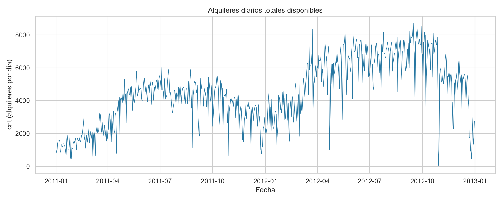
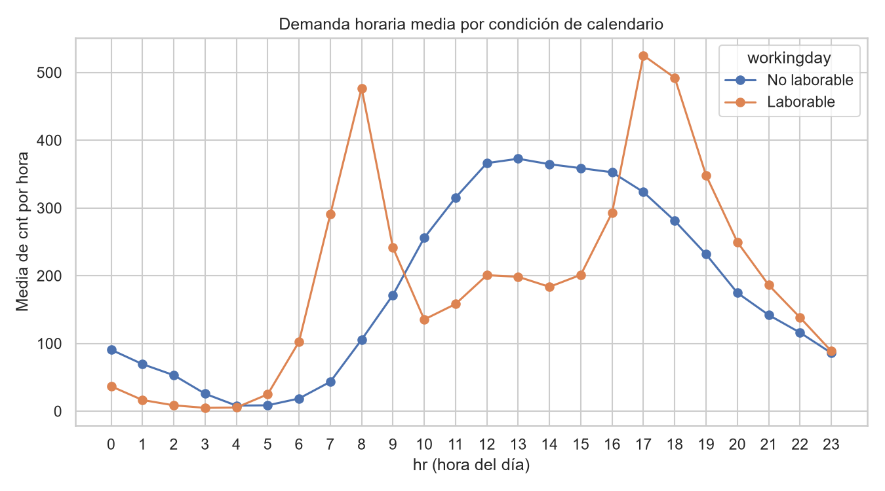
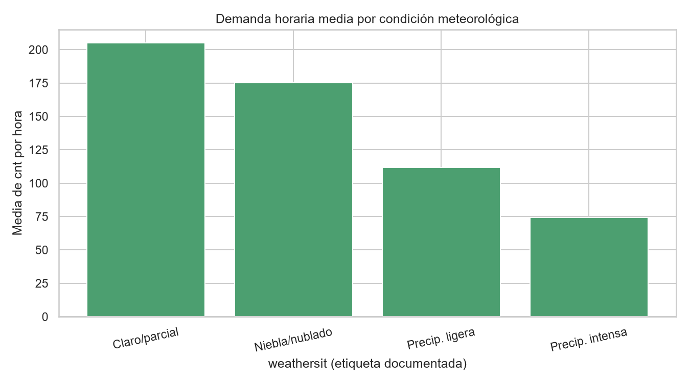
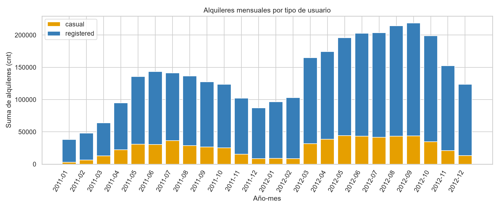
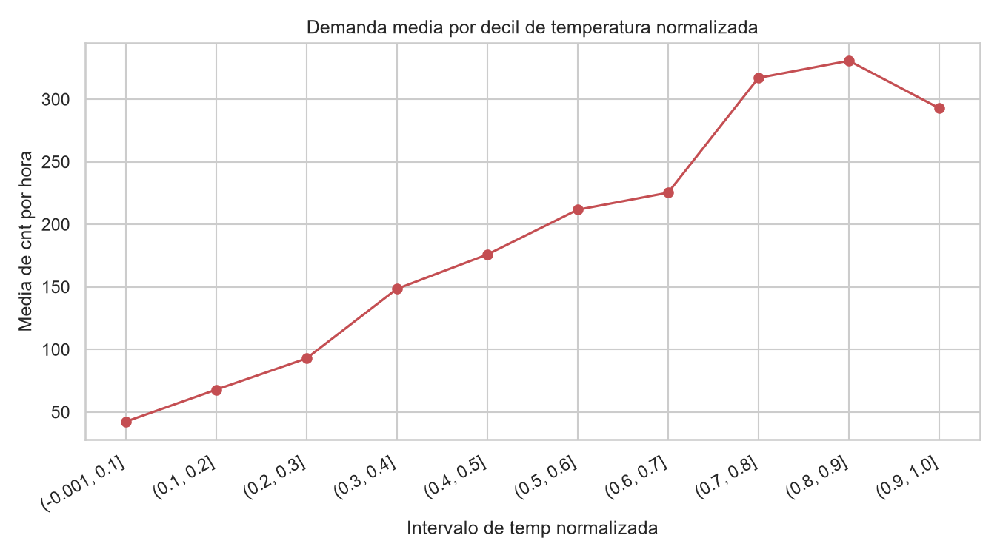

# Resumen ejecutivo

El archivo analizado es el CSV horario documentado para Bike Sharing: contiene 17.379 registros y 17 variables originales, correspondientes a alquileres agregados por hora de Capital Bikeshare entre 2011-01-01 y 2012-12-31. Se preparó una copia de trabajo con las 17.379 filas retenidas y dos etiquetas derivadas para interpretar `season` y `weathersit`. [STAT-001] [TR-001] [TR-002] [TR-003]

La calidad estructural es en general alta: no se detectaron ausencias, filas duplicadas, `instant` repetidos ni incumplimientos de la identidad documentada `cnt = casual + registered`. [STAT-002] [STAT-005] Los códigos temporales, de calendario y meteorología observados están dentro de los dominios documentados; los conteos no son negativos y las métricas meteorológicas permanecen en sus escalas normalizadas. [STAT-003]

La demanda total acumulada es 3.292.679 alquileres; el promedio horario es 189,46, la mediana 142 y el máximo 977, lo que refleja una distribución con valores altos en parte de las horas. [STAT-006] Los usuarios `registered` aportan el 81,17 % del total agregado, frente al 18,83 % de `casual`. [STAT-011]

El principal riesgo de interpretación es la cobertura intradía incompleta: 76 de las 731 fechas tienen un número de registros distinto de 24 y hay 165 marcas horarias ausentes en la secuencia temporal. Los registros se conservaron sin imputación, de modo que los totales diarios de esas fechas pueden no ser comparables estrictamente con días completos. [STAT-004] [ISSUE-001]

# Dataset y alcance

La documentación pública identifica el conjunto como la versión horaria de Bike Sharing para Capital Bikeshare en Washington D.C. Cada fila representa los alquileres agregados en una hora, junto con fecha (`dteday`), componentes de calendario, condiciones meteorológicas normalizadas y conteos de usuarios `casual`, `registered` y `cnt`. La presencia de `hr` y el esquema observado concuerdan con el archivo horario documentado. [STAT-001]

El alcance temporal efectivo va del 2011-01-01 al 2012-12-31 e incluye 731 fechas distintas. Se analizaron los registros disponibles en toda esa cobertura, sin construir un modelo predictivo ni realizar inferencias causales. [STAT-004]

Las variables de demanda son `casual`, `registered` y `cnt`. Las variables de contexto incluyen `season`, `yr`, `mnth`, `hr`, `holiday`, `weekday`, `workingday`, `weathersit`, `temp`, `atemp`, `hum` y `windspeed`. Conforme a la documentación, `temp`, `atemp`, `hum` y `windspeed` se interpretan en sus escalas normalizadas originales. [STAT-003] [STAT-006]

# Inspección, calidad y preparación

La carga reprodujo la estructura original: 17.379 filas, 17 columnas y fechas válidas en las 17.379 observaciones. [STAT-001] No se encontraron valores ausentes en ninguna columna, filas completamente duplicadas ni duplicados del identificador trazable `instant`, que es único en las 17.379 filas. [STAT-002]

Los códigos observados de `season` son 1–4; los de `yr`, `holiday` y `workingday` son binarios; `mnth` cubre 1–12; `hr` cubre 0–23; `weekday` cubre siete categorías; y `weathersit` cubre 1–4. [STAT-003] La categoría documentada como precipitación intensa solo aparece en 3 horas, mientras que 11.413 horas tienen condiciones claras o parcialmente nubladas. Estas diferencias de tamaño muestral condicionan la estabilidad de comparaciones entre categorías meteorológicas. [STAT-007]

Los componentes `yr`, `mnth` y `weekday` son consistentes con `dteday`; tampoco existen combinaciones repetidas de fecha y hora. [STAT-004] Sin embargo, la continuidad temporal no es completa: 655 fechas tienen 24 registros y 76 no; el mínimo diario observado es un registro. En total faltan 165 marcas horarias respecto de una secuencia horaria completa entre las fechas extremas. [STAT-004] Esta situación se conserva como riesgo de cobertura y no se atribuye a un error concreto, pues la tabla no informa la causa de las horas ausentes. [ISSUE-001]

La identidad `cnt = casual + registered` se comprobó observación a observación: hay 0 discrepancias y la suma agregada de ambos componentes coincide exactamente con `cnt` (3.292.679). [STAT-005]

La preparación no eliminó ni imputó observaciones. `dteday` fue validada como fecha y serializada en formato ISO `YYYY-MM-DD`; se añadieron `season_label` y `weathersit_label` desde las codificaciones documentadas para facilitar la lectura de grupos y gráficos, conservando a la vez las columnas codificadas de origen. La copia preparada tiene 17.379 filas y 19 columnas. [TR-001] [TR-002] [TR-003]

# Estadística descriptiva

En las 17.379 horas preparadas se contabilizan 3.292.679 alquileres: 620.017 de usuarios `casual` y 2.672.662 de usuarios `registered`. La media horaria de `cnt` es 189,46, la mediana 142, el primer cuartil 40, el tercer cuartil 281 y el máximo 977. La desviación estándar es 181,39, cercana a la media, por lo que las medianas y cuantiles complementan a la media en la descripción de la demanda. [STAT-006]

Los alquileres `casual` presentan media de 35,68 y mediana de 17 por hora; los `registered`, media de 153,79 y mediana de 115. Esta diferencia es coherente con la mayor contribución agregada de `registered`, pero los conteos se refieren a alquileres, no a personas únicas. [STAT-006] [STAT-011]

Las medias de las variables meteorológicas normalizadas son 0,497 para `temp`, 0,476 para `atemp`, 0,627 para `hum` y 0,190 para `windspeed`. Sus intervalos observados permanecen entre 0 y 1, salvo que `temp` comienza en 0,02 y `windspeed` alcanza como máximo 0,8507. [STAT-003] [STAT-006]

Por estación, la media horaria de `cnt` es 111,12 en `spring`, 208,34 en `summer`, 236,02 en `fall` y 198,87 en `winter`. Por año codificado, la media es 143,79 en `yr=0` y 234,67 en `yr=1`; estas son diferencias descriptivas entre periodos y no estimaciones de un efecto temporal aislado. [STAT-009]

# Variables, agregaciones y relaciones

Las agregaciones por fecha suman 3.292.679 alquileres sobre 731 días. La demanda diaria disponible tiene media 4.504,35, mediana 4.548, primer cuartil 3.152 y tercer cuartil 5.956. El máximo diario registrado es 8.714 el 2012-09-15 y el mínimo 22 el 2012-10-29; este último debe interpretarse teniendo en cuenta la cobertura horaria incompleta identificada. [STAT-010] [ISSUE-001]

El perfil por `hr` cambia marcadamente según `workingday`. En horas laborables, la demanda media alcanza 477,01 a las 08:00 y 525,29 a las 17:00; en horas no laborables, el mayor promedio se observa a las 13:00, con 372,73. Estos perfiles describen patrones conjuntos de calendario y hora, sin demostrar que la condición laborable cause esas diferencias. [STAT-008]

La composición de la demanda también difiere entre segmentos de calendario. En registros con `workingday=1`, `registered` representa el 86,77 % de `cnt`; en `workingday=0`, su proporción es 68,34 % y la de `casual` asciende a 31,67 %. [STAT-011] La figura mensual muestra simultáneamente la escala de la demanda y esta composición por tipo de usuario. [FIG-004]

Por condiciones de `weathersit`, la demanda horaria media es 204,87 en `clear_or_partly_cloudy`, 175,17 en `mist_or_cloudy`, 111,58 en `light_precipitation` y 74,33 en `heavy_precipitation`. La última media procede de solo tres horas y no permite una comparación robusta con las categorías más frecuentes. [STAT-007] [STAT-009]

Las correlaciones de Spearman entre `cnt` y las variables normalizadas son 0,4233 con `temp`, 0,4233 con `atemp`, −0,3596 con `hum` y 0,1266 con `windspeed`. Estas asociaciones son bivariadas y descriptivas; no controlan por hora, calendario, estación ni otras variables observadas. [STAT-012] `temp` y `atemp` tienen correlación de Spearman de 0,9896, evidencia de una fuerte redundancia descriptiva que aconseja cautela al interpretarlas como fuentes independientes de variación. [STAT-012]

La agregación de `temp` en diez intervalos de frecuencia aproximadamente igual presenta medias de `cnt` desde 70,00 en el primer intervalo, de 0,02 a 0,24, hasta 333,22 en el intervalo superior, de 0,74 a 1,00. Los tamaños de los intervalos están entre 1.501 y 2.013 horas; los límites, tamaños y medias exactas se documentan de forma reproducible. Es una descripción agrupada no ajustada y no una estimación causal. [STAT-014]

# Visualizaciones y hallazgos

La serie de alquileres diarios disponibles permite observar variación a lo largo de los dos años y señala los días con totales particularmente bajos o altos; los descensos extremos deben interpretarse con el contexto de cobertura por fecha. [FIG-001] [STAT-010] [ISSUE-001]

El perfil horario confirma visualmente que las horas de mayor media difieren entre registros laborables y no laborables: los picos laborables se concentran en la mañana y, especialmente, al final de la tarde, mientras que los no laborables alcanzan sus niveles más altos alrededor del mediodía y primeras horas de la tarde. [FIG-002] [STAT-008]

La comparación por condición meteorológica presenta medias menores en las categorías de peor condición registrada, pero no separa sus posibles relaciones con hora, estación o calendario. Además, la barra de precipitación intensa corresponde a únicamente tres observaciones. [FIG-003] [STAT-007] [STAT-009]

La descomposición mensual muestra que `registered` domina el volumen agregado cada mes, mientras que `casual` aporta una fracción visualmente mayor en meses de mayor actividad. Es una descripción temporal agregada y no permite atribuir los cambios a un único factor. [FIG-004] [STAT-010] [STAT-011]

La demanda media por deciles de `temp` normalizada complementa la correlación de Spearman. La figura representa diez intervalos construidos con `qcut`, sus límites efectivos, tamaños de grupo y medias de `cnt` están conservados en el análisis estructurado; describe una asociación agregada no ajustada, no una relación funcional ni causal. [FIG-005] [STAT-012] [STAT-014]

# Problemas, riesgos y anomalías

El riesgo principal detectado es la cobertura temporal intradía incompleta. Hay 76 días con un número de registros distinto de 24 y 165 marcas horarias ausentes en la secuencia completa. Se retuvieron los registros existentes y no se imputaron horas ni conteos, porque no hay evidencia que permita reconstruirlos de manera fiable. Esto puede subestimar los totales diarios y afectar comparaciones entre fechas con distinta cobertura. [ISSUE-001] [STAT-004]

Un cribado de `cnt` mediante la regla de 1,5 veces el rango intercuartílico usa un límite superior de 642,5 y marca 505 horas, el 2,91 % de la población. El máximo, 977, corresponde a `instant=14774`, fecha 2012-09-12 y `hr=18`. [STAT-013] Estos registros se clasifican como extremos estadísticos, no como errores: respetan los rangos examinados y la identidad de conteos. Se conservaron para no eliminar demanda potencialmente válida. [ISSUE-002] [STAT-005]

Las categorías minoritarias también son un riesgo de precisión descriptiva. En particular, `heavy_precipitation` tiene tres observaciones y `holiday=1` tiene 500, frente a 16.879 registros no feriados. Las comparaciones basadas en estos grupos deben comunicarse junto con sus tamaños muestrales. [STAT-007]

No se detectaron incidencias de ausencias, duplicados, categorías fuera del dominio documentado, conteos negativos, escalas meteorológicas fuera de rango ni incumplimientos de la identidad de demanda. [STAT-002] [STAT-003] [STAT-005]

# Limitaciones e incertidumbres

Los datos están agregados por hora. No incluyen estaciones de origen o destino, trayectos, duración, disponibilidad de bicicletas, capacidad, usuarios únicos ni detalles operativos; por tanto, no permiten explicar con precisión mecanismos individuales u operacionales.

Las variables meteorológicas se suministran normalizadas y se conservaron en esa escala. Las asociaciones calculadas con demanda no identifican efectos causales y pueden estar influidas por estacionalidad, hora, crecimiento entre años y factores no observados. [STAT-012] [STAT-014]

Los totales diarios y mensuales se obtienen de las horas disponibles. Aunque todos los días del calendario están representados, la presencia de 76 fechas sin 24 registros significa que algunas sumas diarias no corresponden a una jornada horaria completa. [STAT-004] [ISSUE-001]

Los valores extremos altos de `cnt` fueron retenidos por falta de evidencia de error. Pueden afectar medias y correlaciones; por ello el análisis documenta también mediana, cuartiles y el cribado IQR. [STAT-006] [STAT-013] [ISSUE-002]

# Conclusiones

El conjunto proporciona una tabla horaria coherente con la documentación de Bike Sharing, con buena integridad en ausencias, duplicidad, dominios de códigos e identidad entre conteos. La copia preparada conserva toda la población y añade solamente etiquetas interpretables y trazables. [STAT-001] [STAT-002] [STAT-003] [STAT-005] [TR-001] [TR-002] [TR-003]

La demanda agregada muestra una alta variabilidad horaria, un predominio de `registered` en el total y perfiles por hora claramente distintos entre días laborables y no laborables. [STAT-006] [STAT-008] [STAT-011] La comparación por año, estación y condiciones meteorológicas revela diferencias descriptivas relevantes, y la agregación por intervalos de temperatura muestra una progresión de medias de demanda en los grupos observados; estas dimensiones están medidas conjuntamente y no permiten establecer relaciones causales. [STAT-009] [STAT-012] [STAT-014]

Finalmente, cualquier análisis posterior que compare días, detecte anomalías o estime relaciones temporales debería incorporar explícitamente la cobertura por fecha y hora. Los registros extremos y las categorías meteorológicas muy poco frecuentes deben mantenerse contextualizados, en lugar de tratarse automáticamente como errores o evidencia concluyente. [ISSUE-001] [ISSUE-002]