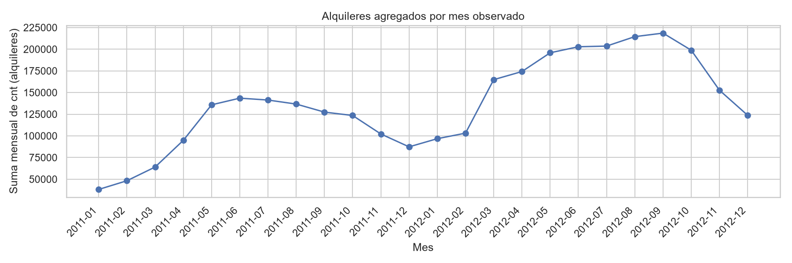
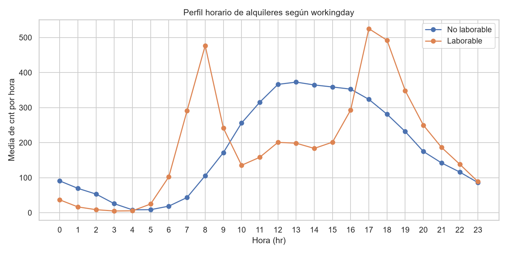
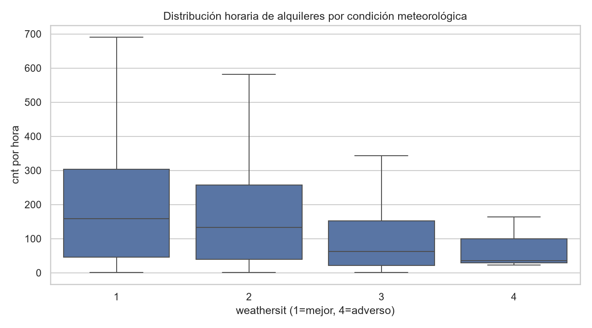
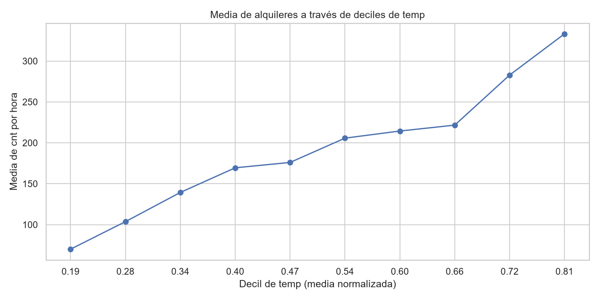
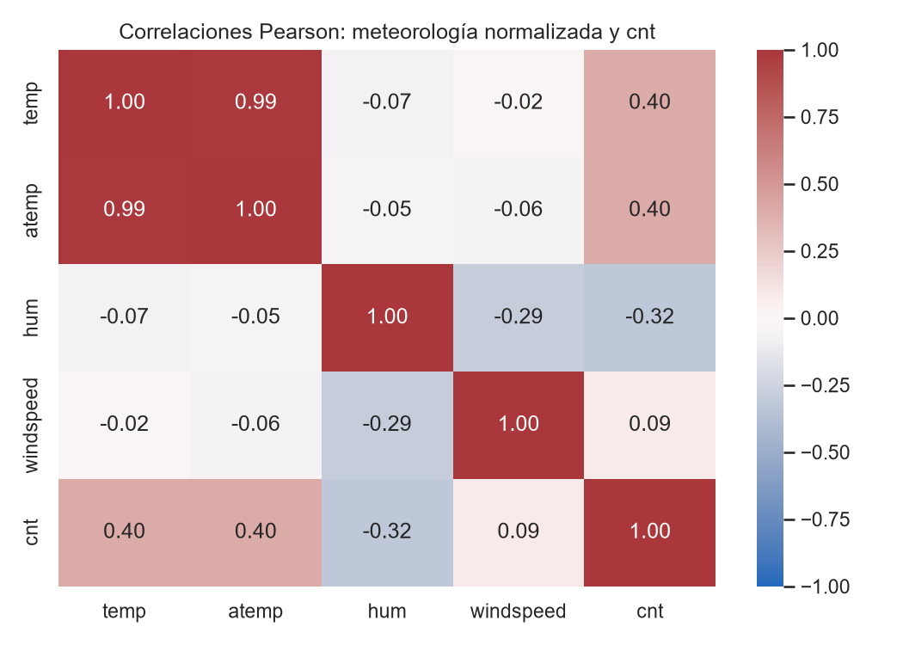

# Resumen ejecutivo

El archivo horario de Bike Sharing contiene 17.379 registros y 17 variables fuente, con cobertura desde `2011-01-01 00:00` hasta `2012-12-31 23:00`. La documentación y el esquema son coherentes con una observación por hora agregada de alquileres de Capital Bikeshare, Washington D.C. [STAT-001]

La demanda horaria `cnt` suma 3.292.679 alquileres observados; su media es 189,5, la mediana 142 y el intervalo intercuartílico va de 40 a 281, lo que evidencia una distribución dispersa y con valores altos relevantes. Los conteos `registered` representan el 81,2% del total agregado y `casual` el 18,8%. [STAT-005] [STAT-007]

No se encontraron valores ausentes, duplicados exactos, códigos fuera de los dominios documentados, valores negativos ni incumplimientos de la identidad `cnt = casual + registered`. Sin embargo, faltan 165 horas respecto de la secuencia horaria completa entre los límites observados y 76 fechas tienen menos de 24 registros; este es el principal riesgo para agregaciones temporales. [STAT-002] [STAT-003] [ISSUE-001]

Los perfiles horarios difieren marcadamente entre `workingday=1` y `workingday=0`: en días laborables las medias de `cnt` alcanzan 477,0 a las 08:00 y 525,3 a las 17:00, mientras que en días no laborables el máximo medio se sitúa en 372,7 a las 13:00. Esta es una descripción de patrones agregados, no una inferencia sobre decisiones individuales ni causalidad. [STAT-009] [FIG-002]

# Dataset y alcance

Se analizó un CSV del nivel horario documentado como `hour.csv` en el dataset Bike Sharing. Cada fila representa una hora agregada de alquileres, con fecha (`dteday`), hora (`hr`), indicadores de calendario, condiciones meteorológicas normalizadas y los conteos `casual`, `registered` y `cnt`. El identificador `instant` se trató como índice trazable, no como medida analítica. [STAT-001]

El alcance es exclusivamente exploratorio y descriptivo. Se revisaron estructura, calidad, distribución de alquileres, composición de los conteos, agregaciones temporales, segmentos de calendario y asociaciones con las variables meteorológicas disponibles. No se entrenaron modelos predictivos y ninguna asociación se interpreta como efecto causal.

# Inspección, calidad y preparación

El archivo original tiene 17.379 filas, 17 columnas y 731 fechas distintas. Los campos de conteo y códigos se cargaron como numéricos; `dteday`, inicialmente textual, se convirtió estrictamente a fecha sin fallos de conversión. [STAT-001] [STAT-004]

Las comprobaciones de calidad mostraron:

- Cero valores ausentes en las 17 columnas fuente.
- Cero filas exactamente duplicadas.
- 17.379 valores únicos de `instant` y cero duplicados de la combinación `dteday`–`hr`.
- Cero valores fuera de los dominios documentados para `season`, `yr`, `mnth`, `hr`, `holiday`, `weekday`, `workingday` y `weathersit`.
- Cero valores negativos en las variables meteorológicas o conteos revisados.
- Cero violaciones de `cnt = casual + registered`. [STAT-002]

Se generó `prepared_data.csv` como copia separada sin eliminar ni imputar registros. La copia conserva las 17.379 filas y añade dos variables: `timestamp = dteday + hr`, para secuencias y agregaciones temporales, y `casual_share = casual / cnt`, para describir la composición del total. La copia tiene 19 columnas; no hubo horas con `cnt=0`, por lo que `casual_share` no presenta ausencias. [STAT-004]

La conservación de los extremos se decidió deliberadamente: una regla IQR señaló 505 horas con `cnt` extremo, pero no aporta evidencia de que sean registros erróneos. Se mantuvieron para no sustituir variación potencialmente real por una limpieza automática. [STAT-012] [ISSUE-002]

# Estadística descriptiva

En las 17.379 horas observadas, `cnt` presenta media de 189,5, mediana de 142, desviación estándar de 181,4, mínimo de 1, máximo de 977 y cuartiles primero y tercero de 40 y 281. La media superior a la mediana es consistente con una distribución de conteos con una cola hacia niveles altos. [STAT-005]

Los componentes muestran distribuciones también heterogéneas:

- `casual`: media 35,7, mediana 17, cuartiles 4 y 48, máximo 367.
- `registered`: media 153,8, mediana 115, cuartiles 34 y 220, máximo 886.
- `casual_share`: media horaria 17,2% y mediana 14,7%. [STAT-005]

Sobre todas las horas observadas, se contabilizaron 620.017 alquileres `casual` y 2.672.662 `registered`, que suman exactamente los 3.292.679 de `cnt`. Esta proporción es una composición de alquileres agregados, no una estimación de personas usuarias únicas. [STAT-007]

Las variables meteorológicas están en la escala normalizada indicada por la documentación. Sus medias son 0,497 para `temp`, 0,476 para `atemp`, 0,627 para `hum` y 0,190 para `windspeed`; por tanto, no se convirtieron a unidades físicas no observadas. [STAT-005]

En la muestra, `weathersit=1` concentra 11.413 horas (65,7%), `weathersit=2` 4.544 (26,1%), `weathersit=3` 1.419 (8,2%) y `weathersit=4` únicamente 3 observaciones. La escasez extrema de la última categoría exige cautela al compararla. [STAT-006]

# Variables, agregaciones y relaciones

El volumen medio de `cnt` fue 143,8 en `yr=0` y 234,7 en `yr=1`; las medianas correspondientes fueron 109 y 191. La comparación describe una diferencia entre los dos años codificados, pero puede coexistir con cambios estacionales, calendarios y cobertura. [STAT-008]

Por `season`, las medias de `cnt` fueron 111,1 para el código 1, 208,3 para el 2, 236,0 para el 3 y 198,9 para el 4. Por `weathersit`, las medias fueron 204,9, 175,2, 111,6 y 74,3 para los códigos 1 a 4, respectivamente. La última media procede de tres horas y no debe generalizarse. [STAT-008]

La agregación mensual muestra mayores medias horarias observadas durante los meses centrales de `yr=1`: por ejemplo, 281,7 en junio, 288,3 en agosto y 303,6 en septiembre. Las sumas mensuales y su evolución se muestran en la figura correspondiente, pero están condicionadas por el número de horas disponibles en cada mes. [STAT-010] [FIG-001]

El contraste por tipo de día y hora es sustantivo. En días laborables, los picos medios se observan a las 08:00 (477,0) y 17:00 (525,3); en días no laborables, los mayores niveles medios se concentran entre las 12:00 y 16:00, con máximo de 372,7 a las 13:00. En ambas situaciones, el componente `registered` es particularmente alto en los picos laborables, mientras que el componente `casual` es relativamente más visible en horas centrales no laborables. [STAT-009]

En asociaciones bivariadas sobre las horas observadas, la correlación de Pearson de `cnt` con `temp` es 0,4048 y con `atemp` 0,4009; con `hum` es -0,3229 y con `windspeed` 0,0932. La correlación de Spearman entre `cnt` y `temp` es 0,4233, y entre `cnt` y `hum` es -0,3596. Estos coeficientes describen asociaciones dentro de datos observacionales, no efectos de la meteorología. [STAT-011]

`temp` y `atemp` tienen una correlación de Pearson de 0,9877, por lo que contienen información muy redundante para análisis descriptivos conjuntos. La figura de correlaciones permite visualizar esta redundancia y las asociaciones con `cnt`. [STAT-011] [FIG-005]

# Visualizaciones y hallazgos

La evolución mensual permite ver cambios de volumen entre meses y años, pero las sumas no deben compararse como si todos los meses tuvieran idéntica cobertura horaria. [FIG-001] [STAT-003] [STAT-010]

La figura del perfil horario muestra que los máximos de días laborables se concentran en torno a las 08:00 y 17:00–18:00, mientras que los de días no laborables se desplazan a la franja de mediodía y tarde. [FIG-002] [STAT-009]

La distribución de `cnt` es más elevada en promedio para `weathersit=1` que para los códigos 2 y 3. La categoría 4 se mantiene en el gráfico por trazabilidad, pero sus tres observaciones no sustentan una comparación estable. [FIG-003] [STAT-006] [STAT-008]

La representación por deciles de `temp` resume una asociación positiva descriptiva entre temperatura normalizada y el promedio horario de `cnt`. Esta lectura no separa los efectos potencialmente coincidentes de estación, hora, año y otros factores disponibles. [FIG-004] [STAT-011]

La matriz muestra la asociación negativa de `hum` con `cnt`, la asociación positiva moderada de `temp` y `atemp` con `cnt`, y la casi perfecta redundancia entre `temp` y `atemp`. [FIG-005] [STAT-011]

# Problemas, riesgos y anomalías

La incidencia principal es la cobertura temporal incompleta: entre los límites de la serie se esperaban 17.544 timestamps horarios, pero hay 17.379 observados; faltan 165. Además, 76 fechas tienen menos de 24 horas, incluyendo una fecha con una sola hora observada. [STAT-003] [ISSUE-001]

La decisión fue conservar todos los registros disponibles y no imputar alquileres en las horas ausentes, ya que la documentación disponible no permite establecer la causa de esas ausencias. Las agregaciones temporales se reportan con esta limitación, y el cribado de totales diarios extremos se restringió a los 655 días que sí tienen 24 horas observadas. [STAT-003] [STAT-012] [ISSUE-001]

El cribado IQR identificó 505 horas con `cnt` fuera de las cercas estadísticas y días completos con totales extremos. No se clasificaron como errores confirmados ni se excluyeron, porque el archivo no proporciona evidencia de invalidación y porque los alquileres agregados pueden variar intensamente por hora. Estos registros pueden influir en medias y correlaciones; por ello se incluyen medianas y cuartiles en la descripción. [STAT-005] [STAT-012] [ISSUE-002]

No se registraron incidencias de ausencias, duplicados, tipos inválidos, dominios categóricos inválidos, rangos negativos ni fallos de la identidad de conteos. [STAT-002]

# Limitaciones e incertidumbres

Los datos son conteos agregados por hora. No incluyen trayectos individuales, estaciones de origen o destino, duración de viajes, usuarios únicos ni características de las personas; por tanto, no permiten inferir comportamiento individual.

Las variables `temp`, `atemp`, `hum` y `windspeed` están normalizadas según la documentación. Sus escalas son adecuadas para comparaciones internas, pero no se deben interpretar automáticamente como magnitudes físicas directas. [STAT-005]

Las 165 horas ausentes y las 76 fechas incompletas afectan la comparabilidad de sumas y promedios por fecha, mes o segmento si la cobertura no es homogénea. La causa de los huecos no puede determinarse con las fuentes autorizadas. [STAT-003] [ISSUE-001]

Las asociaciones observadas entre alquileres, calendario y condiciones meteorológicas pueden reflejar simultáneamente estacionalidad, hora, año, cobertura y factores no incluidos. Por ello, el análisis no sostiene afirmaciones causales. [STAT-008] [STAT-011]

# Conclusiones

El dataset presenta buena integridad estructural: no contiene ausencias, duplicados ni inconsistencias detectables en dominios, rangos o en la identidad entre `casual`, `registered` y `cnt`. La preparación conservó íntegramente la población, añadió trazabilidad temporal y una medida de composición sin alterar los códigos fuente. [STAT-002] [STAT-004]

La actividad observada es muy variable por hora. Los patrones horarios cambian claramente entre `workingday=1` y `workingday=0`, y el componente `registered` concentra la mayor parte de los alquileres agregados. [STAT-007] [STAT-009] [FIG-002]

Las diferencias descriptivas por año, estación, `weathersit` y variables meteorológicas son visibles; en particular, `temp` y `atemp` son casi redundantes, y `hum` presenta asociación negativa con `cnt`. Estos resultados son descriptivos y deben interpretarse junto con la cobertura temporal incompleta y la naturaleza observacional de los registros. [STAT-008] [STAT-011] [ISSUE-001]