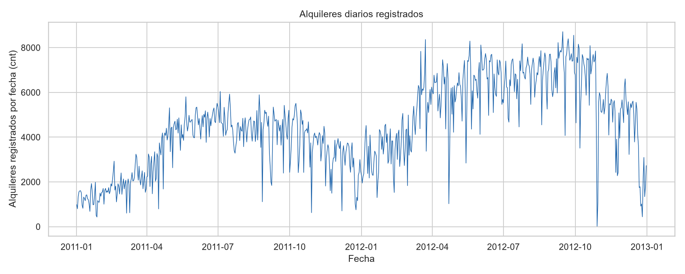
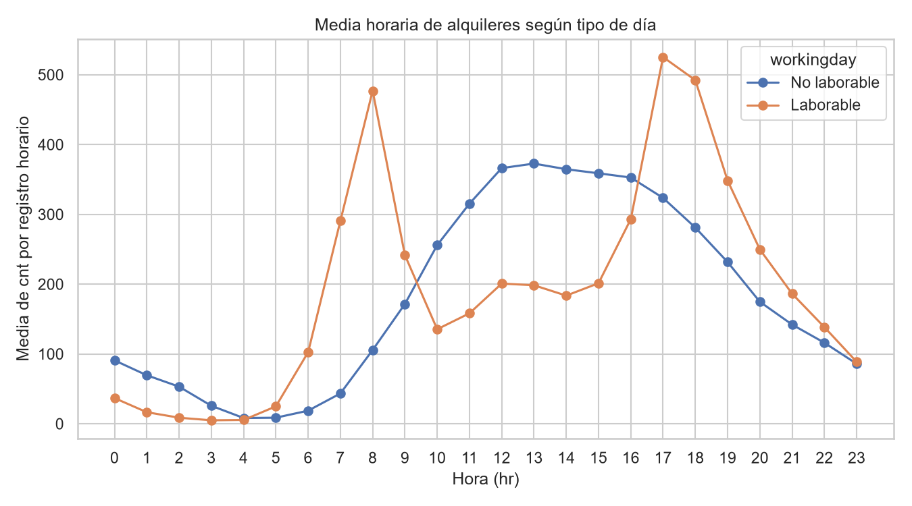
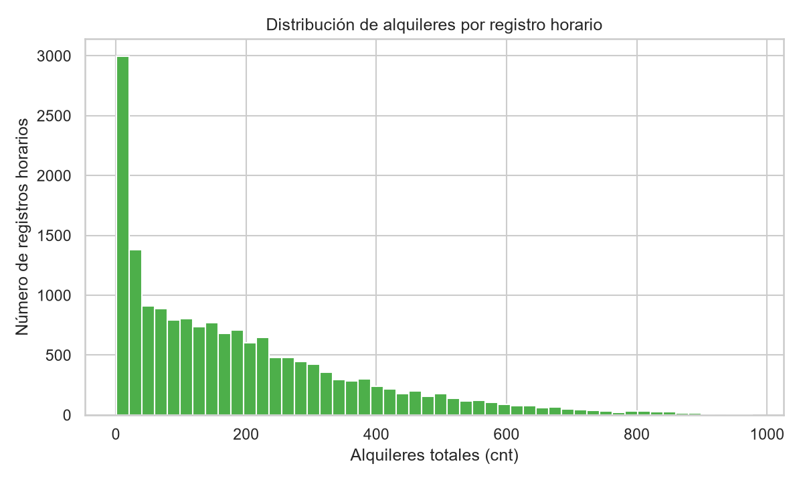
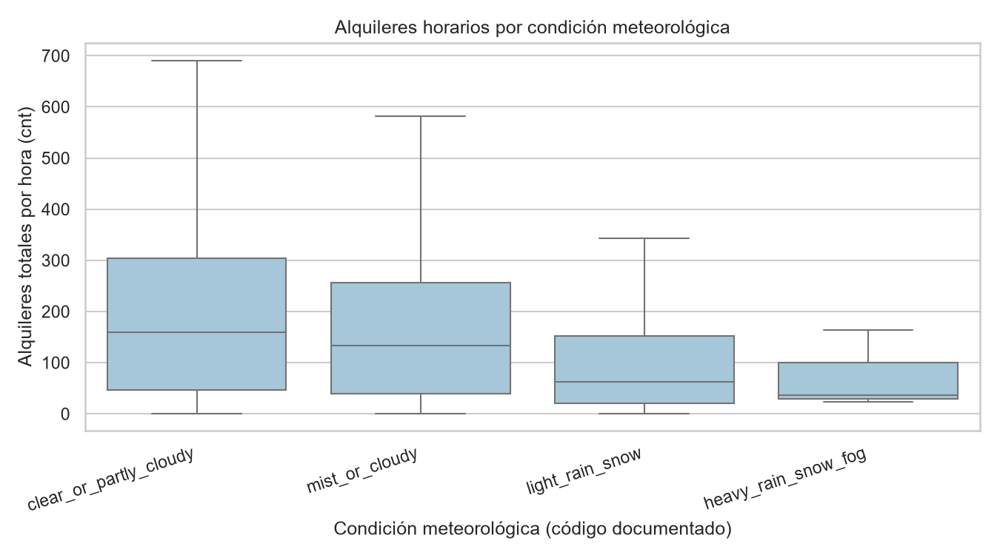
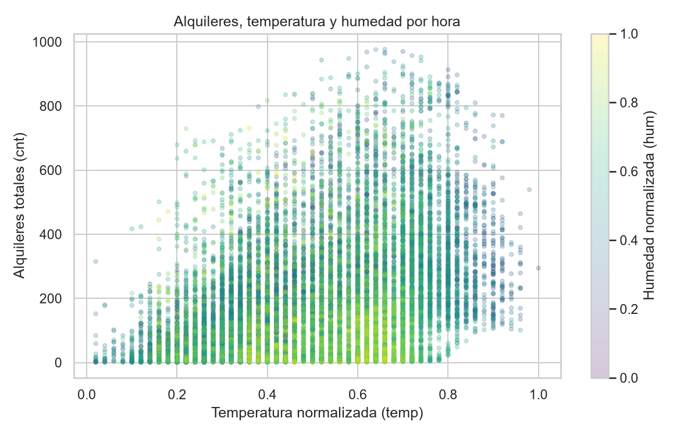

# Resumen ejecutivo

El archivo analizado contiene 17.379 registros horarios de alquileres agregados de Capital Bikeshare entre el 1 de enero de 2011 y el 31 de diciembre de 2012. Cada registro incluye calendario, condiciones meteorológicas normalizadas y recuentos de usuarios `casual`, `registered` y `cnt`. [STAT-001]

La calidad interna es alta en ausencias, duplicación, dominios y consistencia: no se detectaron valores ausentes, filas duplicadas, identificadores `instant` repetidos, claves `dteday`–`hr` duplicadas ni incumplimientos de `cnt = casual + registered`. [STAT-002] [STAT-004] Sin embargo, faltan 165 espacios de la secuencia horaria teórica dentro de la cobertura, repartidos en 76 fechas con menos de 24 observaciones; por ello, las sumas temporales deben interpretarse como alquileres registrados, no necesariamente como totales de horas completas. [STAT-003] [ISSUE-001]

En promedio, se registraron 189,5 alquileres por hora (mediana 142), con alta dispersión (desviación estándar 181,4) y un máximo de 977. El 81,2 % de los alquileres acumulados corresponde a `registered` y el 18,8 % a `casual`. [STAT-007] [STAT-013] La media horaria fue mayor en 2012 (234,7) que en 2011 (143,8); esta diferencia describe los registros observados y no identifica sus causas. [STAT-009]

Los perfiles horarios difieren marcadamente entre días laborables y no laborables: en laborables, el mayor promedio se observa a las 17:00 (`hr=17`, 525,3); en no laborables, a las 13:00 (`hr=13`, 372,7). [STAT-011] La demanda media también difiere descriptivamente por `weathersit`: 204,9 en condiciones claras o parcialmente nubladas, 175,2 con niebla o nubosidad y 111,6 con lluvia/nieve ligera. [STAT-009]

# Dataset y alcance

El CSV corresponde al archivo horario descrito en la documentación pública del Bike Sharing Dataset. La unidad de análisis es un agregado de alquileres de bicicletas en una hora calendario del sistema Capital Bikeshare de Washington D.C.; no representa viajes individuales, estaciones, trayectos ni usuarios únicos. [STAT-001]

La tabla fuente tiene 17 columnas: identificador `instant`; fecha `dteday`; variables de calendario (`season`, `yr`, `mnth`, `hr`, `holiday`, `weekday`, `workingday`); condición meteorológica `weathersit`; variables normalizadas `temp`, `atemp`, `hum`, `windspeed`; y los recuentos `casual`, `registered` y `cnt`. [STAT-001]

El alcance es estrictamente descriptivo. Se examinaron estructura, calidad, distribución, agregaciones temporales, perfiles horarios, composición de usuarios y asociaciones bivariadas con variables meteorológicas. No se entrenaron modelos predictivos ni se realizaron inferencias causales.

# Inspección, calidad y preparación

La fecha `dteday` se convirtió y validó en formato ISO `YYYY-MM-DD` sin fallos. Se conservaron las 17.379 filas originales y se añadieron cuatro variables derivadas: `timestamp` (`dteday` + `hr`), `season_label`, `weathersit_label` y `casual_share`. La copia preparada tiene, por tanto, 17.379 filas y 21 columnas. [STAT-006]

Las etiquetas de `season_label` y `weathersit_label` proceden de los códigos documentados y no sustituyen los códigos fuente. `casual_share` se define como `casual / cnt`; no generó ausencias porque el mínimo de `cnt` es 1. [STAT-006] [STAT-007]

No se eliminaron ni imputaron filas. Esta decisión conserva tanto los registros extremos como las irregularidades temporales porque no existe evidencia interna suficiente para considerarlos errores. [STAT-005] [ISSUE-001] [ISSUE-002]

Las comprobaciones de calidad respaldan los siguientes resultados:

- Las 17 columnas fuente tienen cero valores ausentes. [STAT-002]
- No hay filas completas duplicadas, `instant` repetidos ni combinaciones duplicadas de `dteday` y `hr`. [STAT-002]
- Los valores de `season`, `yr`, `mnth`, `hr`, `holiday`, `weekday`, `workingday` y `weathersit` están dentro de sus dominios documentados. [STAT-004]
- `temp`, `atemp`, `hum` y `windspeed` están dentro de la escala normalizada de 0 a 1 observada; el máximo de `windspeed` es 0,8507. [STAT-004]
- No hay recuentos negativos y se verifica `cnt = casual + registered` en las 17.379 filas. [STAT-004]
- Las variables `yr`, `mnth`, `weekday` y `workingday` concuerdan con `dteday`; la verificación indica que `weekday` sigue la codificación domingo=0. [STAT-004]

# Estadística descriptiva

En los 17.379 registros horarios, `cnt` suma 3.292.679 alquileres registrados, tiene una media de 189,5 y una mediana de 142. El primer y tercer cuartil son 40 y 281, respectivamente; el percentil 99 es 782,2 y el máximo es 977. Estas diferencias entre media, mediana y cuantiles muestran una distribución con valores altos relevantes. [STAT-007]

Los componentes presentan la siguiente descripción:

- `casual`: suma 620.017, media 35,7, mediana 17, rango de 0 a 367. [STAT-007]
- `registered`: suma 2.672.662, media 153,8, mediana 115, rango de 0 a 886. [STAT-007]
- Sobre el total acumulado, `casual` representa el 18,8 % y `registered` el 81,2 %. [STAT-013]

Las variables meteorológicas se conservaron en sus escalas normalizadas documentadas. Sus medias son 0,497 para `temp`, 0,476 para `atemp`, 0,627 para `hum` y 0,190 para `windspeed`. [STAT-007]

La muestra está repartida casi por igual entre 2011 (`yr=0`: 8.645 registros) y 2012 (`yr=1`: 8.734). El 68,3 % de las observaciones corresponde a `workingday=1`; solo 500 registros, el 2,9 %, tienen `holiday=1`. [STAT-008] Las condiciones claras o parcialmente nubladas (`weathersit=1`) reúnen 11.413 registros, el 65,7 % del total; `weathersit=4` aparece solo tres veces. [STAT-008]

# Variables, agregaciones y relaciones

## Evolución por año y temporada

La media de `cnt` pasó de 143,8 en 2011 a 234,7 en 2012. Los respectivos totales registrados son 1.243.103 y 2.049.576; como el número de registros es parecido entre años, la comparación de medias horarias ofrece un complemento importante a las sumas. [STAT-009]

Por estación, las medias horarias de `cnt` fueron 111,1 en `spring`, 208,3 en `summer`, 236,0 en `fall` y 198,9 en `winter`. La participación acumulada de usuarios `casual` fue mayor en `summer` (22,2 %) y `fall` (21,3 %) que en `spring` (12,9 %). [STAT-009] Estas diferencias describen los registros por grupo y no permiten atribuir efectos a la estación.

La mayor suma diaria registrada fue 8.714 alquileres el 15 de septiembre de 2012, fecha que contiene 24 registros horarios. La menor suma diaria fue 22. [STAT-010] Dado que hay fechas incompletas, el mínimo y otras sumas diarias no deben interpretarse necesariamente como una medida de demanda de un día completo. [STAT-003] [ISSUE-001]

## Perfil por hora y tipo de día

El patrón horario cambia según `workingday`. En días laborables, el promedio de `cnt` alcanza 477,0 a las 08:00 y su máximo de 525,3 a las 17:00. En no laborables, el máximo es más tardío: 372,7 a las 13:00. [STAT-011] Este contraste se visualiza en [FIG-002](figures/fig_002_hourly_workingday.png).

La composición también es distinta. En horas punta de laborables, el peso acumulado de `registered` es dominante: a las 17:00, los grupos incluyen 233.729 alquileres `registered` frente a 28.391 `casual`. En el grupo no laborable de las 13:00, se registran 54.587 `registered` y 31.514 `casual`. [STAT-011] Son perfiles descriptivos de segmentos calendáricos y no prueban un mecanismo de uso.

## Condiciones meteorológicas y variables continuas

La media horaria de `cnt` desciende a través de las categorías meteorológicas observadas: 204,9 en `clear_or_partly_cloudy` (11.413 registros), 175,2 en `mist_or_cloudy` (4.544), 111,6 en `light_rain_snow` (1.419) y 74,3 en `heavy_rain_snow_fog` (3). [STAT-009] La última categoría tiene una base muy pequeña, por lo que su resumen es inestable y debe leerse con especial cautela. [STAT-008]

Las correlaciones de Spearman con `cnt` son 0,423 para `temp`, 0,423 para `atemp`, −0,360 para `hum` y 0,127 para `windspeed`. [STAT-012] `temp` y `atemp` son muy redundantes entre sí, con correlación de Spearman elevada, por lo que no conviene tratarlas como evidencias independientes de un mismo patrón. [STAT-012] Estas medidas son asociaciones bivariadas; pueden estar mezcladas con calendario, hora, estación y factores no observados.

# Visualizaciones y hallazgos

La evolución de las sumas diarias registradas se presenta en [FIG-001](figures/fig_001_daily_rentals.png). La figura permite observar variación diaria durante los dos años, pero debe interpretarse junto con la irregularidad de horas observadas por fecha. [FIG-001] [STAT-003] [STAT-010]

El perfil de medias por `hr` y `workingday` muestra las diferencias entre máximos de tarde en laborables y de mediodía en no laborables. [FIG-002] [STAT-011]

La distribución de `cnt` representa visualmente la concentración de registros en valores bajos y medios, junto con una cola de valores altos. La regla IQR identifica 505 registros por encima de 642,5, sin que esto constituya por sí mismo evidencia de error. [FIG-003] [STAT-005] [ISSUE-002]

La comparación por `weathersit` muestra diferencias en la distribución horaria de `cnt`; se ocultan los valores atípicos en la caja para facilitar la lectura de la distribución central, mientras que los extremos se conservan en los datos y se documentan por separado. [FIG-004] [STAT-009] [STAT-005]

El diagrama de dispersión de `cnt`, `temp` y color de `hum` permite apreciar la dispersión sustancial alrededor de la asociación positiva moderada entre `temp` y `cnt`, así como la heterogeneidad que no queda explicada por una sola variable. [FIG-005] [STAT-012]

# Problemas, riesgos y anomalías

La principal incidencia es temporal. Entre `2011-01-01 00:00:00` y `2012-12-31 23:00:00` hay 17.544 espacios horarios teóricos, pero solo 17.379 registros observados: faltan 165 espacios y 76 fechas no tienen 24 observaciones. [STAT-003] [ISSUE-001] Se conservaron los registros existentes y no se imputaron horas desconocidas. Como consecuencia, los totales diarios y mensuales pueden reflejar tanto el nivel registrado como la cobertura desigual. [ISSUE-001]

El cribado IQR detectó 505 registros de `cnt` por encima de 642,5; el máximo de 977 ocurrió el 12 de septiembre de 2012 a las 18:00. [STAT-005] Estos casos se retuvieron porque sus componentes son no negativos y cumplen la identidad documentada; no hay evidencia interna que permita catalogarlos como errores. [STAT-004] [ISSUE-002] Las medias son sensibles a estos valores, por lo que el informe incluye también mediana y cuantiles. [ISSUE-002]

No se detectaron incidencias de datos faltantes por columna, duplicación, dominio categórico, rango normalizado, signos de recuentos ni identidad de los componentes. [STAT-002] [STAT-004]

# Limitaciones e incertidumbres

El archivo contiene alquileres agregados por hora, no trayectos individuales. Por tanto, no permite estudiar duración de viaje, origen, destino, disponibilidad de bicicletas, usuarios únicos ni comportamiento espacial.

Las 165 horas ausentes no se imputaron porque el archivo no identifica su causa. Pueden corresponder a irregularidades de captura, cambios de horario u otras circunstancias no distinguibles con los datos disponibles. [ISSUE-001]

Las condiciones meteorológicas se estudian mediante códigos y variables normalizadas del dataset. El análisis no incorpora verificación meteorológica externa ni otros factores potencialmente relevantes, como políticas operativas, infraestructura, eventos, precios o cambios en la cobertura del servicio.

Las asociaciones calculadas son bivariadas y descriptivas. No controlan simultáneamente por hora, tipo de día, año, estación o variables no observadas; por ello, no permiten interpretar correlaciones o diferencias de grupos como efectos causales. [STAT-012]

La categoría `heavy_rain_snow_fog` contiene solo tres registros, por lo que sus medidas centrales y de composición tienen gran incertidumbre muestral. [STAT-008] [STAT-009]

# Conclusiones

El dataset preparado conserva íntegramente la población original y añade variables derivadas trazables para análisis temporal e interpretación de categorías. La estructura y las identidades internas son consistentes, sin ausencias ni duplicados detectados. [STAT-002] [STAT-004] [STAT-006]

La demanda registrada presenta alta variabilidad horaria: el promedio es 189,5 frente a una mediana de 142, y existen extremos altos que se conservaron como valores potencialmente válidos. [STAT-007] [ISSUE-002] Los alquileres acumulados están compuestos mayoritariamente por `registered` (81,2 %). [STAT-013]

Los hallazgos descriptivos principales son un mayor promedio horario en 2012 que en 2011, perfiles por hora claramente distintos entre laborables y no laborables, y menores medias de alquileres en categorías meteorológicas más adversas observadas. [STAT-009] [STAT-011] Estos patrones deben leerse como asociaciones en los registros disponibles, teniendo presente tanto la cobertura horaria irregular como la ausencia de variables explicativas adicionales. [ISSUE-001]