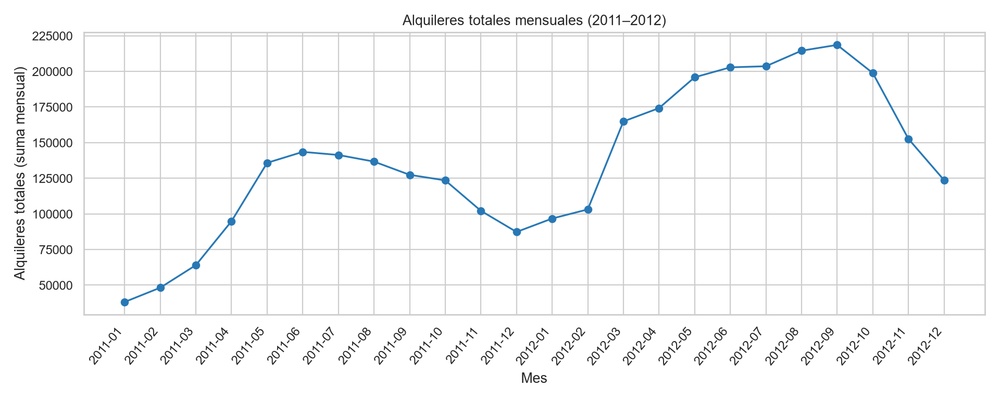
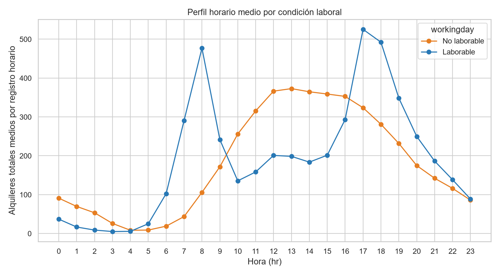
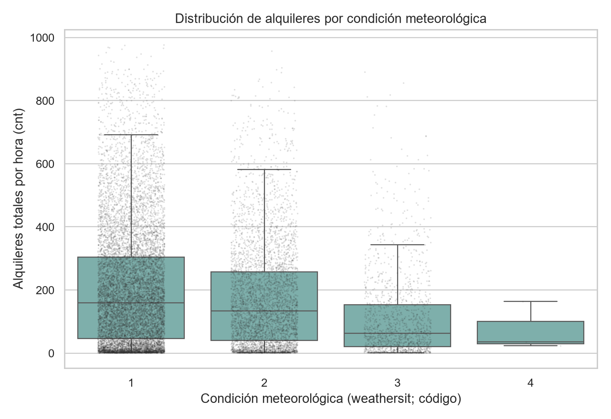
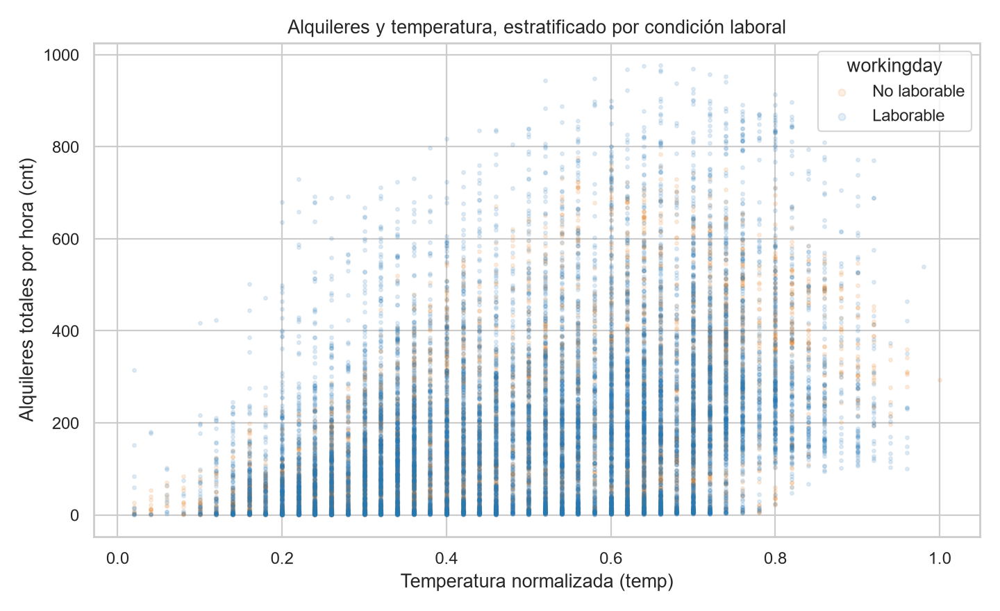

# Resumen ejecutivo

Se analizó el archivo CSV horario de Bike Sharing para Washington D.C. durante 2011–2012. La copia preparada conserva las 17.379 observaciones y las 17 variables fuente; la única normalización aplicada fue validar `dteday` y serializarla de forma ISO (`YYYY-MM-DD`). No se eliminaron observaciones, incluidos los extremos de `cnt`, porque las comprobaciones internas no aportan evidencia de error. [STAT-001] [STAT-002] [STAT-005]

La demanda horaria total (`cnt`) suma 3.292.679 alquileres, con media de 189,5 y mediana de 142 alquileres por registro; la diferencia entre media y mediana, junto con una desviación estándar de 181,4, revela una distribución heterogénea con picos horarios. [STAT-006] Los patrones más visibles son temporales: la media horaria fue mayor en `yr=1` (234,7) que en `yr=0` (143,8), y los días laborables presentan picos marcados a las 08:00 y 17:00–18:00. [STAT-008] [STAT-009] Estas diferencias son descriptivas y no demuestran efectos causales.

La calidad general es buena: no hay valores ausentes, duplicados completos, duplicados de `instant` ni duplicados de la clave observada `dteday`–`hr`; además, se verifica en todas las filas la identidad `cnt = casual + registered`. [STAT-002] [STAT-005] No obstante, faltan 165 combinaciones teóricas de fecha y hora respecto de una malla completa de 731 días por 24 horas, y la categoría `weathersit=4` solo contiene tres registros. [STAT-004] [ISSUE-001] [ISSUE-002]

# Dataset y alcance

El archivo de entrada es un CSV compatible con el archivo horario descrito en `Readme.txt`: contiene `hr`, 17 columnas y 17.379 registros. La documentación lo identifica como un histórico de Capital Bikeshare de Washington D.C. para 2011 y 2012, agregado por hora e integrado con información temporal y meteorológica. [STAT-001]

La unidad de análisis empleada es un registro horario agregado: una combinación observada de `dteday` y `hr`, con códigos de calendario, variables meteorológicas normalizadas y conteos de alquileres. `casual` y `registered` son los componentes del conteo total `cnt`; `instant` se trató exclusivamente como índice de trazabilidad y orden. [STAT-001] [STAT-005]

El alcance es exploratorio y descriptivo. Se examinan estructura, calidad, distribuciones, agregaciones temporales, composición de usuarios y asociaciones bivariadas con variables meteorológicas. No se entrenaron modelos predictivos ni se realizaron inferencias causales.

# Inspección, calidad y preparación

El parseo explícito de `dteday` con el formato `%Y-%m-%d` fue completo. La cobertura va de `2011-01-01` a `2012-12-31`, con 731 fechas distintas y sin días enteros ausentes. Las variables `yr`, `mnth` y `weekday` son coherentes con la fecha bajo la convención observada de `weekday`; los códigos de `season`, `yr`, `mnth`, `hr`, `holiday`, `weekday`, `workingday` y `weathersit` se encuentran en los dominios documentados. [STAT-003] [STAT-004]

Las 17 columnas no tienen ausencias y las 17.379 filas son completas. No se detectaron filas completas duplicadas, valores repetidos de `instant` ni claves duplicadas de fecha y hora. Asimismo, `instant` sigue la secuencia de 1 a 17.379. [STAT-002]

La identidad documentada `cnt = casual + registered` se cumple en las 17.379 filas, con diferencia mínima y máxima iguales a cero. Esto permitió utilizar los componentes para describir composición sin reconciliaciones ni imputación. [STAT-005]

Se creó `prepared_data.csv` como copia separada del original. La preparación validó y estandarizó la serialización ISO de `dteday`; se conservaron todas las filas y columnas fuente. En particular, no se eliminaron extremos de `cnt`, puesto que no presentan discrepancias de identidad, valores negativos ni categorías fuera de dominio. [STAT-013] La decisión y su justificación se registran como `TR-001` y `TR-002` en `statistics.json`.

# Estadística descriptiva

En la población preparada, `cnt` tiene mínimo de 1, primer cuartil de 40, mediana de 142, tercer cuartil de 281 y máximo de 977 alquileres por registro horario. Su media es 189,5 y su desviación estándar 181,4. Por tanto, una hora media no representa completamente la dispersión de la demanda observada. [STAT-006]

Los 3.292.679 alquileres acumulados se distribuyen entre 620.017 alquileres `casual` y 2.672.662 `registered`. Las medianas horarias son 17 para `casual` y 115 para `registered`, frente a 142 para `cnt`. [STAT-006] La identidad de los tres conteos está comprobada antes de esta descomposición. [STAT-005]

Las variables meteorológicas se mantienen en la escala normalizada indicada por la documentación. Para `temp`, la media es 0,497 y el intervalo observado va de 0,02 a 1,00; para `hum`, la media es 0,627 y el intervalo va de 0 a 1,00. `windspeed` presenta media 0,190, mediana 0,194 y máximo 0,8507. Estos valores no deben leerse directamente como unidades físicas sin aplicar las conversiones del `Readme.txt`. [STAT-006]

La categoría meteorológica más frecuente es `weathersit=1` con 11.413 registros; le siguen `weathersit=2` con 4.544 y `weathersit=3` con 1.419. La categoría `weathersit=4` aparece solo tres veces. [STAT-007] La condición laboral `workingday=1` representa 11.865 registros, frente a 5.514 registros con `workingday=0`. [STAT-007]

# Variables, agregaciones y relaciones

El volumen anual agregado fue de 1.243.103 alquileres en `yr=0` y 2.049.576 en `yr=1`. Las medias horarias correspondientes fueron 143,8 y 234,7. La comparación indica un mayor nivel observado en el segundo año codificado, pero no identifica los factores responsables de la diferencia. [STAT-008]

Por estación, la media horaria de `cnt` fue 111,1 para `season=1`, 208,3 para `season=2`, 236,0 para `season=3` y 198,9 para `season=4`. [STAT-008] La evolución mensual muestra niveles acumulados superiores en los meses de `yr=1` frente a sus meses homólogos de `yr=0`, con máximos mensuales de 218.573 alquileres en septiembre de `yr=1` y 143.512 en junio de `yr=0`. [STAT-010]

La suma diaria máxima fue 8.714 alquileres el `2012-09-15`, y la mínima fue 22 el `2012-10-29`. Son resultados descriptivos de la tabla; no se atribuyen a eventos concretos porque la información disponible no permite verificar explicaciones externas. [STAT-010]

El perfil horario difiere claramente entre condiciones laborales. En `workingday=1`, las medias de `cnt` alcanzan 477,0 a las 08:00, 525,3 a las 17:00 y 492,2 a las 18:00. En `workingday=0`, el máximo medio es 372,7 a las 13:00 y se observa una meseta más amplia entre el mediodía y la tarde. [STAT-009] El componente `registered` domina los picos laborales: por ejemplo, a las 08:00 en días laborables su media es 454,7 frente a 22,3 para `casual`. [STAT-009]

Las medias de `cnt` disminuyen al pasar de `weathersit=1` (204,9; 11.413 registros) a `weathersit=2` (175,2; 4.544) y `weathersit=3` (111,6; 1.419). Para `weathersit=4`, la media es 74,3, pero procede de solo tres observaciones y no permite una comparación estable. [STAT-008] [ISSUE-002]

Las correlaciones de Spearman de `cnt` son 0,423 con `temp`, −0,360 con `hum` y 0,127 con `windspeed`. Son asociaciones bivariadas no ajustadas por hora, estación, año u otros factores. [STAT-011] `temp` y `atemp` son altamente redundantes: su correlación de Pearson es 0,988 y la de Spearman es 0,990 aproximadamente. [STAT-011]

# Visualizaciones y hallazgos

**Figura 1.** La evolución mensual sintetiza los totales de 2011–2012 y permite observar la variación dentro de cada año y el mayor volumen agregado del segundo año codificado. [FIG-001] [STAT-010]

**Figura 2.** El perfil horario separa `workingday=1` y `workingday=0`. Los picos de mañana y tarde de los días laborables contrastan con el nivel más alto y sostenido de las horas centrales en los no laborables. [FIG-002] [STAT-009]

**Figura 3.** La comparación de distribuciones por `weathersit` representa tanto dispersión como densidad de observaciones. El grupo 4 debe interpretarse con especial prudencia por su tamaño de tres registros. [FIG-003] [STAT-007] [STAT-008]

**Figura 4.** El diagrama de dispersión muestra una asociación positiva general entre `temp` normalizada y `cnt`, con amplia variabilidad a valores similares de temperatura y diferencias entre condición laboral. Por tanto, la temperatura no resume por sí sola el comportamiento horario observado. [FIG-004] [STAT-011]

# Problemas, riesgos y anomalías

La principal incidencia de cobertura es la ausencia de 165 combinaciones `dteday`–`hr` respecto de las 17.544 combinaciones que tendría una malla de 731 días por 24 horas. El mínimo de registros diarios es 1 y el máximo es 24, aunque no hay fechas completamente ausentes. Se mantuvieron los datos observados sin imputación y las agregaciones usan la población disponible. La documentación no permite distinguir si los huecos responden a cobertura, horario estacional u otra causa. [STAT-004] [ISSUE-001]

`weathersit=4` pertenece al dominio documentado, por lo que no fue considerado un código inválido. Sin embargo, sus tres registros hacen que sus medias, medianas y la forma de su distribución sean muy sensibles a casos individuales. [STAT-007] [STAT-008] [ISSUE-002]

El cribado global por IQR para `cnt` señaló 505 registros por encima del umbral superior estadístico; no se clasificaron como errores. Las observaciones mantienen la identidad de conteos, no presentan valores negativos y usan categorías válidas. Retenerlas evita confundir picos potencialmente reales de demanda con fallos de captura; a la vez, implica que la media es sensible a esos picos. [STAT-005] [STAT-013] [ISSUE-003]

No se identificaron incidencias de ausencias, duplicados, fallos de parseo de fecha, dominios categóricos fuera de rango ni discrepancias en la identidad de conteos. [STAT-002] [STAT-003] [STAT-005]

# Limitaciones e incertidumbres

Los datos están agregados por hora. No contienen trayectos, estaciones de origen o destino, duración de alquileres, disponibilidad de bicicletas, atributos de personas usuarias ni otros determinantes potenciales de la demanda. En consecuencia, el análisis no puede describir desplazamientos individuales ni separar cambios de demanda de posibles restricciones de oferta.

`temp`, `atemp`, `hum` y `windspeed` se encuentran normalizadas según la documentación; se describieron en su escala fuente y no como grados, porcentajes o velocidades físicas directas. [STAT-006]

Las comparaciones entre año, estación, condición laboral y meteorología son asociaciones descriptivas. Estas variables están relacionadas con el tiempo calendario y pueden compartir variación con factores no observados. Las correlaciones presentadas tampoco controlan por hora del día, composición temporal o estacionalidad. [STAT-011]

Los 165 huecos de fecha-hora limitan la comparabilidad estricta de algunas medias horarias, y el tamaño de `weathersit=4` limita cualquier conclusión sobre esa condición. [ISSUE-001] [ISSUE-002] Los extremos de `cnt` se conservaron por falta de evidencia interna de error, pero no se dispone de información externa autorizada para explicar casos concretos. [ISSUE-003]

# Conclusiones

La tabla ofrece una base consistente para EDA horario: su estructura coincide con la documentación, las fechas se validaron, no hay ausencias ni duplicados detectados y `cnt` se reconcilia exactamente con `casual + registered`. [STAT-001] [STAT-002] [STAT-005]

La demanda agregada presenta alta dispersión y patrones temporales marcados. El segundo año codificado registra mayor volumen medio, el perfil de días laborables tiene máximos intensos en horas de mañana y tarde, y los no laborables concentran mayor nivel medio durante las horas centrales. [STAT-008] [STAT-009] [FIG-001] [FIG-002]

Las condiciones meteorológicas y las variables normalizadas muestran asociaciones descriptivas con `cnt`: las medias son menores en los códigos de `weathersit` más severos y `cnt` tiene asociación monotónica positiva con `temp` y negativa con `hum`. Estas observaciones no deben interpretarse como efectos causales. [STAT-008] [STAT-011] [FIG-003] [FIG-004]

La copia preparada es apta para análisis exploratorios posteriores que respeten sus límites de cobertura y granularidad. Cualquier análisis que requiera comparaciones precisas por hora debería considerar explícitamente los 165 huecos temporales, y cualquier conclusión sobre `weathersit=4` debería evitarse o presentarse como meramente ilustrativa. [ISSUE-001] [ISSUE-002]