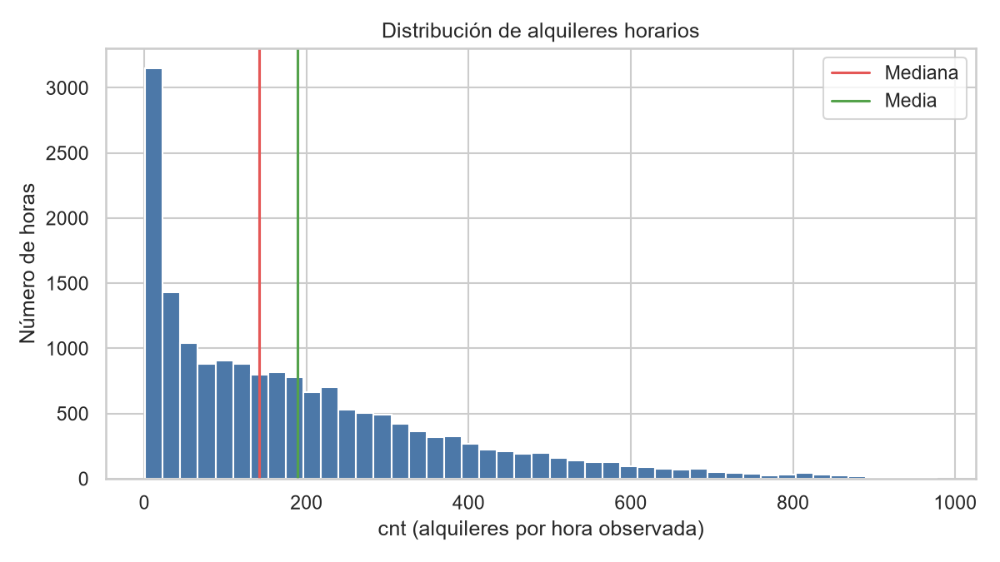
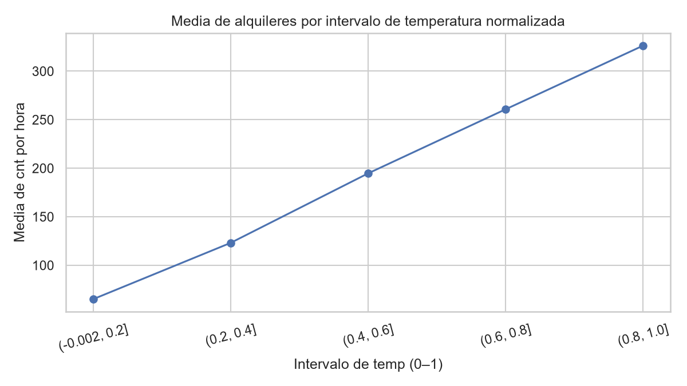
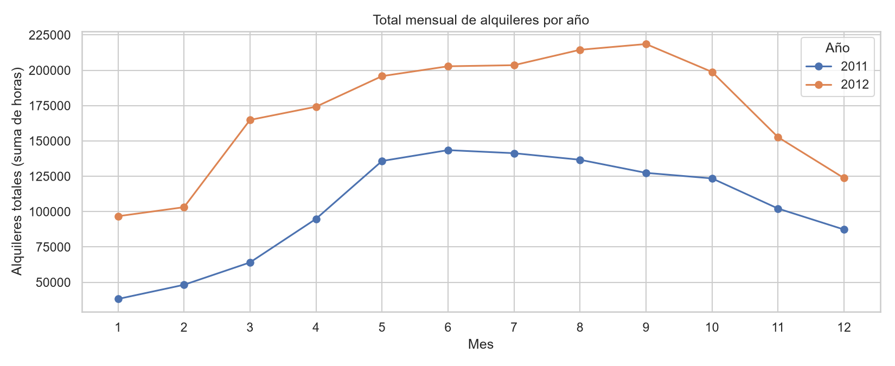
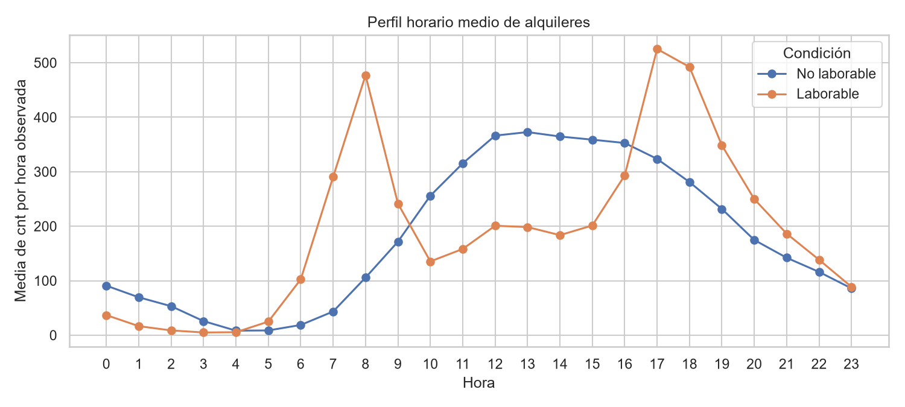
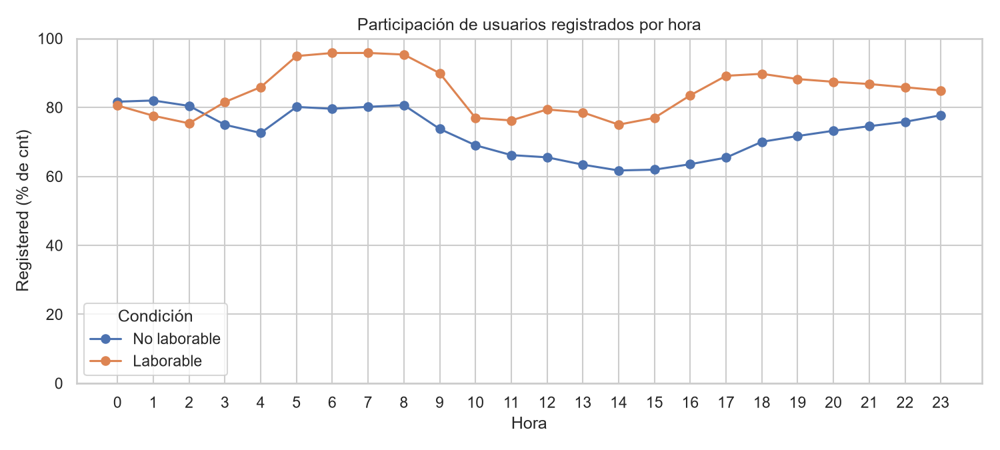
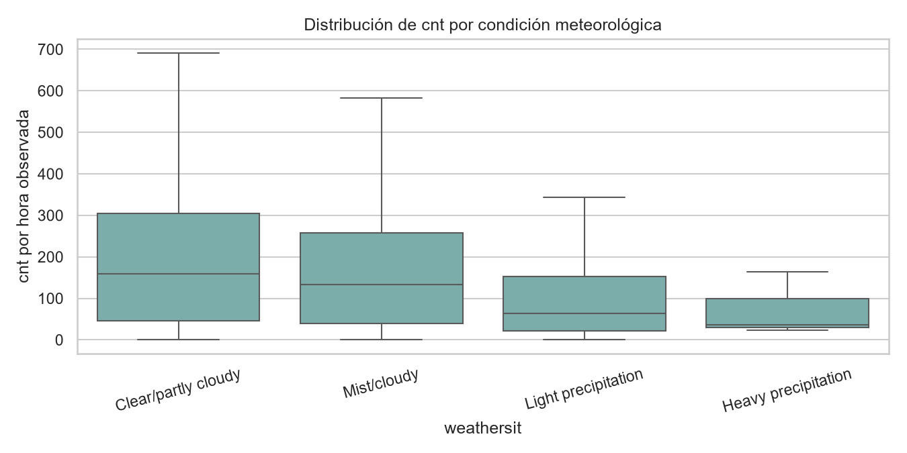

# Resumen ejecutivo

El análisis cubre 17.379 observaciones horarias agregadas de Capital Bikeshare durante 2011–2012. La tabla conserva sus 17 columnas fuente y la copia de trabajo incorpora cinco variables derivadas de interpretación, sin eliminar ni imputar filas. [STAT-001] [STAT-005]

La calidad interna es alta en las comprobaciones realizadas: no hay valores ausentes, duplicados de fila, duplicados de `instant` o de la clave `dteday`–`hr`; además, `cnt = casual + registered` se cumple en todas las filas. [STAT-002] [STAT-003] Sin embargo, frente a una malla teórica de 24 horas para cada fecha, faltan 165 franjas fecha-hora; todas las fechas siguen presentes. Esta cobertura debe considerarse al interpretar totales y promedios temporales. [STAT-004] [ISSUE-001]

La demanda horaria `cnt` tiene media de 189,46, mediana de 142 y rango de 1 a 977 alquileres, lo que evidencia variabilidad elevada y una distribución con valores altos que afectan a la media. [STAT-006] La media observada por hora fue mayor en 2012 (234,67) que en 2011 (143,79); esta diferencia describe los registros disponibles, sin atribuir una causa. [STAT-008]

Los patrones descriptivos más visibles son la concentración de alquileres en las horas diurnas y los picos horarios de los usuarios registrados, especialmente en jornadas `workingday=1`; la composición cambia según hora y condición laboral. [STAT-010] [FIG-002] [FIG-003] Las condiciones `weathersit` más severas aparecen asociadas a menores medias de `cnt`, pero la comparación no separa el papel de horario, estacionalidad u otras variables. [STAT-011]

# Dataset y alcance

El archivo de entrada es un CSV con 17.379 filas y 17 columnas, consistente en estructura con el conjunto horario documentado. La documentación define `cnt` como el total de alquileres y `casual` y `registered` como sus componentes, junto con variables de calendario y meteorología normalizada. [STAT-001]

La unidad de análisis es una hora observada y agregada del sistema Capital Bikeshare en Washington, D.C. Cada fila contiene una fecha (`dteday`), una hora (`hr`), un índice de registro (`instant`), recuentos de alquileres y atributos temporales o meteorológicos. [STAT-001]

El alcance es exclusivamente exploratorio y descriptivo. Se examinan estructura, calidad, distribuciones, agregaciones temporales, composición de usuarios y asociaciones observadas. No se entrenaron modelos predictivos y ninguna comparación se interpreta como efecto causal.

# Inspección, calidad y preparación

La carga del CSV fue correcta. Los campos de calendario y categorías presentan las cardinalidades esperables: cuatro niveles de `season` y `weathersit`, dos de `yr`, `holiday` y `workingday`, 12 meses y 24 horas. [STAT-001] [STAT-003]

Las comprobaciones de calidad no detectaron ausencias en ninguna de las 17 columnas originales. Tampoco se detectaron filas completas duplicadas, `instant` repetidos ni combinaciones duplicadas de `dteday` y `hr`; `instant` coincide secuencialmente con los valores 1 a 17.379. [STAT-002]

Los códigos observados para las variables categóricas están dentro de los definidos en la documentación. Las variables normalizadas `temp`, `atemp`, `hum` y `windspeed` están dentro de los límites comprobados, y los tres recuentos son no negativos. La identidad `cnt = casual + registered` no presenta fallos; asimismo, `yr`, `mnth`, `season`, `weekday` y `workingday` son coherentes con la fecha bajo las reglas verificadas. [STAT-003]

Se creó `prepared_data.csv` como copia separada con las 17.379 filas originales. Para análisis se convirtió `dteday` a fecha y en la copia se serializó como ISO `YYYY-MM-DD`. Se conservaron todas las columnas fuente y se añadieron `calendar_year`, `season_label`, `weathersit_label`, `casual_share` y `registered_share`; estas últimas no tienen ausencias porque no hay filas con `cnt=0`. [STAT-005]

No se imputaron valores ni se eliminaron extremos o fechas incompletas. Esta decisión preserva la población observada y evita presentar como erróneas observaciones que cumplen las reglas internas de rango e identidad. [STAT-005] [ISSUE-002]

# Estadística descriptiva

En las 17.379 horas, `cnt` tiene una media de 189,46 alquileres, mediana de 142, desviación estándar de 181,39, primer cuartil de 40, tercer cuartil de 281 y máximo de 977. La media superior a la mediana y la amplitud entre cuartiles y máximo recomiendan reportar medidas robustas junto a la media. [STAT-006]

Por componente, `casual` tiene media 35,68 y mediana 17, mientras `registered` tiene media 153,79 y mediana 115. Los máximos respectivos son 367 y 886. [STAT-006] La suma de los componentes coincide siempre con `cnt`, por lo que las comparaciones de composición se basan en una partición aritméticamente consistente del total. [STAT-003]

Las variables meteorológicas se mantienen en su escala normalizada. Sus medias son 0,497 para `temp`, 0,476 para `atemp`, 0,627 para `hum` y 0,190 para `windspeed`. [STAT-006]

La media de `cnt` fue 143,79 en 2011 y 234,67 en 2012. Por estación codificada, la menor media corresponde a `season=1` (111,11) y la mayor a `season=3` (236,02); las comparaciones se refieren a horas observadas y sus tamaños de grupo no son idénticos. [STAT-008]

La distribución de `cnt` se representa en la figura siguiente, incluyendo sus referencias visuales de media y mediana:

[FIG-004] [STAT-006]

# Variables, agregaciones y relaciones

La agregación mensual de `cnt`, `casual` y `registered` permite observar la evolución de los alquileres sin la densidad de una serie horaria. Los totales anuales registrados fueron 1.243.103 alquileres en 2011 y 2.049.576 en 2012. [STAT-008] [STAT-009] La figura mensual muestra que la variación dentro de cada año también es relevante, por lo que la diferencia anual no debe leerse como un patrón uniforme en todos los meses. [FIG-001]

El perfil por `hr` muestra demanda muy baja de madrugada —por ejemplo, media de 6,35 a las 04:00— y una máxima media global de 461,45 a las 17:00. [STAT-008] Al separar por `workingday`, el perfil permite apreciar diferencias de forma horaria entre jornadas laborales y no laborales; se trata de una comparación descriptiva que no aísla factores meteorológicos, anuales o de calendario. [STAT-010] [FIG-002]

La composición también varía por hora y condición laboral. La figura de `registered_share` muestra que la participación de `registered` es particularmente alta en franjas de picos laborales, mientras la mezcla se modifica en las horas no laborales. Esta observación procede de proporciones calculadas como razones de las sumas de componentes dentro de cada grupo, no de promedios de porcentajes individuales. [STAT-010] [FIG-003]

La asociación de Spearman de `cnt` con `temp` es 0,423 y con `atemp` es 0,423; con `hum` es −0,360 y con `windspeed` es 0,127. Estas cifras resumen co-variación monotónica bivariada, no efectos independientes ni relaciones causales. [STAT-012] `temp` y `atemp` muestran asociación muy alta entre sí, por lo que aportan información parcialmente redundante en un análisis simultáneo. [STAT-013]

Al agrupar `temp` normalizada, la media de `cnt` aumenta de 65,07 en el intervalo hasta 0,2 a 326,28 en el intervalo superior a 0,8. La interpretación está limitada por la estructura estacional y horaria compartida por estas variables. [STAT-012] [FIG-006]

[FIG-006]

# Visualizaciones y hallazgos

La evolución mensual se presenta como una agregación de totales horarios por `calendar_year` y `mnth`, apropiada para observar cambios de nivel y estacionalidad descriptiva sin sobrecargar el gráfico con 17.379 puntos. [STAT-009]

[FIG-001]

El perfil horario medio desagregado por `workingday` permite comparar la forma de la demanda, no inferir qué causa las diferencias entre ambos tipos de jornada. [STAT-010]

[FIG-002]

La participación de usuarios registrados ofrece una lectura complementaria de la composición de `cnt` por hora. [STAT-010]

[FIG-003]

Por `weathersit`, las medias de `cnt` son 204,87 en `Clear/partly cloudy` (11.413 horas), 175,17 en `Mist/cloudy` (4.544), 111,58 en `Light precipitation` (1.419) y 74,33 en `Heavy precipitation` (3). El último grupo es demasiado pequeño para sostener conclusiones generales. [STAT-011]

[FIG-005]

# Problemas, riesgos y anomalías

El principal riesgo de calidad identificado es temporal. El intervalo de fechas va de 2011-01-01 a 2012-12-31 e incluye las 731 fechas esperadas, pero contiene 17.379 registros frente a 17.544 franjas de una malla regular de 24 horas: hay 165 combinaciones fecha-hora no representadas. [STAT-004] [ISSUE-001]

Estas franjas no se imputaron y no se crearon observaciones sintéticas. La información disponible no permite identificar si la ausencia se debe a cobertura operativa, particularidades horarias u otro mecanismo; por tanto, los promedios y totales de fecha u hora deben interpretarse como resúmenes de registros disponibles. [ISSUE-001]

El cribado de `cnt` con la regla de Tukey 1,5×IQR identifica 505 extremos estadísticos, con cuartiles 40 y 281. [STAT-014] No se clasificaron como errores: son recuentos no negativos y respetan la identidad entre el total y sus componentes. Se conservaron y se acompañan de mediana y cuartiles para limitar una interpretación centrada solo en la media. [STAT-003] [STAT-006] [ISSUE-002]

No se detectaron incidencias de ausencia, duplicación, rango inválido, categoría no documentada o fallo de identidad en las validaciones realizadas. [STAT-002] [STAT-003]

# Limitaciones e incertidumbres

Los datos están agregados por hora y no incluyen información de estación, trayecto, capacidad, disponibilidad, mantenimiento ni operaciones del sistema. En consecuencia, no permiten explicar por sí solos cambios en la demanda.

Las variables meteorológicas se documentan en escalas normalizadas. Se han analizado en esas escalas y no se han comunicado como magnitudes físicas directas sin una conversión explícita. [STAT-006]

Las asociaciones entre alquileres, calendario y clima pueden reflejar tendencias anuales, estacionalidad, horarios y otros factores observados o no observados. Por ello, las correlaciones y diferencias entre grupos no prueban causalidad. [STAT-008] [STAT-012]

La cobertura horaria incompleta frente a 24 horas diarias introduce incertidumbre adicional en agregaciones temporales. El mecanismo de las 165 franjas no representadas no puede determinarse con el CSV y la documentación disponible. [STAT-004] [ISSUE-001]

Los extremos de demanda no se vinculan a eventos externos específicos porque no hay información de tales eventos en las entradas analizadas. [ISSUE-002]

# Conclusiones

La tabla es internamente coherente para análisis exploratorio: no presenta ausencias ni duplicados comprobados, respeta códigos y rangos evaluados, y mantiene la identidad documental de los recuentos. [STAT-002] [STAT-003]

La demanda horaria es heterogénea: la mediana de `cnt` es 142 frente a una media de 189,46, y el patrón horario alcanza su mayor media global a las 17:00. [STAT-006] [STAT-008] La demanda media observada es mayor en 2012 que en 2011 y muestra diferencias descriptivas por estación, hora, condición laboral y categorías meteorológicas. [STAT-008] [STAT-010] [STAT-011]

La composición entre `casual` y `registered` cambia con la hora y `workingday`, mientras que `temp`, `atemp` y `hum` muestran asociaciones bivariadas con `cnt` que deben interpretarse con cautela. [STAT-010] [STAT-012]

La copia preparada conserva toda la población observada y documenta sus transformaciones. Para análisis posteriores que requieran métricas temporales completas, la prioridad sería aclarar el mecanismo de las 165 franjas fecha-hora no representadas antes de imputar, excluir o comparar indicadores que presupongan exactamente 24 horas cada día. [STAT-005] [ISSUE-001]