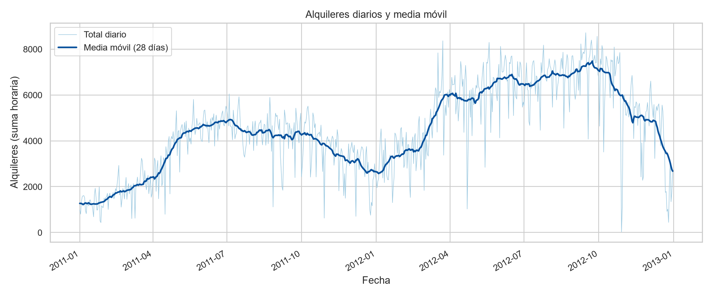
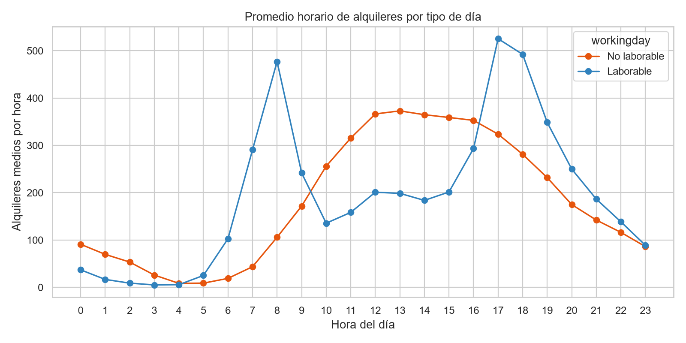
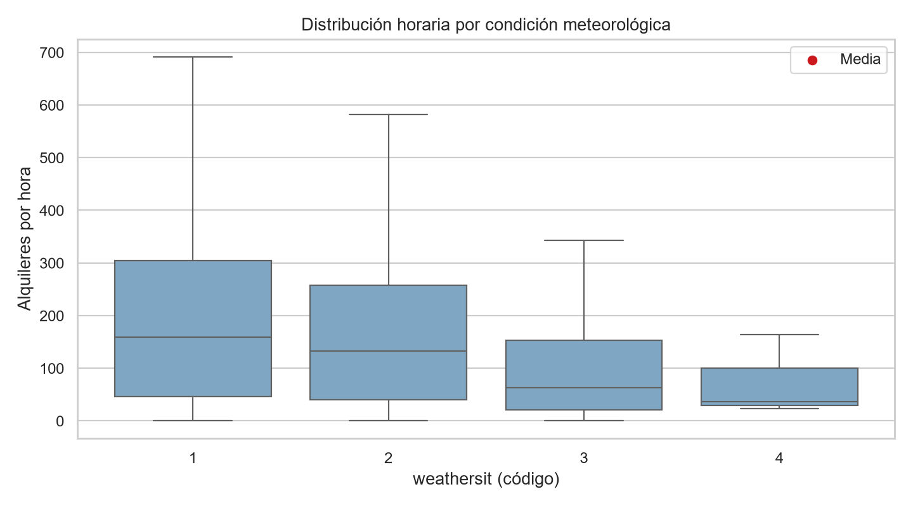
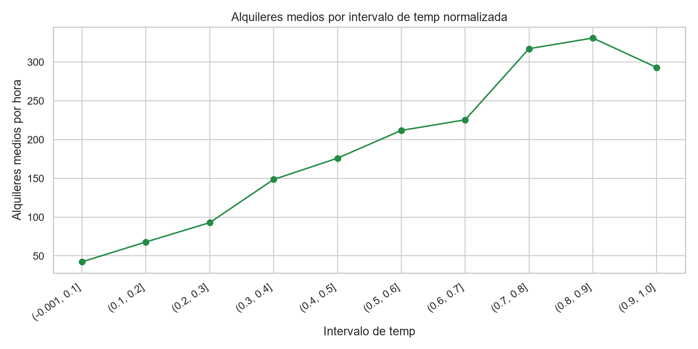
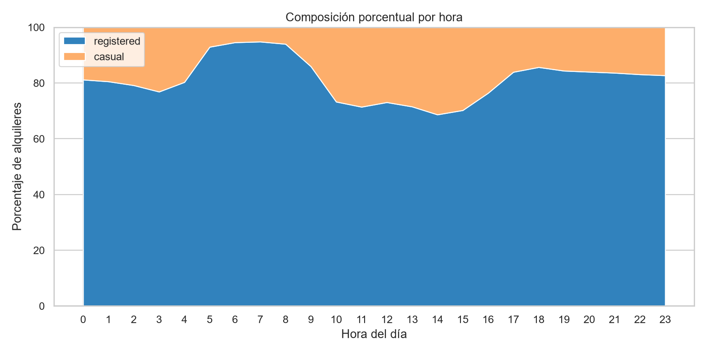

# Resumen ejecutivo

El archivo analizado es el CSV horario documentado de Bike Sharing: contiene 17.379 registros y 17 variables fuente, con cobertura de fechas desde 2011-01-01 hasta 2012-12-31. Cada registro representa un agregado de alquileres de una hora, identificado por `dteday` y `hr`. [STAT-001]

La integridad de las variables fuente es alta en las comprobaciones realizadas: no hay valores ausentes, fechas no convertibles, filas completas duplicadas, `instant` duplicados ni combinaciones duplicadas de `dteday`–`hr`. La identidad documentada `cnt = casual + registered` se cumple en todas las filas. [STAT-002] [STAT-003]

Se conservaron todas las observaciones. Se añadieron `date_hour`, para el análisis temporal, y `casual_share`, para describir composición; no hubo filas con `cnt=0`, por lo que esta última variable no introduce ausencias. [STAT-007]

El conteo horario `cnt` tiene media de 189,5, mediana de 142 y rango de 1 a 977 alquileres. Los usuarios `registered` aportan el 81,2% de los 3.292.679 alquileres registrados, frente al 18,8% de `casual`. [STAT-005] [STAT-007]

El principal riesgo de calidad es temporal: frente a una rejilla completa de 17.544 horas entre los extremos del período, faltan 165 posiciones horarias; 76 de las 731 fechas tienen un número de registros distinto de 24. Por ello, las sumas de días y meses que incluyan fechas incompletas pueden estar subestimadas. [STAT-004] [ISSUE-001]

# Dataset y alcance

Según la documentación pública, los datos corresponden a alquileres de Capital Bikeshare en Washington D.C., agregados por hora e integrados con variables de calendario, estación y meteorología normalizada. Las variables `casual`, `registered` y `cnt` representan respectivamente conteos horarios de usuarios ocasionales, registrados y su total. [STAT-001]

La unidad de análisis es una hora observada: `instant` funciona como índice trazable; `dteday` y `hr` sitúan temporalmente el registro. `season`, `yr`, `mnth`, `holiday`, `weekday`, `workingday` y `weathersit` son códigos de calendario o categorías, no escalas numéricas sustantivas. [STAT-001] [STAT-003]

El alcance es exclusivamente exploratorio y descriptivo. Se examinan estructura, calidad, distribuciones, agregaciones temporales y asociaciones observadas. No se entrenaron modelos predictivos ni se efectuaron inferencias causales.

# Inspección, calidad y preparación

La carga del CSV fue correcta y su estructura es compatible con el archivo horario descrito: se observan las 24 categorías de `hr`, cuatro códigos de `season`, cuatro de `weathersit` y dos años codificados por `yr`. [STAT-001] [STAT-006]

Las comprobaciones de calidad no encontraron ausencias en ninguna de las 17 columnas fuente; tampoco detectaron fechas inválidas tras convertir `dteday`, duplicados completos, duplicados de `instant` ni duplicados de `dteday`–`hr`. `instant` está ordenado y no presenta saltos entre sus valores consecutivos. [STAT-002]

Los códigos de `season`, `yr`, `mnth`, `hr`, `holiday`, `weekday`, `workingday` y `weathersit` están dentro de sus dominios documentados. Las cuatro variables normalizadas permanecen en el intervalo [0,1]: por ejemplo, `temp` va de 0,02 a 1,00 y `windspeed` de 0 a 0,8507. No hay conteos negativos. [STAT-003]

Asimismo, `yr`, `mnth` y `weekday` son coherentes con `dteday` cuando `weekday=0` se interpreta como domingo. La identidad `cnt = casual + registered` no presenta incumplimientos. [STAT-003]

La preparación mantuvo las 17.379 filas y las 17 columnas fuente. Se transformó `dteday` a una fecha y se serializó de forma ISO; se creó `date_hour = dteday + hr`; y se derivó `casual_share = casual / cnt`. Se conservaron los extremos y los códigos originales porque no se encontró evidencia de invalidez que justificara imputar, recortar o excluir observaciones. [STAT-002] [STAT-003]

No obstante, `season` no debe reemplazarse por bloques rígidos de meses: aunque sus códigos están dentro de dominio, 3.922 filas no coinciden con la regla simplificada diciembre–febrero, marzo–mayo, junio–agosto y septiembre–noviembre. Se conserva por ello la clasificación original de la fuente. [STAT-003] [ISSUE-003]

# Estadística descriptiva

En las 17.379 horas retenidas, `cnt` tiene media 189,5, mediana 142, desviación estándar 181,4, percentil 25 de 40, percentil 75 de 281 y máximo de 977. La diferencia entre media y mediana, junto con los cuantiles altos —563,1 en el percentil 95 y 782,2 en el 99—, describe una distribución con una cola superior relevante. [STAT-005]

Los componentes muestran escalas distintas. `casual` tiene media 35,7 y mediana 17, mientras que `registered` tiene media 153,8 y mediana 115. En el acumulado, `registered` suma 2.672.662 alquileres y `casual` 620.017; sus participaciones sobre `cnt` son 81,2% y 18,8%, respectivamente. [STAT-005] [STAT-007]

Las variables meteorológicas se conservaron en su escala normalizada. Sus medias son 0,497 para `temp`, 0,476 para `atemp`, 0,627 para `hum` y 0,190 para `windspeed`. Las medianas respectivas son 0,500, 0,4848, 0,630 y 0,194. [STAT-005]

Por año, el promedio horario de `cnt` pasa de 143,8 en `yr=0` a 234,7 en `yr=1`; es una diferencia descriptiva en el archivo, no una estimación de un efecto temporal aislado. [STAT-008]

Por condición meteorológica, el promedio de `cnt` es 204,9 para `weathersit=1`, 175,2 para `weathersit=2`, 111,6 para `weathersit=3` y 74,3 para `weathersit=4`. La última categoría tiene solo tres observaciones, por lo que su media es especialmente inestable. [STAT-006] [STAT-008]

# Variables, agregaciones y relaciones

El perfil horario cambia marcadamente según `workingday`. En observaciones no laborables (`workingday=0`), el máximo del promedio horario ocurre a las 13:00, con aproximadamente 372,7 alquileres. En observaciones laborables (`workingday=1`), el máximo ocurre a las 17:00, con aproximadamente 525,3 alquileres. Estas diferencias resumen patrones observados y no aíslan los efectos de estación, año, clima u otras características simultáneas. [STAT-009]

La composición entre usuarios también varía por hora. La figura de composición presenta la participación porcentual horaria de `casual` y `registered`, calculada a partir de sumas de ambos componentes por `hr`; esta lectura complementa el predominio agregado de usuarios registrados. [STAT-007] [STAT-009] [FIG-005]

Por estación codificada, la media horaria de `cnt` es 111,1 en `season=1`, 208,3 en `season=2`, 236,0 en `season=3` y 198,9 en `season=4`. Estas comparaciones deben interpretarse usando el código provisto, no como bloques mensuales fijos. [STAT-008] [ISSUE-003]

Las asociaciones de rango de Spearman entre `cnt` y las variables meteorológicas son 0,423 con `temp`, 0,423 con `atemp`, −0,360 con `hum` y 0,127 con `windspeed`. Estas cifras describen co-variación monotónica en la población observada; no prueban que una condición meteorológica cause cambios en alquileres. La similitud entre `temp` y `atemp` aconseja tratarlas como variables potencialmente redundantes en interpretaciones posteriores. [STAT-011]

La agregación a 731 fechas permite estudiar la trayectoria diaria y los resúmenes por año-mes, pero las sumas diarias de fechas con horas faltantes requieren cautela. [STAT-004] [STAT-010] [ISSUE-001]

# Visualizaciones y hallazgos

La serie diaria y su media móvil de 28 días muestran la variación temporal de las sumas horarias y facilitan distinguir fluctuaciones diarias de cambios de escala más persistentes. La figura se basa en los agregados diarios; los días incompletos permanecen visibles y no se imputaron. [STAT-010] [FIG-001] [ISSUE-001]

El perfil horario visualiza el contraste entre horas laborables y no laborables. En particular, el pico medio laborable a las 17:00 es más alto que el pico no laborable de las 13:00; el gráfico resume medias por grupo y no implica que `workingday` sea la única diferencia entre ambas poblaciones. [STAT-009] [FIG-002]

La distribución de `cnt` por `weathersit` muestra heterogeneidad entre categorías y señala con un punto la media de cada grupo. La lectura de `weathersit=4` es limitada por sus tres registros, aun cuando el gráfico incluya dicha categoría. [STAT-006] [STAT-008] [FIG-003]

Las medias de `cnt` por intervalos de `temp` normalizada permiten observar el patrón descriptivo sin superponer los 17.379 puntos individuales. Debe interpretarse junto con la estacionalidad, el calendario y la correlación de `temp` con `atemp`. [STAT-011] [FIG-004]

La composición porcentual por `hr` ilustra que la mezcla entre `casual` y `registered` no es constante a lo largo del día. Es una proporción de alquileres observados por hora, no una tasa de personas únicas ni una medida de exposición. [STAT-007] [STAT-009] [FIG-005]

# Problemas, riesgos y anomalías

El riesgo principal es la incompletitud temporal. Existen 165 horas ausentes frente a la rejilla continua esperada entre 2011-01-01 00:00 y 2012-12-31 23:00. Setenta y seis fechas presentan un número de registros diferente de 24; entre ellas hay días con 12, 8, 18, 17, 1 y 11 observaciones. Los datos se retuvieron sin imputar porque el archivo y la documentación no permiten determinar la causa ni estimar de forma fiable los conteos ausentes. [STAT-004] [ISSUE-001]

Se detectaron ocho días con suma diaria de `cnt` situada a tres o más desviaciones estándar de la media de su respectivo mes-año. Esta es una señal estadística contextual, no evidencia de un error de captura ni de un evento específico. Se conservaron estas observaciones y se usan mediana y cuantiles para no depender exclusivamente de medias sensibles a extremos. [STAT-005] [STAT-012] [ISSUE-002]

El código `season` constituye un riesgo de interpretación, no un valor inválido. Su discrepancia con bloques mensuales simplificados afecta 3.922 filas; se retuvo el valor original y se recomienda usar `dteday` o `mnth` si la pregunta exige un calendario mensual exacto. [STAT-003] [ISSUE-003]

No se registraron incidencias de ausencias, duplicados, valores negativos, códigos fuera de dominio, rangos meteorológicos fuera de [0,1] ni incumplimientos de `cnt = casual + registered`. [STAT-002] [STAT-003]

# Limitaciones e incertidumbres

- La tabla agrega alquileres por hora; no contiene información sobre personas únicas, trayectos, duración, estaciones, disponibilidad de bicicletas o capacidad del sistema.
- Las variables `temp`, `atemp`, `hum` y `windspeed` son normalizadas. Este análisis no las convirtió a unidades físicas, por lo que sus magnitudes deben leerse en esa escala.
- Las 165 posiciones horarias faltantes impiden considerar todas las sumas temporales como igualmente completas. Las comparaciones que incluyan días incompletos pueden estar afectadas por subestimación localizada. [STAT-004] [ISSUE-001]
- La categoría `weathersit=4` cuenta con tres registros, insuficientes para una comparación descriptiva estable frente a categorías mucho más frecuentes. [STAT-006] [STAT-008]
- Los extremos diarios detectados no pueden atribuirse a incidentes específicos con la información disponible. [STAT-012] [ISSUE-002]
- Las asociaciones de clima, calendario, hora y alquileres están potencialmente entrelazadas con estacionalidad, tendencia entre años y factores no observados. Por ello, no deben interpretarse causalmente. [STAT-011]

# Conclusiones

El archivo horario presenta una estructura consistente y una buena integridad de valores observados: no hay ausencias por columna, duplicados ni incumplimientos de la identidad entre `cnt` y sus dos componentes. La copia preparada conserva la población completa y añade únicamente variables derivadas trazables para fecha-hora y composición. [STAT-002] [STAT-003]

La demanda horaria observada es variable y presenta una distribución con valores altos poco frecuentes: la media de `cnt` es 189,5 frente a una mediana de 142. Los alquileres registrados dominan el total agregado, aunque la mezcla entre tipos de usuario varía a lo largo del día. [STAT-005] [STAT-007] [FIG-005]

Los patrones temporales y horarios difieren entre condiciones laborables y no laborables, y se observan diferencias descriptivas entre categorías meteorológicas y estacionales. Las asociaciones con `temp`, `atemp`, `hum` y `windspeed` deben considerarse descriptivas, especialmente ante la coexistencia de calendario, estacionalidad y tendencia anual. [STAT-008] [STAT-009] [STAT-011]

Para análisis posteriores, la prioridad es respetar la cobertura horaria incompleta, conservar `season` como código de fuente en lugar de reconstruirlo por mes y evitar conclusiones causales o explicaciones externas para días extremos sin evidencia adicional. [ISSUE-001] [ISSUE-002] [ISSUE-003]