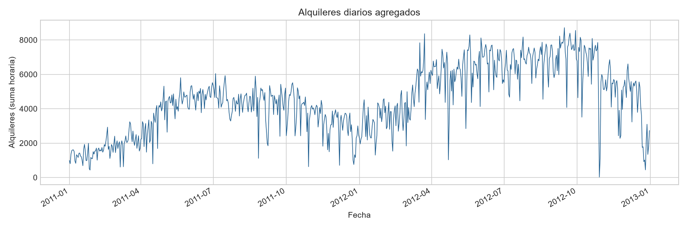
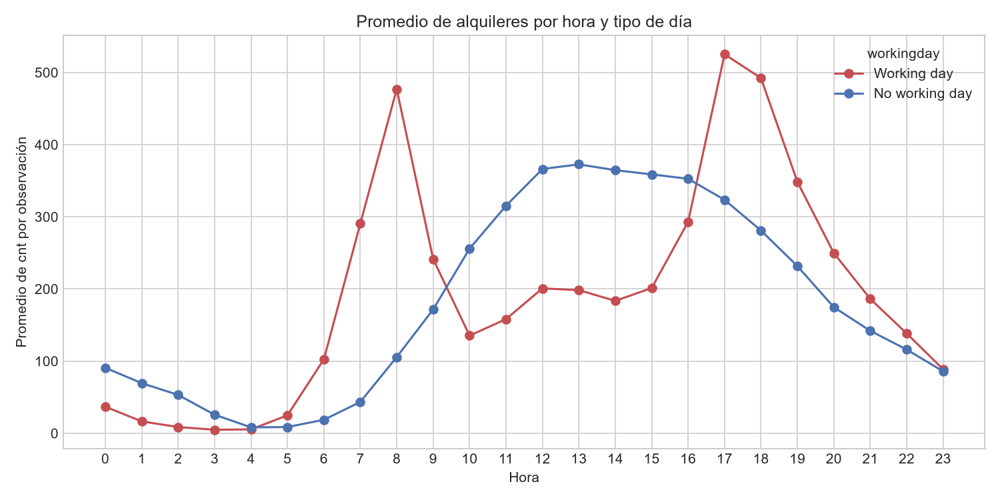
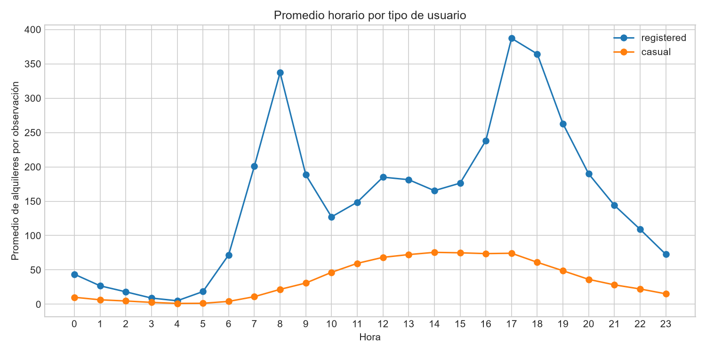
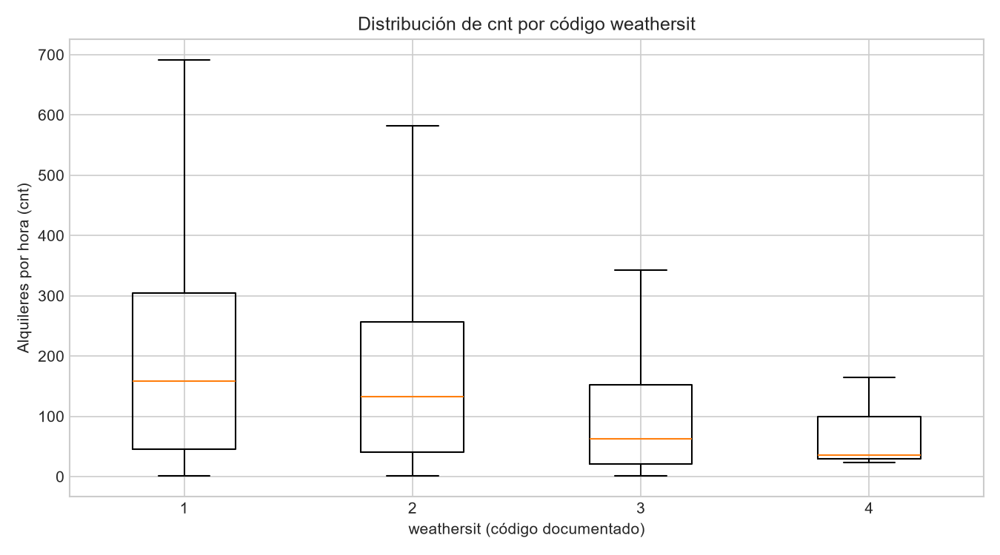
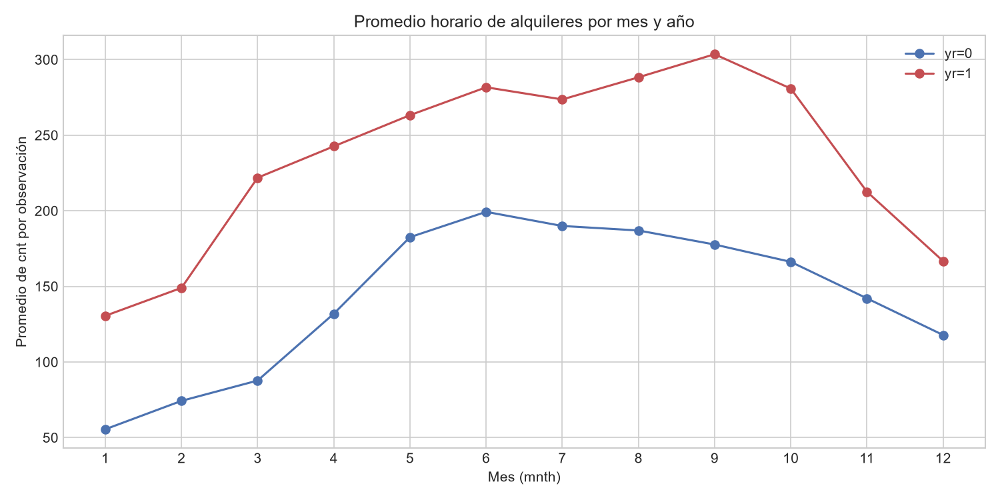

# Resumen ejecutivo

Se analizaron 17.379 observaciones horarias de alquileres de Capital Bikeshare entre el 1 de enero de 2011 y el 31 de diciembre de 2012. La copia preparada conserva todas las filas fuente y añade variables de trazabilidad temporal, etiquetas de códigos y una comprobación explícita de componentes; no se imputaron ni eliminaron registros. [STAT-001] [STAT-003]

La calidad estructural es alta: no se observaron valores ausentes, duplicados de fila, `instant` repetidos, timestamps duplicados, códigos fuera de los dominios documentados ni discrepancias en la identidad `cnt = casual + registered`. [STAT-002] [STAT-003] [STAT-005] [STAT-006] Sin embargo, faltan 165 horas dentro del intervalo de cobertura, un riesgo relevante al comparar sumas diarias o grupos con distinto número de horas observadas. [STAT-004] [ISSUE-001]

El total observado fue de 3.292.679 alquileres; `registered` aportó el 81,2% y `casual` el 18,8%. [STAT-008] El promedio horario aumentó de 143,8 en `yr=0` a 234,7 en `yr=1`, una diferencia descriptiva que coincide con una mayor suma observada en el segundo año. [STAT-009]

Los alquileres muestran un patrón horario claramente diferente según `workingday`: en días laborables los máximos medios se concentran a las 08:00 (477,0) y 17:00 (525,3), mientras que en días no laborables se concentran durante el intervalo de mediodía y tarde temprana, con máximo a las 13:00 (372,7). [STAT-011] Las categorías de `weathersit` con códigos más altos también presentan menores promedios observados de `cnt`, aunque esta comparación no controla simultáneamente hora, estación o calendario. [STAT-009]

# Dataset y alcance

El archivo analizado es un CSV del nivel horario del dataset Bike Sharing documentado como `hour.csv`. Cada fila representa un agregado de alquileres del sistema Capital Bikeshare para una combinación de fecha (`dteday`) y hora (`hr`), e incluye calendario, condiciones meteorológicas normalizadas y los recuentos `casual`, `registered` y `cnt`. [STAT-001]

El alcance es exclusivamente exploratorio y descriptivo. Se examinan estructura, calidad, distribución, agregaciones temporales, composición de usuarios y asociaciones observadas con calendario y meteorología. No se entrenaron modelos predictivos y ninguna diferencia entre grupos ni correlación se interpreta como una relación causal.

# Inspección, calidad y preparación

El CSV original contiene 17 columnas y 17.379 filas, con cobertura observada desde `2011-01-01T00:00:00` hasta `2012-12-31T23:00:00`. La presencia de `hr`, junto con la documentación pública, confirma el nivel horario de la tabla. [STAT-001]

Las comprobaciones de calidad mostraron:

- Cero valores ausentes en todas las columnas fuente. [STAT-002]
- Cero filas completas duplicadas, cero valores duplicados de `instant` y cero timestamps duplicados tras combinar `dteday` y `hr`. [STAT-003]
- Conversión válida de todas las fechas. [STAT-003]
- Coherencia de `yr`, `mnth`, `weekday` y `workingday` con la fecha; la codificación verificada de `weekday` es `0=Sunday` a `6=Saturday`. [STAT-005]
- Ausencia de códigos fuera de los dominios documentados para `season`, `yr`, `mnth`, `hr`, `holiday`, `weekday`, `workingday` y `weathersit`. [STAT-005]
- Ausencia de valores negativos en recuentos; `temp`, `atemp`, `hum` y `windspeed` permanecen dentro del intervalo normalizado `[0, 1]`. [STAT-006]
- Cumplimiento de `cnt = casual + registered` en las 17.379 filas. [STAT-006]

La copia `prepared_data.csv` mantiene las 17.379 observaciones y las 17 variables fuente. Se convirtió `dteday` a fecha para el análisis y se serializó en formato ISO en la copia; además se añadieron `timestamp`, `season_label`, `weathersit_label`, `weekday_label` y `user_total_check`. Estas derivadas no reemplazan los campos originales. [TR-001] [TR-002]

Se retuvieron todos los registros, incluidos los valores altos de `cnt`. El cribado IQR detectó 505 horas por encima de 642,5 alquileres, pero no hay evidencia interna de que sean errores: respetan rangos, claves temporales e identidad de componentes. [STAT-014] [ISSUE-002]

# Estadística descriptiva

En las 17.379 observaciones horarias retenidas, `cnt` suma 3.292.679 alquileres, tiene media de 189,5, mediana de 142, primer cuartil de 40, tercer cuartil de 281 y máximo de 977. La distancia entre media y mediana, junto con el rango de 1 a 977, indica una distribución con dispersión considerable y una cola de valores altos. [STAT-007]

Los componentes también presentan heterogeneidad: `casual` tiene media de 35,7 y mediana de 17, mientras que `registered` tiene media de 153,8 y mediana de 115. [STAT-007] En el total agregado, `registered` suma 2.672.662 alquileres (81,2%) y `casual` 620.017 (18,8%). [STAT-008]

Las variables meteorológicas se encuentran en escalas normalizadas: la mediana de `temp` es 0,50, la de `atemp` 0,4848, la de `hum` 0,63 y la de `windspeed` 0,194. Sus unidades físicas no se observan directamente porque la documentación especifica escalas divididas por constantes. [STAT-007]

Por año, `yr=0` reúne 8.645 registros, una suma de 1.243.103 alquileres y una media horaria de 143,8; `yr=1` reúne 8.734 registros, una suma de 2.049.576 y una media de 234,7. Estas cifras describen un nivel de alquiler observado mayor en el segundo año, sin atribuirlo a una causa específica. [STAT-009]

# Variables, agregaciones y relaciones

La agregación por fecha produce 731 días observados. El mayor total diario fue 8.714 alquileres el `2012-09-15`, con 24 horas registradas. El mínimo diario agregado fue 22 el `2012-10-29`, pero ese día contiene solo una hora observada y no debe interpretarse como el mínimo de un día completo. [STAT-010] [ISSUE-001]

El perfil horario cambia notablemente según `workingday`. En días laborables, los promedios de `cnt` alcanzan 477,0 a las 08:00 y 525,3 a las 17:00; en días no laborables, el máximo medio es 372,7 a las 13:00. [STAT-011] Este patrón es una descripción de los registros agrupados; pueden coexistir diferencias de calendario, composición de usuarios, estacionalidad y cobertura.

La composición por hora también es distinta: el perfil medio de `registered` domina los picos de los días laborables, coherente con la participación agregada de este tipo de usuario en el total. [STAT-008] [STAT-011]

Por `weathersit`, las medias horarias observadas de `cnt` son 204,9 para código 1 (`clear_or_partly_cloudy`), 175,2 para código 2 (`mist_or_cloudy`), 111,6 para código 3 (`light_precipitation`) y 74,3 para código 4 (`heavy_precipitation`). El último grupo contiene solo tres observaciones, por lo que su resumen es especialmente inestable. [STAT-009]

Las correlaciones bivariadas de Spearman entre `cnt` y las variables normalizadas son 0,423 con `temp`, 0,423 con `atemp`, −0,360 con `hum` y 0,127 con `windspeed`. La correlación de Pearson entre `temp` y `atemp` es muy elevada, lo que señala redundancia descriptiva entre ambas medidas. [STAT-013] Estas asociaciones no ajustan por hora, año, estación ni otras variables y no permiten establecer efectos causales.

# Visualizaciones y hallazgos

La evolución agregada diaria muestra variación sustancial a lo largo de los dos años y permite contextualizar máximos, mínimos y cambios temporales sin la sobrecarga visual de una serie horaria completa. Los días incompletos deben interpretarse con cautela. [STAT-010] [FIG-001]

El gráfico horario separado por `workingday` hace visibles los picos matinal y vespertino de días laborables frente al perfil de mediodía de días no laborables. [STAT-011] [FIG-002]

La figura de componentes horarios muestra que `registered` explica una parte importante de los picos horarios, mientras que `casual` tiene un perfil medio menor en el total de observaciones. [STAT-011] [FIG-003]

La distribución de `cnt` por `weathersit` representa la dispersión dentro de cada categoría y evita interpretar solo las medias; el grupo de código 4 debe leerse con especial prudencia por su tamaño de tres filas. [STAT-009] [FIG-004]

La comparación mensual por `yr` presenta patrones temporales distintos entre ambos años y complementa las diferencias de promedio anual. [STAT-012] [FIG-005]

# Problemas, riesgos y anomalías

El principal problema detectado es la cobertura incompleta: faltan 165 de las 17.544 horas esperables entre el primer y el último timestamp, aunque no falta ningún día completo. No se crearon filas ni se imputaron valores porque una hora ausente no equivale a un alquiler cero. [STAT-004] [ISSUE-001] Como consecuencia, los totales diarios de fechas incompletas pueden estar subestimados y las comparaciones de agregados deben considerar el número de horas registradas. [STAT-010] [ISSUE-001]

Se identificaron 505 valores altos de `cnt` mediante una regla IQR, con umbral superior de 642,5 y máximo de 977. Se conservaron porque no contradicen los controles de rango, integridad temporal o identidad entre componentes. [STAT-006] [STAT-014] [ISSUE-002] Estos valores influyen en medias y desviaciones estándar, por lo que se reportan también mediana y cuantiles. [STAT-007] [ISSUE-002]

No se detectaron incidencias de ausencias, duplicación, códigos inválidos, fechas inválidas, rangos normalizados incompatibles o incumplimiento de la identidad de recuentos. [STAT-002] [STAT-003] [STAT-005] [STAT-006]

# Limitaciones e incertidumbres

Los registros son agregados horarios, no viajes individuales, y no contienen estaciones, origen, destino, duración ni información de usuarios más allá de `casual` y `registered`. Por tanto, el análisis no describe movilidad espacial ni comportamiento individual.

Los huecos horarios limitan la comparabilidad de algunos agregados temporales y no puede determinarse con el archivo cuál es la razón de cada ausencia. [ISSUE-001]

Las variables meteorológicas están normalizadas y las comparaciones por `weathersit` son descriptivas. Las relaciones bivariadas con `cnt` pueden estar confundidas por hora, día laborable, mes, año o estacionalidad. [STAT-013]

El dataset y la documentación suministrada no aportan contexto operativo ni información de eventos que permita explicar picos o caídas concretas. Por ello, los extremos conservados no se atribuyen a sucesos específicos. [ISSUE-002]

# Conclusiones

El archivo horario presenta una estructura internamente consistente y una alta calidad en los controles evaluables: todos los registros se conservaron y la preparación se limitó a conversiones y derivadas trazables. [STAT-003] [STAT-005] [STAT-006] [TR-001] [TR-003]

La demanda horaria observada es heterogénea, con un total de 3,29 millones de alquileres y predominio de `registered` en la composición agregada. [STAT-007] [STAT-008] Los patrones horarios difieren marcadamente por `workingday`, y los perfiles de usuario ayudan a contextualizar esa diferencia descriptiva. [STAT-011] [FIG-002] [FIG-003]

La cobertura temporal incompleta es la principal precaución analítica: los huecos no deben tratarse como demanda nula y afectan especialmente a agregados diarios incompletos. [STAT-004] [ISSUE-001] Las diferencias meteorológicas y las correlaciones observadas son útiles para describir el conjunto, pero no sustentan atribuciones causales. [STAT-009] [STAT-013]