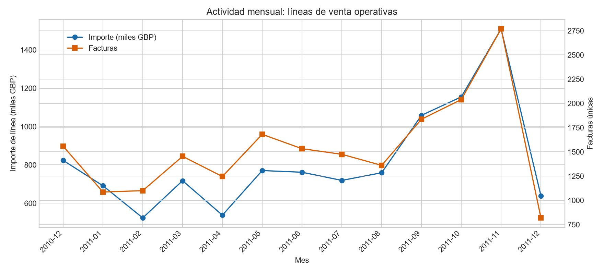
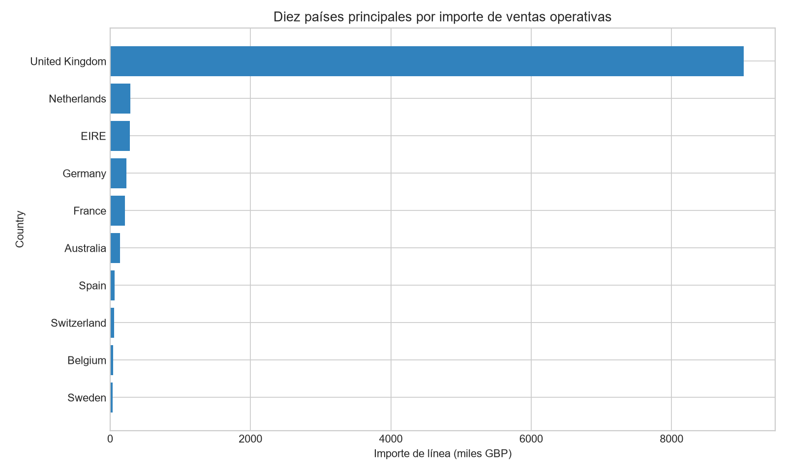
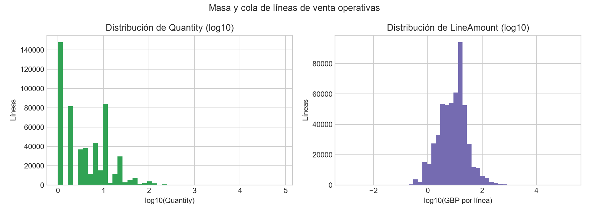
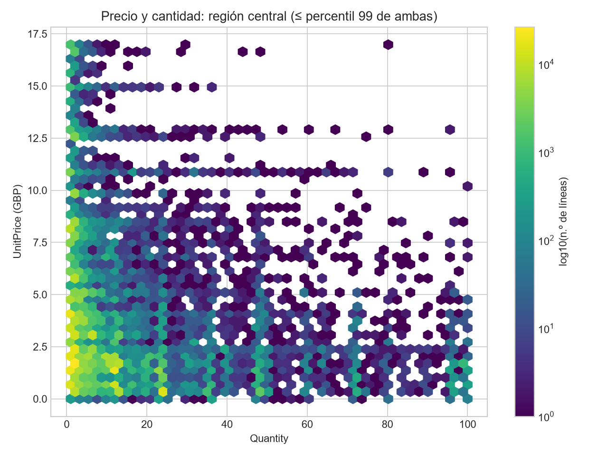

# Resumen ejecutivo

El archivo contiene 541.909 líneas de factura, 25.900 `InvoiceNo` distintos y ocho variables fuente. La ventana observada va del 1 de diciembre de 2010 al 9 de diciembre de 2011. Conforme a la documentación disponible, una fila es una **línea de factura** y no representa necesariamente una factura completa, un pago o una compra consolidada. [STAT-001] [STAT-003]

Se conservó íntegramente la población en `prepared_data.csv`: no se eliminaron cancelaciones, ausencias, duplicados exactos ni valores extremos. Se tipificaron los identificadores como nominales, se serializó `InvoiceDate` en ISO 8601 y se añadieron `IsCancellation`, `HasCustomerID`, `LineAmount` e `InvoiceMonth`. [STAT-007]

Para describir actividad positiva se definió una población operativa explícita: `InvoiceNo` sin prefijo `C`, `Quantity > 0` y `UnitPrice > 0`. Esta población reúne 530.104 líneas (97,822%), 19.960 facturas y un total de `LineAmount` de 10.666.684,54 GBP; esta cifra es un importe derivado de líneas, no una confirmación de cobro o ingreso neto. [STAT-009]

La actividad está concentrada en `United Kingdom`, que representa el 84,61% del importe de la población operativa. El mes de mayor importe en esa población fue noviembre de 2011, con 1.509.496,33 GBP; los meses de diciembre en los extremos temporales deben interpretarse con cautela por posible cobertura parcial. [STAT-011] [STAT-012] [ISSUE-006]

# Dataset y alcance

Se analizó el libro `xlsx` en la hoja `Online Retail`, con las columnas `InvoiceNo`, `StockCode`, `Description`, `Quantity`, `InvoiceDate`, `UnitPrice`, `CustomerID` y `Country`. La documentación proporcionada señala que las transacciones pertenecen a una empresa británica de comercio electrónico y que parte de los clientes pueden ser mayoristas. [STAT-001]

La unidad de observación es una línea de factura. Por ello, una misma factura puede contener varias líneas: se observaron hasta 1.114 líneas asociadas al mismo `InvoiceNo`. Los análisis a nivel de factura se construyeron mediante agregación y no sustituyen la unidad original. [STAT-003] [STAT-014]

El análisis es exploratorio y descriptivo. No se entrenaron modelos predictivos ni se realizaron inferencias causales. Los importes se expresan como `LineAmount = Quantity × UnitPrice`, en GBP según el diccionario de datos; se usan para comparar líneas y agregados bajo poblaciones declaradas. [STAT-007] [STAT-014]

# Inspección, calidad y preparación

La carga inicial identificó 541.909 filas, ocho columnas fuente y cobertura efectiva desde `2010-12-01T08:26:00` hasta `2011-12-09T12:50:00`. `Quantity` se cargó como entero, `UnitPrice` como flotante e `InvoiceDate` como fecha; `InvoiceNo`, `StockCode` y `CustomerID` son identificadores nominales, aunque algunos se hubieran cargado con una representación numérica. [STAT-001]

La copia preparada conserva las 541.909 filas y amplía la tabla a 12 columnas. Se transformaron `InvoiceNo`, `StockCode` y `CustomerID` a texto nominal, se recortaron espacios periféricos de esos identificadores y se serializó `InvoiceDate` en formato ISO 8601. Las cuatro columnas derivadas fueron:

- `IsCancellation`: indicador de que `InvoiceNo` comienza por `C`, convención documentada para cancelaciones.
- `HasCustomerID`: indicador de disponibilidad de `CustomerID`.
- `LineAmount`: `Quantity × UnitPrice`.
- `InvoiceMonth`: periodo mensual derivado de `InvoiceDate`. [STAT-007]

La identidad aritmética de `LineAmount` se comprobó para todas las filas, con error absoluto máximo igual a cero. [STAT-007] [STAT-014]

No se deduplicaron automáticamente las 5.268 filas exactamente repetidas (0,972%). Sin un identificador de línea ni una regla documental que distinga una repetición administrativa de líneas legítimas indistinguibles, eliminarlas podría sesgar a la baja los conteos y los importes. [STAT-003] [ISSUE-003]

# Estadística descriptiva

En el archivo completo hay 25.900 `InvoiceNo`, 4.070 `StockCode`, 4.223 valores no ausentes de `Description`, 4.372 `CustomerID` identificados y 38 valores de `Country`. [STAT-002]

En todas las líneas, la mediana de `Quantity` es 3 unidades y la de `UnitPrice` es 2,08 GBP; la mediana de `LineAmount` es 9,75 GBP. Las medias son superiores y los rangos son muy amplios —por ejemplo, `LineAmount` varía entre −168.469,60 y 168.469,60 GBP—, por lo que las métricas de media y suma son sensibles a las colas y a los ajustes con signo. [STAT-008]

En las líneas de venta operativas, la mediana de `Quantity` es 3, la mediana de `UnitPrice` es 2,08 GBP y la mediana de `LineAmount` es 9,90 GBP. El percentil 99 de `LineAmount` es 183,60 GBP, frente a un máximo de 168.469,60 GBP, lo que confirma una distribución muy asimétrica. [STAT-009]

`CustomerID` está ausente en 135.080 líneas, equivalentes al 24,927% del archivo. Las líneas sin identificador de cliente tienen una mediana de `LineAmount` de 4,96 GBP, frente a 11,10 GBP entre las líneas con identificador presente. Esta diferencia es descriptiva; no permite atribuirla a una característica del cliente ni interpretar las filas no identificadas a nivel individual. [STAT-002] [STAT-010] [ISSUE-001]

# Variables, agregaciones y relaciones

Se identificaron 9.288 líneas de cancelación según el prefijo `C` de `InvoiceNo`, equivalentes al 1,714% del archivo. Hay 10.624 líneas con `Quantity` negativa, de las cuales 9.288 son cancelaciones y 1.336 no presentan dicho prefijo. También hay 2.515 líneas con `UnitPrice` igual a cero fuera de cancelaciones. Estos casos se conservaron y se separaron de la población operativa mediante filtros explícitos. [STAT-004] [ISSUE-004]

La actividad operativa mensual presenta variación sustancial. Noviembre de 2011 fue el máximo de importe, con 83.369 líneas, 2.769 facturas y 1.509.496,33 GBP; octubre de 2011 acumuló 1.154.979,30 GBP. Estas comparaciones no deben extenderse sin cautela a diciembre de 2010 ni a diciembre de 2011, que son meses de borde de la extracción. [STAT-011] [ISSUE-006]

La concentración geográfica es elevada: `United Kingdom` acumula 9.025.222,08 GBP y el 84,61% del importe de ventas operativas. Los diez primeros valores de `Country` concentran el 97,21% de dicho importe. Esto describe la composición de los registros por país, no una causa de la actividad. [STAT-012]

Los rankings de artículos se calcularon con una fila agregada por `StockCode`; `Description` no forma parte de la clave. Para facilitar la lectura, la etiqueta mostrada es la descripción no ausente más frecuente para cada código en las líneas operativas, con desempate alfabético. Por cantidad, `PAPER CRAFT , LITTLE BIRDIE` (`StockCode` `23843`) suma 80.995 unidades en una sola línea; por importe, `DOTCOM POSTAGE` (`DOT`) encabeza el ranking con 206.248,77 GBP. La presencia de conceptos como `DOTCOM POSTAGE`, `POSTAGE` y `Manual` aconseja no interpretar todo `StockCode` como un producto físico homogéneo. [STAT-013] [ISSUE-005]

A nivel de factura dentro de la población operativa, la mediana es de 15 líneas y la mediana del importe agregado es 303,84 GBP. La correlación de Spearman entre `Quantity` y `UnitPrice` es −0,403, mientras que `LineAmount` se asocia positivamente con ambas variables; esta última relación es parcialmente mecánica porque `LineAmount` se define como su producto. [STAT-014]

# Visualizaciones y hallazgos

La evolución mensual de importe y facturas operativas se muestra en la siguiente figura. La doble escala distingue importe de líneas y número de facturas, y permite observar el máximo de noviembre de 2011 sin confundir las dos métricas. [FIG-001] [STAT-011]

La comparación de los diez países principales evidencia la dominancia de `United Kingdom` y la distancia respecto al resto de categorías principales. La figura representa importes de la población operativa, no población, demanda o rentabilidad por país. [FIG-002] [STAT-012]

Las distribuciones de `Quantity` y `LineAmount` se presentan en escala `log10` para hacer visible la masa central junto con la cola alta. Esta transformación es exclusivamente visual; las estadísticas estructuradas conservan la escala original. [FIG-003] [STAT-009] [STAT-015]

El gráfico hexagonal de `Quantity` y `UnitPrice` limita ambas variables al percentil 99 para visualizar la densidad central. El recorte no se utilizó para eliminar filas ni para los agregados; los extremos permanecen en la copia preparada y en las estadísticas. [FIG-004] [STAT-015] [ISSUE-007]

# Problemas, riesgos y anomalías

La principal limitación de completitud es `CustomerID`: falta en 135.080 líneas. No se imputaron identificadores, y los análisis que requieran clientes individuales deben restringirse a las observaciones identificadas. [ISSUE-001] [STAT-002]

`Description` falta en 1.454 líneas (0,268%). Asimismo, 650 `StockCode` se asocian con más de una descripción no ausente y 112 no tienen ninguna descripción no ausente. Por esta razón, los agregados de producto usan exclusivamente `StockCode` como clave. Cuando se requiere una etiqueta, `Description` se selecciona como la descripción no ausente más frecuente del código en la población correspondiente; no se interpreta como identificador unívoco. [STAT-002] [STAT-006] [STAT-013] [ISSUE-002] [ISSUE-005]

Los valores negativos, precios nulos, cancelaciones y duplicados exactos no se clasificaron como errores confirmados. La documentación solo establece que el prefijo `C` señala una cancelación; no proporciona reglas suficientes para interpretar los demás ajustes o extremos. Cada uno se retuvo con una decisión analítica explícita. [ISSUE-003] [ISSUE-004]

Como cribado estadístico, la regla IQR superior identifica 56.363 líneas por encima de 23,5 unidades, 37.999 por encima de 8,45 GBP de `UnitPrice` y 42.651 por encima de 38,625 GBP de `LineAmount` dentro de ventas operativas. Son señales de cola alta, no pruebas de error, por lo que no se excluyeron. [STAT-015] [ISSUE-007]

# Limitaciones e incertidumbres

El archivo registra líneas de factura, no pagos, entregas, devoluciones consolidadas, márgenes ni facturas netas. En consecuencia, `LineAmount` es una medida derivada útil para el EDA, pero no confirma ingreso realizado o rentabilidad. [STAT-007] [STAT-014]

Las cancelaciones se identifican únicamente con el criterio publicado de prefijo `C`. Las 1.336 líneas con cantidad negativa y sin ese prefijo, los precios cero y los valores extremos no pueden clasificarse definitivamente con la documentación disponible. [STAT-004] [ISSUE-004]

La ausencia de `CustomerID` limita agregaciones y conclusiones a nivel de cliente; no hay base para imputar la identidad faltante. Además, las descripciones no son una taxonomía estable de producto debido a su correspondencia no unívoca con `StockCode`; la etiqueta seleccionada para un código no representa necesariamente todas sus variantes de descripción. [ISSUE-001] [ISSUE-005] [STAT-013]

Los meses inicial y final de la ventana temporal podrían estar incompletos. Por ello, la serie mensual describe los registros disponibles y no debe interpretarse como una comparación estricta de meses calendario completos. [STAT-005] [ISSUE-006]

# Conclusiones

El dataset ofrece una base amplia para describir actividad de facturación por línea: contiene 541.909 observaciones, 25.900 facturas distintas y cobertura de 13 meses calendario observados. La estructura exige distinguir líneas, facturas y clientes, y no tratarlos como niveles intercambiables. [STAT-001] [STAT-003] [STAT-005]

La copia preparada preserva toda la evidencia fuente y hace explícitas las decisiones analíticas mediante tipado nominal de identificadores, fecha ISO y variables derivadas reproducibles. Las líneas de venta operativas concentran 10,67 millones de GBP de importe derivado, pero su interpretación debe separarse de cancelaciones, ajustes y pagos reales. [STAT-007] [STAT-009]

La actividad operativa está altamente concentrada en `United Kingdom` y alcanzó su máximo mensual observado en noviembre de 2011. Los rankings agregados exclusivamente por `StockCode` cambian según se use cantidad o importe, y pueden incluir conceptos de servicio o ajuste además de artículos físicos. [STAT-011] [STAT-012] [STAT-013]

Finalmente, las ausencias de `CustomerID`, los duplicados exactos, los ajustes no positivos, la relación no unívoca entre `StockCode` y `Description`, los extremos y la posible parcialidad temporal deben permanecer visibles en cualquier uso posterior de estos datos. [ISSUE-001] [ISSUE-003] [ISSUE-004] [ISSUE-005] [ISSUE-006] [ISSUE-007]