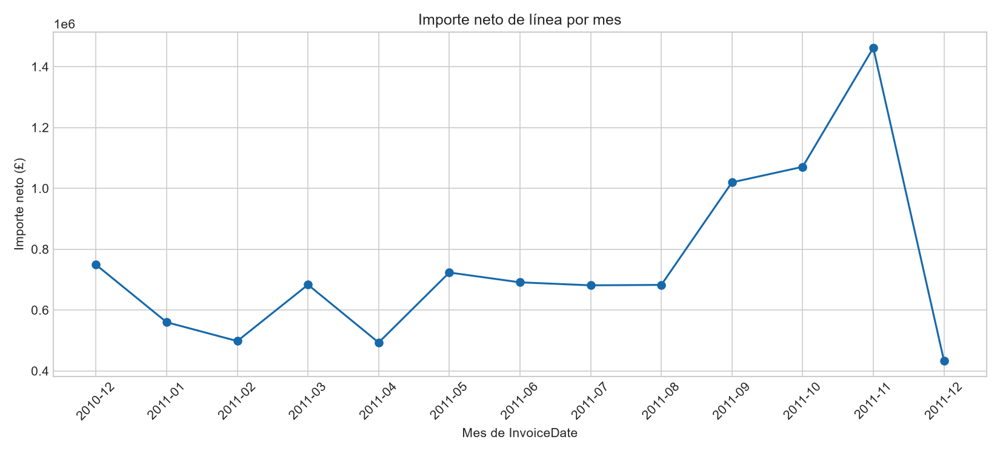
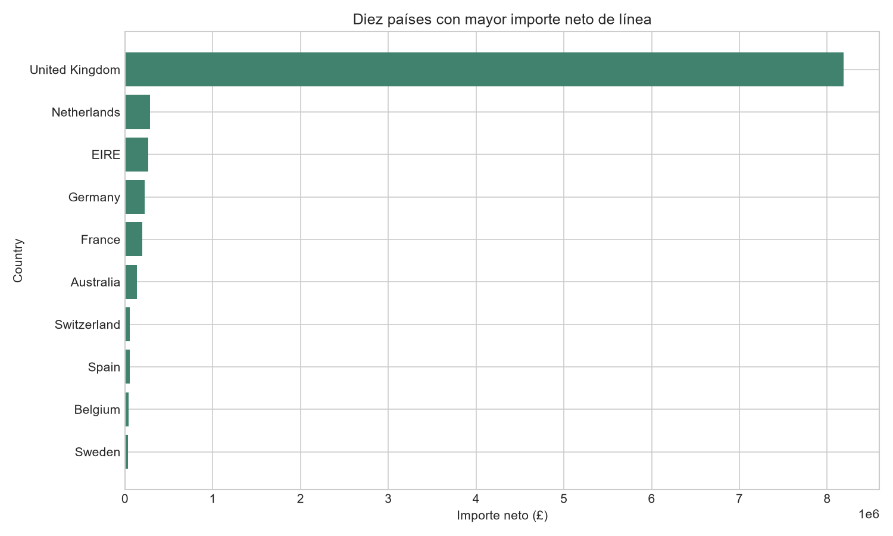
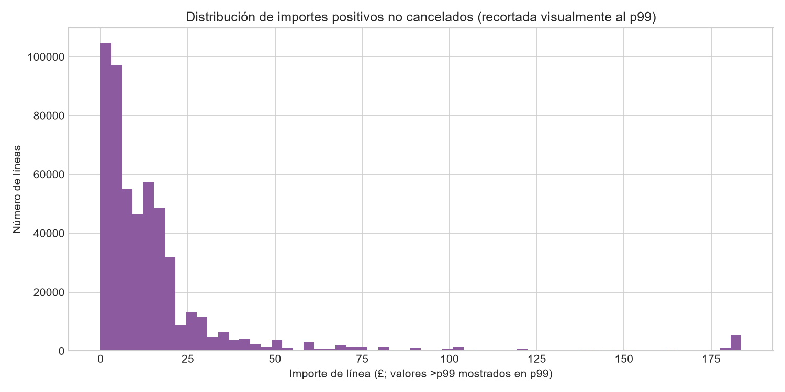
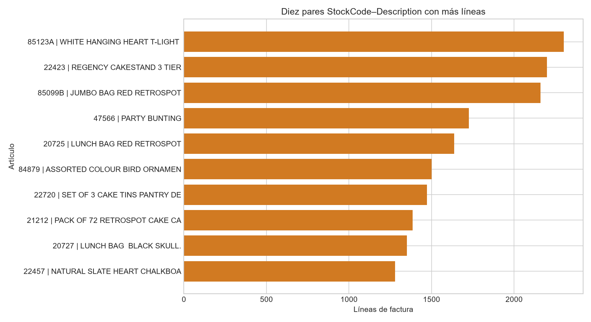

# Resumen ejecutivo

El archivo `xlsx` de la hoja `Online Retail` contiene 541.909 líneas de factura y ocho variables fuente. Tras una preparación conservadora se mantuvieron todas las filas y se añadieron cuatro variables analíticas, por lo que la copia de trabajo tiene 12 columnas. [STAT-001] [STAT-009]

El importe neto de línea —definido como `Quantity × UnitPrice` e incluyendo valores negativos— suma £9.747.747,93; las líneas de importe positivo suman £10.666.684,54. Esta diferencia confirma que la elección de población y tratamiento de cancelaciones modifica sustancialmente la suma descriptiva. [STAT-009] [STAT-015]

`InvoiceNo` con prefijo `C`, definido en la documentación como cancelación, representa 9.288 líneas y 3.836 facturas, con importe neto de -£896.812,49. Las restantes 532.621 líneas suman £10.644.560,42, aunque este subconjunto todavía contiene algunos importes negativos o nulos. [STAT-007] [STAT-010]

La actividad observada está muy concentrada en `United Kingdom`, con £8.187.806,36 de importe neto y 495.478 líneas. La actividad mensual neta alcanza su máximo observado en noviembre de 2011 (£1.461.756,25), pero los dos diciembres son periodos de borde y no deben compararse directamente con meses completos. [STAT-005] [STAT-011] [ISSUE-004]

# Dataset y alcance

El dataset procede de un libro `xlsx`, hoja `Online Retail`, cargado sin modificar el archivo original. Contiene `InvoiceNo`, `StockCode`, `Description`, `Quantity`, `InvoiceDate`, `UnitPrice`, `CustomerID` y `Country`. [STAT-001]

De acuerdo con la documentación pública proporcionada, una fila representa una **línea de factura**, no una factura completa, una compra completa ni un cliente. Por tanto, los conteos de filas, facturas y clientes responden a unidades distintas y no son intercambiables. [STAT-001]

La cobertura efectiva va desde `2010-12-01T08:26:00` hasta `2011-12-09T12:50:00`, con 13 meses calendario observados. [STAT-005] El análisis es exclusivamente descriptivo: no evalúa causalidad, rentabilidad ni comportamiento fuera de las observaciones registradas.

# Inspección, calidad y preparación

La tabla original contiene 541.909 filas y 8 columnas. La copia preparada conserva las 541.909 filas y añade `is_cancellation`, `line_amount`, `invoice_month` y `customer_id_available`, alcanzando 12 columnas. [STAT-001] [STAT-009]

Se trataron `InvoiceNo`, `StockCode` y `CustomerID` como identificadores nominales, convirtiéndolos a representación de cadena para evitar una interpretación cuantitativa impropia. `InvoiceDate` se conservó como fecha-hora y se serializó en formato ISO 8601 en `prepared_data.csv`. También se eliminaron espacios periféricos de `Description` y `Country`, sin imputar valores faltantes. Las transformaciones y su justificación constan en `TR-001` a `TR-004`.

La preparación fue deliberadamente conservadora: no se eliminaron cancelaciones, filas con importes negativos o nulos, valores extremos, ausencias ni filas exactamente repetidas. Esta decisión preserva las operaciones registradas y evita clasificar automáticamente ajustes o transacciones legítimas como errores. [STAT-003] [STAT-006] [STAT-007]

La calidad presenta dos ausencias principales: `CustomerID` falta en 135.080 líneas (24,93 %) y `Description` en 1.454 (0,27 %). Todas las ausencias de `Description` coinciden con ausencia de `CustomerID`; además hay 133.626 líneas con `CustomerID` ausente pero `Description` disponible. [STAT-002] [ISSUE-001] [ISSUE-002]

Se identificaron 5.268 filas exactamente duplicadas (0,97 %). Se retuvieron porque la información disponible no permite distinguir con seguridad entre duplicación técnica y líneas legítimamente repetidas. [STAT-003] [ISSUE-003]

# Estadística descriptiva

En la población completa preparada se registran 25.900 valores distintos de `InvoiceNo`, 4.070 `StockCode`, 4.372 `CustomerID` identificados y 38 países. [STAT-009]

Las distribuciones de `Quantity`, `UnitPrice` y `line_amount` son marcadamente asimétricas. En todas las líneas, la mediana de `Quantity` es 3 unidades y el percentil 99 es 100, frente a un máximo de 80.995 y mínimo de -80.995. La mediana de `UnitPrice` es £2,08, con percentil 99 de £18,00, mínimo de -£11.062,06 y máximo de £38.970,00. [STAT-006]

Para `line_amount`, la mediana es £9,75, el percentil 95 £59,40 y el percentil 99 £180,00, mientras que el rango total va de -£168.469,60 a £168.469,60. Hay 9.290 líneas de importe negativo y 2.515 de importe nulo. [STAT-006] Estas cifras muestran que las medias y sumas son sensibles a colas y ajustes, por lo que se complementan con cuantiles.

Entre las líneas cuyo `InvoiceNo` no empieza por `C`, la mediana de `line_amount` es £9,90 y el percentil 99 es aproximadamente £183,50. En este subconjunto permanecen 2.515 líneas de importe nulo y 2 líneas negativas; por ello, “no cancelación por prefijo” no equivale a venta regular validada. [STAT-010]

La disponibilidad de `CustomerID` segmenta la cobertura analítica: 406.829 líneas lo tienen disponible, con mediana de importe de £11,10, frente a 135.080 líneas sin identificador y mediana de £4,96. Esta es una diferencia descriptiva observada, no una explicación de la falta de identificador. [STAT-012] [ISSUE-001]

# Variables, agregaciones y relaciones

`line_amount` se definió de forma determinista como `Quantity × UnitPrice`; el máximo error absoluto de comprobación de esta identidad fue 0. Por tanto, no constituye una medida independiente de sus dos componentes. [STAT-015]

Las cancelaciones identificadas por el prefijo `C` presentan una coherencia clara con los signos: las 9.288 líneas de cancelación tienen `Quantity` e importe de línea negativos. En cambio, fuera de ese prefijo existen 1.336 líneas con cantidad negativa y 2 con importe negativo, que se conservaron como operaciones de interpretación incierta. [STAT-007] [ISSUE-005]

La evolución mensual de importes netos varía de £493.207,12 en abril de 2011 a £1.461.756,25 en noviembre de 2011 entre los meses completos observados. El aumento visible hacia septiembre–noviembre describe el patrón registrado; no permite atribuir causas ni comparar directamente los meses parciales de diciembre. [STAT-005] [STAT-014]

Por país, `United Kingdom` reúne 495.478 líneas, 23.494 facturas y £8.187.806,36 netos. Le siguen, por importe neto, `Netherlands` (£284.661,54), `EIRE` (£263.276,82), `Germany` (£221.698,21) y `France` (£197.403,90). El ranking es una descripción de la composición observada y no una comparación ajustada por clientes, cobertura o tipo de operación. [STAT-011]

Los artículos principales dependen de la métrica elegida. El par `85123A`–`WHITE HANGING HEART T-LIGHT HOLDER` es el más frecuente, con 2.302 líneas, mientras que `DOT`–`DOTCOM POSTAGE` alcanza el mayor importe neto del ranking, £206.245,48, con 709 líneas. [STAT-013] En consecuencia, frecuencia de línea e importe neto no identifican necesariamente los mismos conceptos destacados.

La relación entre `StockCode` y `Description` no es estrictamente uno a uno: 647 códigos se asocian con más de una descripción y 177 descripciones con más de un código. Por ello, los rankings se calcularon por el par `StockCode`–`Description`. [STAT-008] [ISSUE-006]

# Visualizaciones y hallazgos

La evolución mensual visualiza el incremento observado durante septiembre–noviembre de 2011 y el máximo neto de noviembre. La figura representa importes netos, por lo que incorpora el efecto de cancelaciones y ajustes; los meses de diciembre son periodos incompletos. [FIG-001] [STAT-005] [STAT-014] [ISSUE-004]

La comparación geográfica muestra la elevada concentración en `United Kingdom`; los restantes países del top 10 quedan a gran distancia en importe neto registrado. [FIG-002] [STAT-011]

La distribución de importes positivos de líneas no canceladas se muestra recortada visualmente al percentil 99 para que los extremos no oculten la masa central. El recorte es únicamente gráfico: no se eliminaron valores de la copia preparada ni de los cálculos agregados. [FIG-003] [STAT-010] [STAT-016]

La selección de los diez pares `StockCode`–`Description` con más líneas hace visible la concentración de frecuencia, sin representar la totalidad de las categorías de alta cardinalidad. [FIG-004] [STAT-013]

# Problemas, riesgos y anomalías

La falta de `CustomerID` afecta al 24,93 % de las líneas y supone un riesgo alto para análisis por cliente: no se imputó y toda métrica de clientes debe restringirse explícitamente a identificadores disponibles. [ISSUE-001] [STAT-002]

Las 1.454 ausencias de `Description` se conservaron como faltantes reales. Esto puede limitar agregaciones o rankings construidos exclusivamente con descripciones. [ISSUE-002] [STAT-002]

Las 5.268 filas idénticas se conservaron debido a la incertidumbre sobre su origen. Si una parte fuese duplicación técnica, los conteos de líneas y algunas sumas podrían estar sobreestimados; el dataset no proporciona una clave de línea adicional para resolverlo. [ISSUE-003] [STAT-003]

La cobertura temporal termina el 9 de diciembre de 2011, de modo que diciembre de 2011 no representa un mes completo; diciembre de 2010 también es un mes de borde. [ISSUE-004] [STAT-005]

El cribado por vallas de 1,5×IQR identifica 58.619 valores inusuales de `Quantity`, 39.627 de `UnitPrice` y 44.997 de `line_amount`. Estas cantidades no son recuentos de errores: son señales estadísticas de colas largas y posibles operaciones especiales que se mantuvieron para no excluir registros sin evidencia concluyente. [STAT-016] [ISSUE-005]

# Limitaciones e incertidumbres

`CustomerID` ausente limita tanto el recuento de clientes como cualquier segmentación centrada en ellos; no es posible saber con estos datos si las filas sin identificador corresponden a una población comparable a las identificadas. [ISSUE-001]

El prefijo `C` permite identificar cancelaciones según la documentación pública, pero no explica exhaustivamente los importes negativos, cantidades negativas fuera de dicho prefijo, ceros, códigos especiales ni extremos. [STAT-007] [ISSUE-005]

`line_amount` es un importe de línea calculado, no una medida de ingresos, margen o rentabilidad. No incluye evidencia sobre impuestos, descuentos, devoluciones vinculadas, envío, costes ni moneda alternativa. [STAT-015]

Las categorías presentan alta cardinalidad y `StockCode`–`Description` no es una correspondencia estable estricta. Los rankings son útiles para describir los conceptos registrados, pero no deben interpretarse como un catálogo depurado ni como cuota completa de productos. [STAT-004] [STAT-008]

Las comparaciones mensuales están condicionadas por los periodos de borde; asimismo, todas las comparaciones por país, producto, cancelación o disponibilidad de identificador son asociaciones descriptivas y no establecen causalidad. [ISSUE-004]

# Conclusiones

La copia preparada preserva íntegramente las 541.909 líneas originales y añade variables trazables para distinguir cancelaciones, calcular `line_amount`, agregar por mes y señalar disponibilidad de cliente. [STAT-001] [STAT-015]

El conjunto registra £9,75 millones de importe neto de línea, condicionado por £896.812,49 netos negativos de facturas identificadas como cancelaciones. Las definiciones de población —total, importes positivos o facturas sin prefijo `C`— deben comunicarse junto con cualquier suma. [STAT-007] [STAT-009] [STAT-010]

La actividad observada se concentra geográficamente en `United Kingdom`, temporalmente alcanza un máximo en noviembre de 2011 y muestra una distribución de importes con cola extrema. Estos son patrones descriptivos del registro disponible, no evidencia de mecanismos causales. [STAT-005] [STAT-006] [STAT-011]

Las principales precauciones para reutilizar el dataset son la cobertura incompleta de `CustomerID`, la ambigüedad de duplicados y operaciones especiales, los extremos retenidos y los meses de borde incompletos. [ISSUE-001] [ISSUE-003] [ISSUE-004] [ISSUE-005]