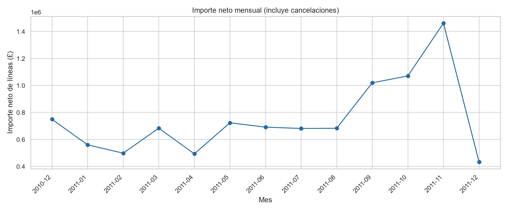
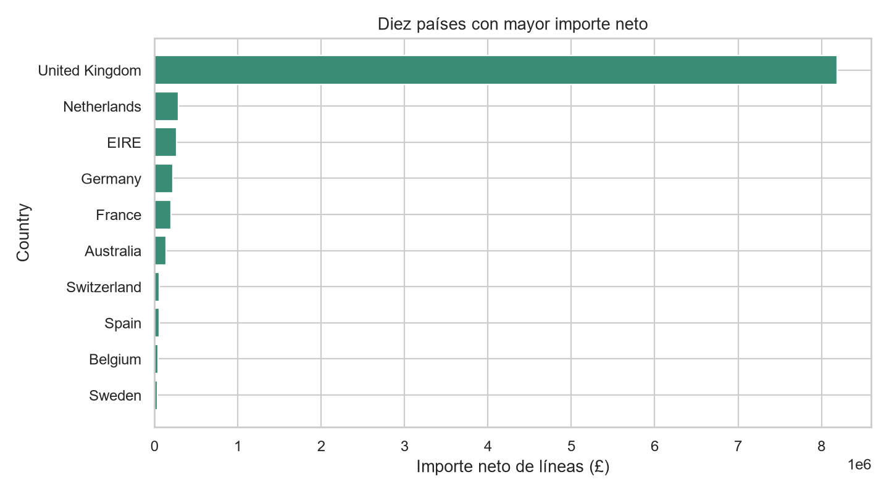
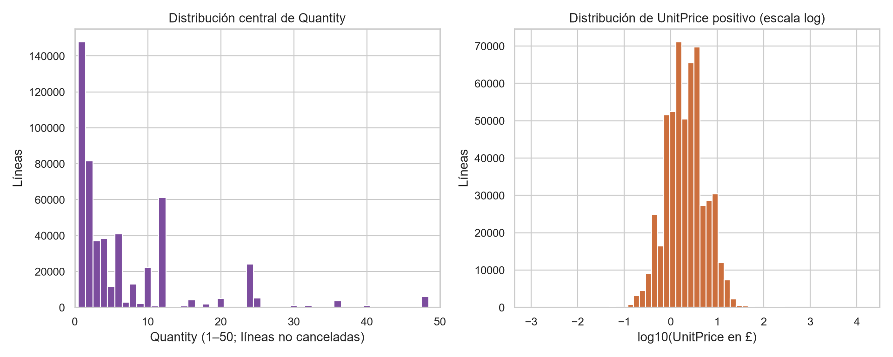
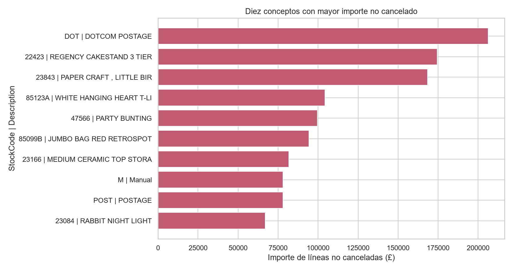

# Resumen ejecutivo

El archivo `Online Retail` contiene 541.909 líneas de factura, correspondientes al periodo observado entre el 1 de diciembre de 2010 y el 9 de diciembre de 2011. Se conservaron todas las líneas en la copia de trabajo y se añadieron `IsCancellation`, `LineAmount` y `YearMonth` para distinguir cancelaciones, valorar líneas y agregar temporalmente. [STAT-001] [STAT-006]

El importe neto calculado como suma de `LineAmount` fue £9.747.747,93 y el total neto de unidades fue 5.176.450. Las cancelaciones —identificadas exclusivamente por el prefijo `C` en `InvoiceNo`, conforme a la documentación— representan 9.288 líneas (1,71%), con £896.812,49 de importe negativo; las líneas no canceladas suman £10.644.560,42. [STAT-003] [STAT-007] [STAT-008]

La actividad está muy concentrada en `United Kingdom`, que acumula 495.478 líneas y 84,00% del importe neto calculado. El máximo importe neto mensual observado corresponde a noviembre de 2011 (£1.461.756,25), aunque los dos diciembres disponibles son parciales y no deben compararse directamente con meses completos. [STAT-009] [STAT-010] [ISSUE-004]

La principal limitación de calidad para segmentación de clientes es la ausencia de `CustomerID` en 135.080 líneas (24,93%). Además, hay 5.268 filas exactamente repetidas, valores extremos y signos negativos que no se eliminaron automáticamente por falta de reglas de negocio que permitan clasificarlos de forma concluyente como errores. [STAT-002] [STAT-003] [STAT-014] [ISSUE-001] [ISSUE-003] [ISSUE-005]

# Dataset y alcance

La fuente analizada es el archivo de entrada en formato `xlsx`, hoja `Online Retail`, con ocho variables originales: `InvoiceNo`, `StockCode`, `Description`, `Quantity`, `InvoiceDate`, `UnitPrice`, `CustomerID` y `Country`. La carga se realizó sin modificar el archivo original. [STAT-001]

De acuerdo con la documentación pública disponible, cada fila representa una **línea de factura**. Por tanto, una fila no equivale necesariamente a una factura completa, a una compra completa ni a un cliente. `InvoiceNo`, `StockCode` y `CustomerID` se trataron como identificadores nominales, no como medidas numéricas. [STAT-001]

La cobertura efectiva va desde `2010-12-01T08:26:00` hasta `2011-12-09T12:50:00`, con actividad en 305 fechas distintas. El alcance descriptivo se limita a las líneas registradas por esta empresa y este periodo; no se realizan inferencias sobre otros negocios, años o poblaciones. [STAT-001] [STAT-005]

# Inspección, calidad y preparación

La tabla original tiene 541.909 filas y 8 columnas. La copia preparada mantiene las 541.909 filas y añade tres variables derivadas, por lo que contiene 11 columnas. No se eliminaron observaciones. [STAT-006]

Se normalizaron `InvoiceNo`, `StockCode` y `CustomerID` como texto para preservar su naturaleza nominal y evitar una interpretación cuantitativa o sufijos de representación derivados de la lectura de Excel. `InvoiceDate` se conservó como fecha-hora y se serializó en formato ISO 8601 en `prepared_data.csv`. [STAT-006]

Las variables derivadas son:

- `IsCancellation`: indicador booleano basado en si `InvoiceNo` empieza por `C`, regla publicada para cancelaciones.
- `LineAmount`: producto determinista `Quantity × UnitPrice`.
- `YearMonth`: mes calendario derivado de `InvoiceDate`. [STAT-006] [STAT-013]

La identidad de `LineAmount` fue comprobada para todas las líneas: la diferencia absoluta máxima frente a `Quantity × UnitPrice` es cero. [STAT-013]

No se imputaron ausencias. `CustomerID` falta en 135.080 líneas (24,93%) y `Description` en 1.454 (0,268%); imputar un identificador de cliente habría creado asociaciones no observadas. [STAT-002] [ISSUE-001] [ISSUE-002]

Tampoco se deduplicaron automáticamente las 5.268 filas exactamente idénticas. Una coincidencia completa puede ser una duplicación técnica, pero también puede representar líneas comerciales repetidas legítimamente; con la documentación disponible no es posible resolver esa ambigüedad. [STAT-003] [ISSUE-003]

# Estadística descriptiva

En la población completa se observan 25.900 valores distintos de `InvoiceNo`, 4.070 de `StockCode`, 4.223 de `Description`, 4.372 clientes identificados y 38 categorías de `Country`. [STAT-003] [STAT-005] [STAT-007]

La distribución de las variables numéricas es marcadamente amplia:

| Variable | Mediana | Media | Percentil 99 | Mínimo | Máximo |
|---|---:|---:|---:|---:|---:|
| `Quantity` | 3 | 9,55 | 100 | -80.995 | 80.995 |
| `UnitPrice` (£) | 2,08 | 4,61 | 18,00 | -11.062,06 | 38.970,00 |
| `LineAmount` (£) | 9,75 | 17,99 | 180,00 | -168.469,60 | 168.469,60 |

[STAT-004] [STAT-007]

La distancia entre medianas, medias y extremos aconseja interpretar promedios junto con cuantiles. Por ejemplo, 99% de las líneas tienen `Quantity` de 100 unidades o menos, mientras que el máximo es 80.995; esto confirma que los extremos pueden afectar de forma sustancial las medias y los totales. [STAT-004]

Las 9.288 líneas clasificadas como cancelaciones contienen -277.574 unidades y un importe agregado de -£896.812,49. Sus medianas de cantidad e importe son -2 y -£8,50, respectivamente. En contraste, las 532.621 líneas no canceladas acumulan 5.454.024 unidades, £10.644.560,42 y una mediana de importe de £9,90. Estas cifras describen grupos definidos por el prefijo de factura, sin emparejar una cancelación con la venta original. [STAT-008]

# Variables, agregaciones y relaciones

El importe neto mensual aumentó hacia el último tramo del periodo completo: septiembre de 2011 registró £1.019.687,62, octubre £1.070.704,67 y noviembre £1.461.756,25. El mes de noviembre también tuvo 84.711 líneas y 3.462 facturas distintas, los valores mensuales más altos del registro. [STAT-009]

Los meses de diciembre de 2010 y diciembre de 2011 contienen 42.481 y 25.525 líneas, respectivamente, pero son periodos parciales debido a los límites observados del archivo. Por esa razón, sus importes netos no son comparables de forma directa con los meses calendario completos. [STAT-005] [STAT-009] [ISSUE-004]

La actividad por país está concentrada. `United Kingdom` registra £8.187.806,36 de importe neto, 4.263.829 unidades y 23.494 facturas distintas; equivale a 84,00% del importe neto total. Entre los siguientes países por importe neto figuran `Netherlands` (£284.661,54), `EIRE` (£263.276,82), `Germany` (£221.698,21) y `France` (£197.403,90). Las diferencias deben leerse teniendo en cuenta tamaños de grupo muy desiguales. [STAT-010]

En líneas no canceladas, el concepto `DOT | DOTCOM POSTAGE` encabeza el ranking por importe con £206.248,77, seguido por `22423 | REGENCY CAKESTAND 3 TIER` con £174.484,74. `23843 | PAPER CRAFT , LITTLE BIRDIE` alcanza £168.469,60 en una sola línea de 80.995 unidades, por lo que es un caso particularmente influyente. Este ranking mezcla artículos y conceptos como portes o entradas manuales; no debe interpretarse estrictamente como un ranking de productos físicos. [STAT-011]

Para las 530.104 líneas no canceladas con `Quantity` y `UnitPrice` positivos, la correlación de Spearman entre ambas variables es -0,403. Esto describe una asociación monotónica negativa moderada dentro de esa población, no una relación causal ni un mecanismo de fijación de precios. [STAT-013]

Los resultados por cliente se limitan a filas con `CustomerID` disponible. Dentro de esa población, `CustomerID` 14646 presenta el mayor importe neto agregado (£279.489,02 en 77 facturas), seguido por 18102 (£256.438,49 en 62 facturas). Estos identificadores son etiquetas nominales y no se analizaron como valores numéricos. [STAT-012] [ISSUE-001]

# Visualizaciones y hallazgos

La serie mensual visualiza el aumento de importe neto durante septiembre, octubre y noviembre de 2011, así como la necesidad de interpretar con cautela ambos diciembres parciales. [FIG-001] [STAT-009] [ISSUE-004]

La comparación de los diez países con mayor importe neto muestra la dominancia de `United Kingdom`; la figura usa importe neto de líneas, incluidas cancelaciones. [FIG-002] [STAT-010]

La distribución central de `Quantity` se limita visualmente al intervalo 1–50 para conservar legibilidad, mientras que `UnitPrice` positivo se representa en escala logarítmica. Estas decisiones gráficas evitan que los extremos oculten el patrón central, sin eliminarlos del análisis ni de los cálculos. [FIG-003] [STAT-004] [STAT-013] [ISSUE-005]

La figura de conceptos principales confirma que algunos de los mayores importes corresponden a portes (`DOTCOM POSTAGE`, `POSTAGE`) y a `Manual`, además de artículos con `StockCode`. Esto refuerza la cautela al interpretar agregados por código como ventas de productos físicos homogéneos. [FIG-004] [STAT-011]

# Problemas, riesgos y anomalías

- **Ausencia de `CustomerID`:** afecta a 135.080 líneas (24,93%). Se conservaron los registros y los análisis de clientes se restringieron explícitamente a identificadores disponibles. Esto puede limitar la representatividad de cualquier resultado por cliente. [ISSUE-001] [STAT-002]
- **Ausencia de `Description`:** afecta a 1.454 líneas (0,268%). No se infirió una descripción desde `StockCode`, pues un código puede estar asociado a más de una descripción no ausente. [ISSUE-002] [STAT-005] [ISSUE-006]
- **Filas exactamente repetidas:** se detectaron 5.268 (0,97%). Se retuvieron porque no se puede distinguir con la evidencia disponible entre duplicados técnicos y repeticiones comerciales válidas. Si fueran duplicados técnicos, los agregados podrían estar sobreestimados; si fueran legítimos, eliminarlos los subestimaría. [ISSUE-003] [STAT-003]
- **Meses frontera parciales:** el archivo comienza en diciembre de 2010 y termina el 9 de diciembre de 2011. No se efectuaron normalizaciones por día al no disponer de un calendario de operación. [ISSUE-004] [STAT-005]
- **Extremos, negativos y ceros:** hay 10.624 líneas con `Quantity` negativa, 9.290 con `LineAmount` negativo, 2.515 con `UnitPrice` igual a cero y 2 con `UnitPrice` negativo. El cribado IQR identifica 58.619 valores fuera de vallas para `Quantity`, 39.627 para `UnitPrice` y 44.997 para `LineAmount`. Estas señales no prueban por sí mismas un error; se conservaron y se documentaron como casos inciertos. [STAT-004] [STAT-014] [ISSUE-005]
- **No correspondencia uno-a-uno entre código y descripción:** 650 `StockCode` tienen más de una descripción no ausente. Los rankings de conceptos se construyeron con la pareja `StockCode`–`Description`, sin forzar una correspondencia artificial. [STAT-005] [ISSUE-006]

# Limitaciones e incertidumbres

`LineAmount` es una variable derivada de `Quantity × UnitPrice`. Representa el importe de la línea según los campos disponibles, pero no incorpora información no presente en el archivo, como impuestos, gastos externos, descuentos adicionales o el emparejamiento entre una cancelación y su factura original. [STAT-013]

La clasificación de cancelación depende de la regla documental del prefijo `C` y no determina por sí sola el motivo comercial ni permite vincular cada devolución a una línea de venta específica. [STAT-008]

La documentación no proporciona reglas de negocio suficientes para confirmar si filas repetidas, importes cero, códigos especiales, negativos o extremos son errores de captura, ajustes, servicios, devoluciones o transacciones válidas. Por ello, se han presentado como riesgos o incertidumbres, no como errores confirmados. [ISSUE-003] [ISSUE-005] [ISSUE-006]

Los análisis por clientes excluyen las líneas sin `CustomerID`, y las comparaciones mensuales requieren cautela en los dos periodos de diciembre incompletos. [ISSUE-001] [ISSUE-004]

# Conclusiones

El dataset describe un conjunto amplio de líneas de factura con fuerte concentración geográfica en `United Kingdom` y una intensificación del importe neto y de la actividad observada durante septiembre–noviembre de 2011, con noviembre como máximo mensual registrado. [STAT-009] [STAT-010]

El importe neto agregado de £9,75 millones resulta de combinar líneas no canceladas y líneas de cancelación; por ello, las métricas de importe deben declarar siempre si incluyen o excluyen estas últimas. [STAT-007] [STAT-008]

La preparación preservó la población original y priorizó trazabilidad: se normalizaron tipos nominales, se añadieron variables derivadas verificadas y se retuvieron observaciones ambiguas. Esta elección evita introducir supuestos no respaldados, pero implica que los análisis sensibles a extremos, faltantes o duplicaciones deben interpretarse junto con los riesgos documentados. [STAT-006] [STAT-013] [ISSUE-001] [ISSUE-003] [ISSUE-005]