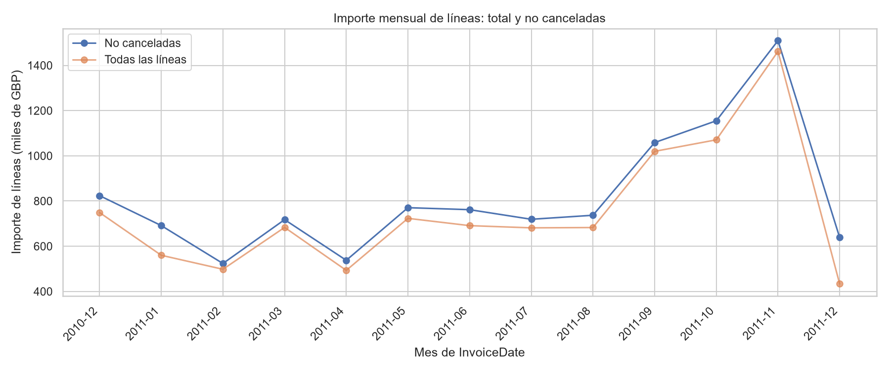
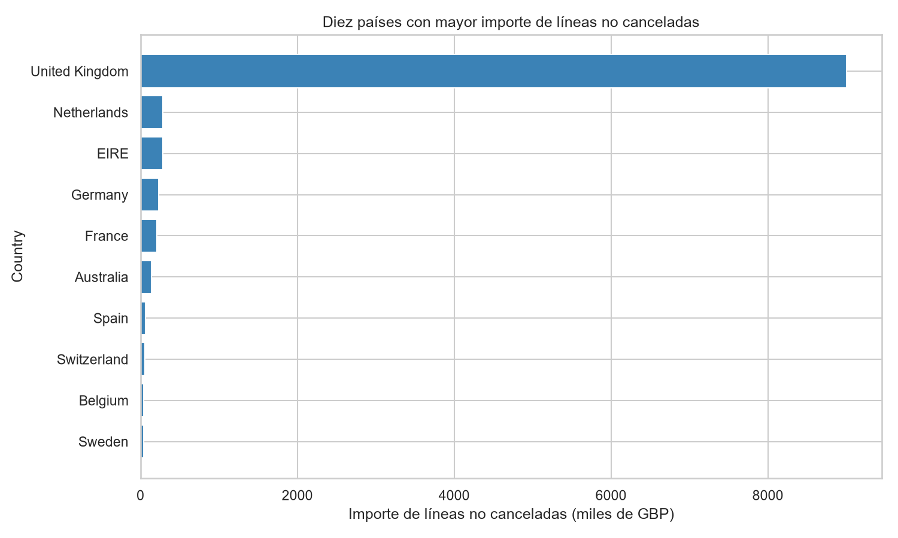
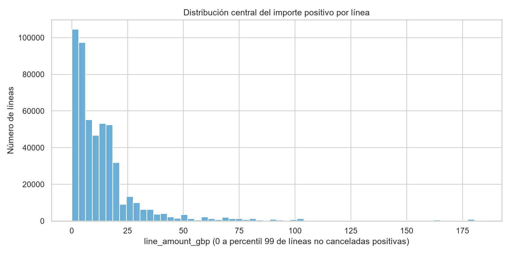
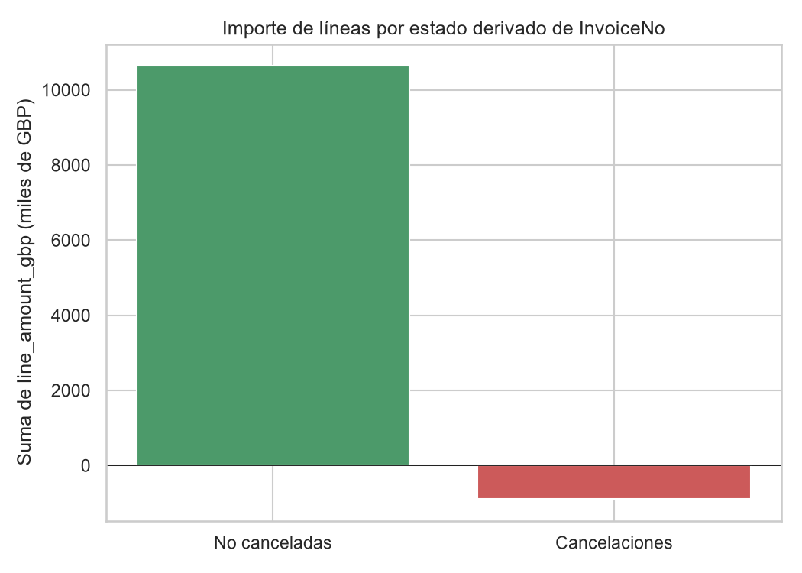

# Resumen ejecutivo

El archivo XLSX de la hoja `Online Retail` contiene 541.909 líneas de factura, 25.900 valores distintos de `InvoiceNo`, 4.070 `StockCode`, 4.372 `CustomerID` identificables y 38 categorías de `Country`. La unidad de análisis es la **línea de factura**, por lo que una factura, un cliente o un producto pueden ocupar varias filas. [STAT-001] [STAT-008]

La copia preparada conserva las 541.909 filas; se normalizaron los identificadores como texto, se serializó `InvoiceDate` en formato ISO y se derivaron `is_cancellation`, `line_amount_gbp` e `invoice_month`. No se eliminaron duplicados, ausencias, importes negativos, ceros ni extremos debido a que la documentación disponible no permite confirmarlos como errores. [STAT-007] [ISSUE-003] [ISSUE-004]

El importe agregado de las líneas no canceladas fue 10.644.560,42 GBP; las líneas cuyo `InvoiceNo` comienza por `C` —regla documental usada para `is_cancellation`— sumaron −896.812,49 GBP. Esta comparación describe importes aritméticos de línea, no ingresos netos contables. [STAT-009] [STAT-014]

La actividad no cancelada está concentrada en `United Kingdom`, con el 84,579% del importe no cancelado, y el máximo mensual observado se produjo en noviembre de 2011, con 1.509.496,33 GBP de importe no cancelado. Ambas observaciones son descriptivas y no atribuyen causas. [STAT-010] [STAT-012]

# Dataset y alcance

Se analizó el archivo de entrada en formato XLSX, hoja `Online Retail`, documentado como transacciones de una empresa británica de comercio electrónico. La documentación indica que cada registro representa una línea de factura, no necesariamente una factura completa, una compra única ni un cliente único. [STAT-001]

Las ocho variables de origen son `InvoiceNo`, `StockCode`, `Description`, `Quantity`, `InvoiceDate`, `UnitPrice`, `CustomerID` y `Country`. Los identificadores `InvoiceNo`, `StockCode` y `CustomerID` se trataron como categorías nominales, no como variables cuantitativas. `UnitPrice` se interpreta en GBP de acuerdo con la documentación, mientras que `line_amount_gbp` es una variable derivada definida como `Quantity * UnitPrice`. [STAT-001] [STAT-014]

El alcance es exploratorio y descriptivo: se examinan líneas, facturas agregadas, meses, países, productos/conceptos y clientes identificables. No se entrenaron modelos predictivos ni se realizaron inferencias causales.

# Inspección, calidad y preparación

La carga recuperó 541.909 filas y 8 columnas de origen. Los tipos cargados fueron coherentes en lo esencial: `Quantity` era entero, `UnitPrice` numérico decimal e `InvoiceDate` fecha-hora; varios identificadores se cargaron como objetos o como valor numérico, por lo que se normalizaron semánticamente para preservar su carácter nominal. [STAT-001] [STAT-007]

La copia `prepared_data.csv` conserva todas las filas y añade tres campos:

- `is_cancellation`: indicador booleano de que `InvoiceNo` empieza por `C`, conforme a la regla publicada.
- `line_amount_gbp`: producto aritmético de `Quantity` y `UnitPrice`.
- `invoice_month`: mes de `InvoiceDate` en formato `YYYY-MM`. [STAT-007]

`InvoiceNo`, `StockCode` y `CustomerID` se almacenaron como texto; `CustomerID` permanece vacío cuando el valor original era ausente. `InvoiceDate` se exportó en formato ISO 8601. Estas decisiones evitan convertir identificadores en escalas numéricas y hacen explícita la temporalidad. [STAT-007]

No se imputaron las 135.080 ausencias de `CustomerID` (24,927% de las líneas) ni las 1.454 ausencias de `Description` (0,268%). En consecuencia, los análisis por cliente se restringen explícitamente a líneas identificadas y los rankings que requieren descripción declaran su filtro. [STAT-002] [ISSUE-001] [ISSUE-002]

# Estadística descriptiva

Hay 25.900 facturas distintas; la mediana es de 10 líneas por `InvoiceNo`, mientras que el máximo alcanza 1.114 líneas. Que un `InvoiceNo` se repita es consistente con la unidad de análisis y no se consideró un duplicado por sí mismo. [STAT-003]

Se detectaron 5.268 filas exactamente duplicadas. Se conservaron porque la documentación no distingue una repetición transaccional legítima de una duplicación técnica. Por tanto, los conteos y sumas incluyen estas ocurrencias. [STAT-003] [ISSUE-003]

En el conjunto completo, `Quantity` tiene mediana 3, cuartiles 1 y 10, mínimo −80.995 y máximo 80.995. `UnitPrice` tiene mediana 2,08 GBP, cuartiles 1,25 y 4,13 GBP, mínimo −11.062,06 GBP y máximo 38.970 GBP. El importe de línea tiene mediana 9,75 GBP, percentil 99 de 180 GBP, mínimo −168.469,60 GBP y máximo 168.469,60 GBP. Estas amplitudes evidencian una distribución fuertemente asimétrica. [STAT-006]

Hay 10.624 líneas con `Quantity` negativa, 2 con `UnitPrice` negativo y 2.515 con `UnitPrice` igual a cero. Las reglas IQR aplicadas únicamente como diagnóstico sitúan los límites superiores en 23,5 unidades y 8,45 GBP, respectivamente; 56.635 líneas no canceladas superan el primer límite y 37.999 el segundo. Superar dichos límites no prueba que una observación sea errónea. [STAT-006] [ISSUE-004]

La regla de cancelación identificó 9.288 líneas y 3.836 facturas con prefijo `C`. Todas esas líneas tienen `Quantity` negativa y su importe agregado es −896.812,49 GBP. Las restantes 532.621 líneas representan 22.064 facturas, suman 5.454.024 unidades y 10.644.560,42 GBP de importe de línea; aun así incluyen 1.336 líneas con cantidad negativa y 2.515 con precio cero. [STAT-009]

# Variables, agregaciones y relaciones

La cobertura observada va de `2010-12-01T08:26:00` a `2011-12-09T12:50:00`: 374 días calendario inclusivos y registros en 305 días. No hay fechas ausentes. El inicio en diciembre de 2010 y el cierre el 9 de diciembre de 2011 implican que los dos meses de borde tienen cobertura parcial respecto de un mes calendario completo. [STAT-005] [ISSUE-006]

El importe no cancelado mensual alcanza su máximo en noviembre de 2011 con 1.509.496,33 GBP, 84.711 líneas y 3.462 facturas. En contraste, diciembre de 2011 solo contiene actividad hasta el día 9; su importe no cancelado de 638.792,68 GBP no es directamente comparable con un mes completo. [STAT-005] [STAT-012]

En líneas no canceladas, `United Kingdom` aporta 9.003.097,96 GBP de importe de línea, 487.622 líneas y 20.122 facturas; representa el 84,579% del importe no cancelado total. Le siguen `Netherlands` (285.446,34 GBP), `EIRE` (283.453,96 GBP), `Germany` (228.867,14 GBP) y `France` (209.715,11 GBP). Esta concentración describe las categorías registradas, no una medida de tamaño de mercado ni una comparación ajustada por población. [STAT-010]

Entre las líneas no canceladas con `CustomerID`, hay 4.339 clientes con actividad. El importe agregado por cliente tiene mediana de 674,45 GBP, media de 2.053,79 GBP y máximo de 280.206,02 GBP; los diez clientes con mayor importe representan el 17,262% del importe de esta población identificada. Estos resultados excluyen líneas sin `CustomerID`. [STAT-011] [ISSUE-001]

Para el ranking de productos o conceptos se usaron 530.104 líneas no canceladas con `Quantity > 0`, `UnitPrice > 0` y `Description` disponible. La combinación `DOT` / `DOTCOM POSTAGE` encabeza el importe con 206.248,77 GBP; le siguen `22423` / `REGENCY CAKESTAND 3 TIER` con 174.484,74 GBP y `23843` / `PAPER CRAFT , LITTLE BIRDIE` con 168.469,60 GBP en una sola línea de 80.995 unidades. El ranking contiene conceptos como envío, operaciones manuales o ajustes potenciales, por lo que no debe interpretarse exclusivamente como un ranking de artículos físicos. [STAT-013]

La comprobación de identidad confirma que `line_amount_gbp` coincide exactamente con `Quantity * UnitPrice` para las 541.909 filas. Es una relación constructiva, no una asociación independiente, y no acredita importe neto contable. [STAT-014]

# Visualizaciones y hallazgos

La evolución mensual presenta el importe total de líneas y el importe de líneas no canceladas. La separación permite observar que las cancelaciones reducen la suma total respecto a las líneas no canceladas, particularmente sin convertir la diferencia en una estimación de ingresos netos. [FIG-001] [STAT-012]

La comparación de los diez países con mayor importe no cancelado hace visible el predominio de `United Kingdom` y la distancia respecto de las siguientes categorías. La escala representa miles de GBP y el filtro excluye las líneas clasificadas como cancelaciones. [FIG-002] [STAT-010]

La distribución central de `line_amount_gbp` se limita visualmente a líneas positivas no canceladas hasta el percentil 99, para impedir que los extremos dominen el eje. El recorte es solo gráfico: no altera `prepared_data.csv` ni los resúmenes completos, que conservan los extremos y signos. [FIG-003] [STAT-006]

La comparación de importes por estado derivado muestra una suma positiva para las líneas no canceladas y una suma negativa para las facturas con prefijo `C`. Es una representación de la regla de clasificación y del importe aritmético registrado; no empareja devoluciones con ventas previas. [FIG-004] [STAT-009]

# Problemas, riesgos y anomalías

- **Cobertura incompleta de clientes.** `CustomerID` falta en 135.080 líneas (24,927%). Se mantuvo como ausencia y no se imputó; los resultados por cliente pueden no representar toda la actividad. [ISSUE-001] [STAT-002]
- **Cobertura incompleta de descripciones.** Faltan 1.454 `Description`. Se conservaron y se excluyen solo de análisis que requieren identificar el concepto. [ISSUE-002] [STAT-013]
- **Filas idénticas.** Hay 5.268 duplicados exactos. Se retuvieron por falta de una regla que determine si son un problema técnico; las sumas podrían estar afectadas si fueran copias accidentales. [ISSUE-003] [STAT-003]
- **Signos, ceros y colas extremas.** Cantidades negativas, precios nulos o negativos e importes extremos se preservaron. Parte de este patrón es compatible con cancelaciones, pero los dos importes negativos fuera de la clasificación `C` y los extremos no pueden diagnosticarse de forma concluyente con la documentación disponible. [ISSUE-004] [STAT-006] [STAT-014]
- **Catálogo no unívoco.** Hay 650 `StockCode` con más de una `Description` y 172 descripciones asociadas a más de un código; además, 113.452 descripciones tienen espacios iniciales o finales. Por ello no se realizó una consolidación automática y los rankings usan la combinación de código y descripción. [ISSUE-005] [STAT-004]
- **Bordes temporales.** La cobertura comienza en diciembre de 2010 y termina antes de finalizar diciembre de 2011. No se anualizaron ni ajustaron los agregados mensuales. [ISSUE-006] [STAT-005]

# Limitaciones e incertidumbres

La fuente disponible documenta el significado de los campos, pero no aporta reglas de negocio para descuentos, impuestos, costes, ajustes, anulaciones enlazadas con ventas originales o clasificación de clientes mayoristas. Por ello, `line_amount_gbp` se limita a un importe aritmético de línea y no equivale necesariamente a facturación neta, venta reconocida o rentabilidad. [STAT-014]

Una fila no representa una compra completa. Las facturas tienen número variable de líneas, de modo que los análisis a nivel de línea dan más peso a facturas extensas que a facturas con pocos conceptos. [STAT-003]

La clasificación `is_cancellation` usa exclusivamente el prefijo `C` de `InvoiceNo`, tal como indica la documentación. Aunque las líneas así clasificadas tienen cantidades negativas en este archivo, no puede inferirse que cada una cancele una línea de venta concreta ni calcularse una tasa de devolución emparejada. [STAT-009]

Los análisis por cliente se limitan a líneas con identificador disponible y los resultados por producto dependen del filtro positivo y de la combinación `StockCode`–`Description`. La alta concentración observada puede estar influida por operaciones de gran volumen, conceptos de envío y valores extremos conservados. [STAT-011] [STAT-013] [ISSUE-001] [ISSUE-005]

# Conclusiones

El dataset proporciona una base amplia para describir líneas de facturación, con cobertura desde diciembre de 2010 hasta diciembre de 2011, 25.900 facturas registradas y una estructura de alta cardinalidad en clientes, códigos y descripciones. [STAT-005] [STAT-008]

El patrón principal es de concentración: `United Kingdom` domina el importe de líneas no canceladas y los agregados de clientes muestran una cola alta. La actividad mensual no cancelada alcanza el máximo observado en noviembre de 2011, aunque los meses de borde requieren cautela comparativa. [STAT-010] [STAT-011] [STAT-012]

Las cancelaciones según el prefijo documentado `C`, los valores negativos, precios cero y extremos son materialmente relevantes para cualquier lectura monetaria. Se conservaron para preservar trazabilidad, y los resultados deben interpretarse como descripciones de importes de línea registrados, no como resultados contables netos ni explicaciones causales del comportamiento comercial. [STAT-006] [STAT-009] [ISSUE-004]