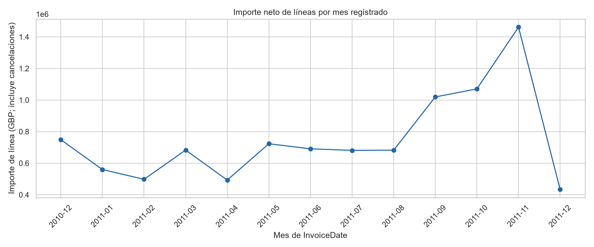
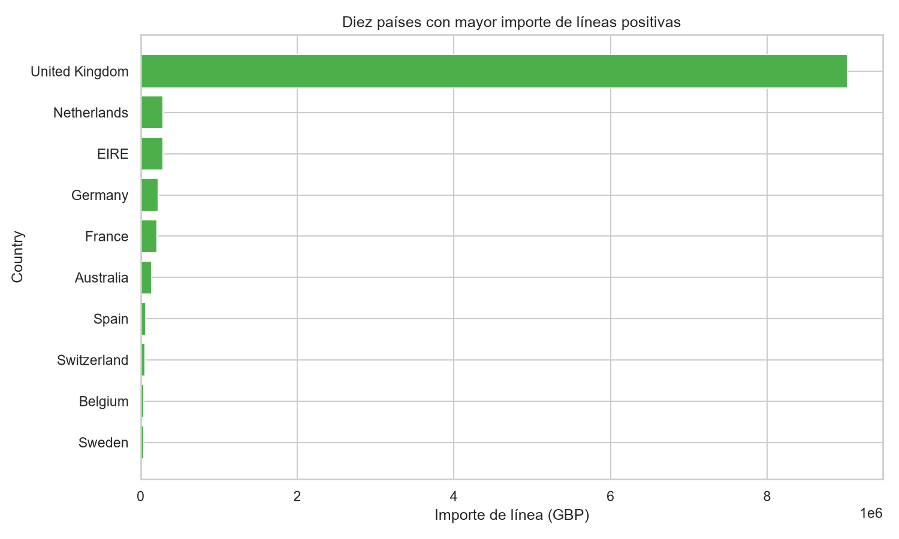
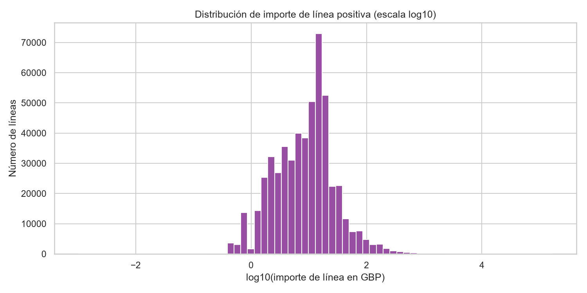
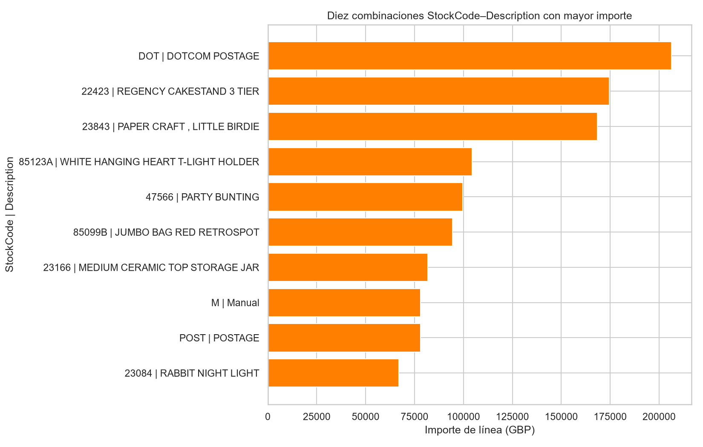

# Resumen ejecutivo

El archivo XLSX contiene 541.909 líneas de factura y 8 variables fuente. La unidad de observación es una línea registrada en una factura, por lo que no equivale necesariamente a una compra completa, una factura agregada ni un cliente. [STAT-001]

Se conservó íntegramente la población en `prepared_data.csv` (541.909 filas), se normalizaron los tipos semánticos de identificadores y se añadieron `is_cancellation`, `line_amount`, `invoice_month` y `customer_identified`. No se imputaron ausencias ni se eliminaron duplicados, cancelaciones o valores extremos debido a la incertidumbre sobre su naturaleza. [STAT-006] [ISSUE-001] [ISSUE-003] [ISSUE-004]

Para describir ventas ordinarias se definió una población explícita: líneas sin prefijo `C`, con `Quantity > 0` y `UnitPrice > 0`. Esta población contiene 530.104 líneas, 5.588.376 unidades y un importe de líneas de £10.666.684,54. La mediana del importe por línea es £9,90, frente a una media de £20,12, lo que evidencia una distribución con cola derecha. [STAT-008]

`United Kingdom` concentra £9.025.222,08, equivalente al 84,61% del importe de líneas positivas; `Netherlands`, `EIRE`, `Germany` y `France` le siguen a mucha distancia. [STAT-010] Los resultados por cliente deben interpretarse con cautela porque `CustomerID` falta en el 24,93% de las líneas. [STAT-002] [ISSUE-001]

# Dataset y alcance

El dataset analizado es la hoja `Online Retail` de un archivo XLSX. La documentación pública indica que recoge transacciones de una empresa británica de comercio electrónico entre diciembre de 2010 y diciembre de 2011, y especifica que cada fila representa una línea de factura. También establece que un `InvoiceNo` que comienza por `C` corresponde a una cancelación.

La carga identificó las variables `InvoiceNo`, `StockCode`, `Description`, `Quantity`, `InvoiceDate`, `UnitPrice`, `CustomerID` y `Country`. Los tipos observados eran coherentes en términos generales con su uso, salvo que identificadores nominales aparecían como `object` o, en el caso de `CustomerID`, como `float64`. [STAT-001]

El alcance se limita a describir las líneas registradas, sus agregaciones y sus asociaciones. `line_amount` se calcula como `Quantity × UnitPrice`; representa un importe de línea derivado, no una medida contable conciliada de ingresos, cobros, margen, entrega o rentabilidad. [STAT-006] [STAT-009]

# Inspección, calidad y preparación

La tabla original tiene 541.909 filas y 8 columnas. No hay ausencias en `InvoiceNo`, `StockCode`, `Quantity`, `InvoiceDate`, `UnitPrice` ni `Country`; sí hay 1.454 ausencias en `Description` (0,27%) y 135.080 en `CustomerID` (24,93%). Se observaron 4.070 `StockCode`, 4.372 clientes identificados y 38 países. [STAT-002]

La copia preparada mantiene las 541.909 filas, incorpora 4 variables derivadas y queda con 12 columnas. `InvoiceNo`, `StockCode` y `CustomerID` se trataron como cadenas nominales, para evitar operaciones métricas sobre identificadores. `InvoiceDate` se conservó como fecha-hora y se serializa de manera no ambigua en el CSV. [STAT-006]

Las transformaciones fueron:

- Estandarización de identificadores y etiquetas textuales: `InvoiceNo`, `StockCode` y `CustomerID` se preservaron como identificadores; se recortaron espacios periféricos de `Description` y `Country`.
- Creación de `is_cancellation`, basada exclusivamente en el prefijo `C` documentado en `InvoiceNo`.
- Creación de `line_amount = Quantity × UnitPrice`; la diferencia absoluta máxima frente a la identidad calculada fue 0.
- Creación de `invoice_month` y `customer_identified` para las agregaciones temporales y para separar la cobertura de análisis por cliente.
- Conservación de todas las filas, incluidos faltantes, duplicados exactos, signos negativos, precios nulos y extremos. [STAT-006]

No se imputaron `CustomerID` ni `Description`, pues el archivo no proporciona una fuente verificable para reconstruirlos. [ISSUE-001] [ISSUE-002] No se eliminaron los 5.268 registros duplicados más allá de la primera aparición: la igualdad exacta entre los ocho campos fuente no permite distinguir una duplicación técnica de líneas operativas legítimamente repetidas. [STAT-003] [ISSUE-003]

# Estadística descriptiva

En el conjunto completo se identificaron 25.900 valores distintos de `InvoiceNo`, de los cuales 3.836 corresponden a facturas de cancelación y 22.064 a facturas sin el prefijo `C`. Hay 9.288 líneas de cancelación, que representan el 1,71% de todas las líneas. [STAT-004] [STAT-007]

Las 9.288 líneas con prefijo `C` tienen `Quantity` negativa. Además, existen 1.336 líneas sin prefijo `C` con cantidad negativa, por lo que el signo por sí solo no sustituye la regla documental de cancelación. Se observaron 2.515 precios unitarios iguales a cero y 2 precios negativos; no hay cantidades iguales a cero. [STAT-004] [ISSUE-004]

Para la población de ventas ordinarias positivas —sin prefijo `C`, `Quantity > 0`, `UnitPrice > 0`— las estadísticas principales son:

| Medida | `Quantity` | `UnitPrice` (GBP) | `line_amount` (GBP) |
|---|---:|---:|---:|
| Líneas válidas | 530.104 | 530.104 | 530.104 |
| Mediana | 3 | 2,08 | 9,90 |
| Media | 10,54 | 3,91 | 20,12 |
| Percentil 75 | 10 | 4,13 | 17,70 |
| Percentil 99 | 100 | 16,98 | 183,60 |
| Máximo | 80.995 | 13.541,33 | 168.469,60 |

[STAT-008]

La distancia entre mediana, media y máximos muestra asimetría importante. En particular, el importe por línea tiene un máximo de £168.469,60, por lo que la media no debe interpretarse como una línea típica sin acompañarla de cuantiles. [STAT-008]

En la población completa, que incluye cancelaciones, importes negativos y precios nulos, `Quantity` varía entre −80.995 y 80.995, y `line_amount` entre −£168.469,60 y £168.469,60. [STAT-004]

# Variables, agregaciones y relaciones

La cobertura efectiva de `InvoiceDate` va desde el 1 de diciembre de 2010 a las 08:26 hasta el 9 de diciembre de 2011 a las 12:50, sin fechas ausentes ni no parseables. [STAT-005] La ventana observada de diciembre de 2010 termina el día 23 y la de diciembre de 2011 termina el día 9; ambos periodos son parciales y no son directamente comparables con meses completos. [STAT-005] [ISSUE-005]

La agregación mensual de todas las líneas, incluyendo cancelaciones, alcanza su mayor importe neto registrado en noviembre de 2011 (£1.461.756,25; 84.711 líneas) y el segundo mayor valor en octubre de 2011 (£1.070.704,67; 60.742 líneas). El total de importes de línea de la población completa es £9.747.747,93. [STAT-009]

En las ventas ordinarias positivas, `United Kingdom` reúne 485.123 líneas, 18.019 facturas, 4.662.390 unidades y £9.025.222,08. Su participación de 84,61% refleja una concentración geográfica muy elevada dentro de la población definida. `Netherlands` (£285.446,34), `EIRE` (£283.453,96), `Germany` (£228.867,14) y `France` (£209.715,11) ocupan las siguientes posiciones por importe. Esto es una descripción de los registros incluidos, no una comparación ajustada por tamaño de mercado ni una explicación causal. [STAT-010]

El ranking por `StockCode` y `Description` muestra que `DOT | DOTCOM POSTAGE` acumula £206.248,77 en 706 líneas. Entre artículos con apariencia de producto, `22423 | REGENCY CAKESTAND 3 TIER` suma £174.484,74, mientras que `23843 | PAPER CRAFT , LITTLE BIRDIE` suma £168.469,60 en una sola línea de 80.995 unidades. [STAT-011] Los rankings deben leerse con cautela: incluyen conceptos como `DOT`, `POST` y `M`, cuyas descripciones sugieren cargos o registros manuales, no productos homogéneos comparables. [STAT-011]

Entre las líneas positivas con `CustomerID` presente, se agregaron 4.338 clientes. La mediana es de 2 facturas por cliente y £674,49 de importe acumulado; la media de importe es £2.054,27 y el máximo es £280.206,02, otra señal de concentración y asimetría. Estos resultados no cubren líneas sin identificador de cliente. [STAT-012] [ISSUE-001]

Las correlaciones de Spearman en las ventas ordinarias positivas muestran una asociación monotónica negativa entre `Quantity` y `UnitPrice` (−0,403), y asociaciones positivas entre `Quantity` y `line_amount` (0,676) y entre `UnitPrice` y `line_amount` (0,338). Esto es consistente con la identidad de `line_amount`, pero no identifica mecanismos ni relaciones causales. [STAT-013]

La correspondencia entre `StockCode` y `Description` no es estrictamente uno a uno: de 3.958 códigos con descripción no vacía, 647 se asocian a más de una descripción, y un código llega a tener 8 descripciones distintas. Por ello, los rankings se presentan usando ambos campos conjuntamente. [STAT-013] [ISSUE-006]

# Visualizaciones y hallazgos

La evolución mensual representa el importe de todas las líneas, incluidas cancelaciones. Confirma el incremento observado en septiembre, octubre y noviembre de 2011, pero la lectura de los diciembres debe condicionarse a su cobertura parcial. [FIG-001] [STAT-005] [STAT-009]

La comparación geográfica hace visible la concentración de las líneas positivas en `United Kingdom`, que representa más de cuatro quintas partes del importe de esta población. [FIG-002] [STAT-010]

La distribución de `line_amount` se muestra en escala `log10` para conservar legibilidad frente a valores muy altos. La mayor parte de las líneas se concentra en importes bajos respecto de la cola superior, coherente con la diferencia entre la mediana de £9,90 y el máximo de £168.469,60. [FIG-003] [STAT-008] [STAT-014]

El gráfico de las diez combinaciones `StockCode`–`Description` con mayor importe permite distinguir la presencia de cargos como `DOTCOM POSTAGE` y registros como `Manual` frente a descripciones de productos. Por tanto, no debe utilizarse como un ranking puro de artículos físicos sin una clasificación adicional validada. [FIG-004] [STAT-011]

# Problemas, riesgos y anomalías

- **Ausencia de `CustomerID`:** 135.080 líneas (24,93%) carecen de identificador de cliente. Se conservaron vacías y se creó `customer_identified`; los análisis de clientes se restringen explícitamente a los registros identificables. Esto puede sesgar la representatividad de los patrones por cliente si la ausencia no es aleatoria. [ISSUE-001] [STAT-002] [STAT-012]

- **Ausencia de `Description`:** 1.454 líneas (0,27%) no tienen descripción. No se imputaron; afectan a la capacidad de etiquetar artículos, aunque no impiden conservar el `StockCode`. [ISSUE-002] [STAT-002]

- **Duplicados exactos:** hay 5.268 filas duplicadas más allá de la primera, equivalentes al 0,97% de las líneas. Se retuvieron porque no hay un identificador de línea ni otra evidencia que determine que sean errores. Si fueran duplicaciones técnicas, podrían inflar conteos e importes. [ISSUE-003] [STAT-003]

- **Cancelaciones, cantidades negativas y precios nulos:** las 9.288 líneas con prefijo `C` tienen cantidad negativa, pero existen otras 1.336 líneas negativas sin dicho prefijo; además hay 2.515 precios nulos y 2 negativos. Se conservaron para preservar el registro, pero se excluyeron de la población analítica de ventas ordinarias positivas. [ISSUE-004] [STAT-004] [STAT-008]

- **Cobertura temporal desigual:** diciembre de 2010 y diciembre de 2011 no cubren meses completos en las fechas observadas. No se hicieron extrapolaciones ni ajustes por días de actividad. [ISSUE-005] [STAT-005]

- **Ambigüedad código-descripción:** 647 `StockCode` tienen más de una `Description` no vacía. Puede reflejar cambios legítimos de etiqueta, variantes o inconsistencias; no puede resolverse con los campos disponibles. [ISSUE-006] [STAT-013]

- **Extremos de importe:** con una regla exploratoria de `Q3 + 1,5×IQR`, el umbral es £38,625 y 42.651 líneas (8,05% de las ventas positivas) quedan por encima. Este cribado no prueba error: los valores se retuvieron y se utilizó escala logarítmica para visualizarlos. [ISSUE-007] [STAT-014]

# Limitaciones e incertidumbres

El análisis no permite conciliar transacciones con pagos, devoluciones efectivas, notas de crédito, costes, margen, inventario, entregas, campañas ni otros procesos operativos. En consecuencia, los importes de línea no deben presentarse como ventas contables netas.

La ausencia de `CustomerID` limita los resultados por cliente a una subpoblación identificable. Tampoco se conoce el mecanismo que generó las ausencias, por lo que no es posible evaluar si esta subpoblación es representativa. [ISSUE-001]

La documentación solo confirma la condición de cancelación mediante el prefijo `C` de `InvoiceNo`; no permite clasificar de forma concluyente todas las líneas con cantidades negativas, precios nulos, precios negativos o importes extremos. [ISSUE-004] [ISSUE-007]

Los duplicados exactos se han retenido por trazabilidad, pero su efecto potencial debe considerarse en cualquier uso posterior de totales o tasas. [ISSUE-003] Los meses extremos tienen cobertura parcial, por lo que la comparación mensual debe hacerse con cautela. [ISSUE-005]

Las correlaciones y agregaciones son descriptivas. No permiten sostener que el precio determine la cantidad, que un país explique el importe, ni que un producto cause un patrón temporal. [STAT-013]

# Conclusiones

El dataset proporciona un registro amplio de líneas de factura: 541.909 líneas, 25.900 facturas nominales, 4.070 códigos y 38 países. [STAT-001] [STAT-007] La copia preparada conserva íntegramente esa población y hace explícitas las variables necesarias para separar cancelaciones, calcular importes y agregar por mes o por cliente identificado. [STAT-006]

La actividad positiva está fuertemente concentrada en `United Kingdom`, y las distribuciones de cantidad, precio e importe son marcadamente asimétricas. La mediana de importe de una línea positiva es £9,90, mientras que el 1% superior supera £183,60 y el máximo llega a £168.469,60. [STAT-008] [STAT-010]

Los resultados son adecuados para describir la actividad registrada y comparar subpoblaciones bajo reglas explícitas. Sin embargo, toda lectura posterior debe mantener separadas las ventas ordinarias positivas, las cancelaciones y los registros especiales; además, debe reconocer las ausencias de `CustomerID`, los duplicados ambiguos, la inconsistencia parcial entre `StockCode` y `Description`, y la cobertura temporal incompleta de los meses extremos. [ISSUE-001] [ISSUE-003] [ISSUE-004] [ISSUE-005] [ISSUE-006]