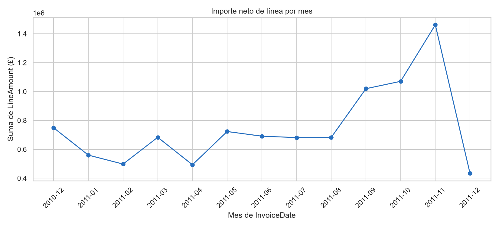
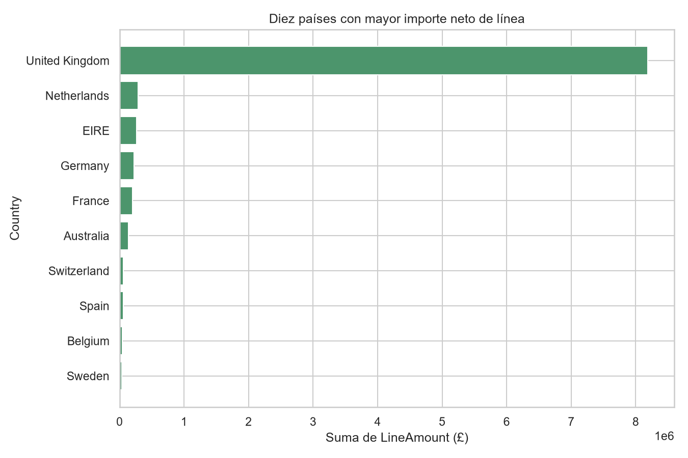
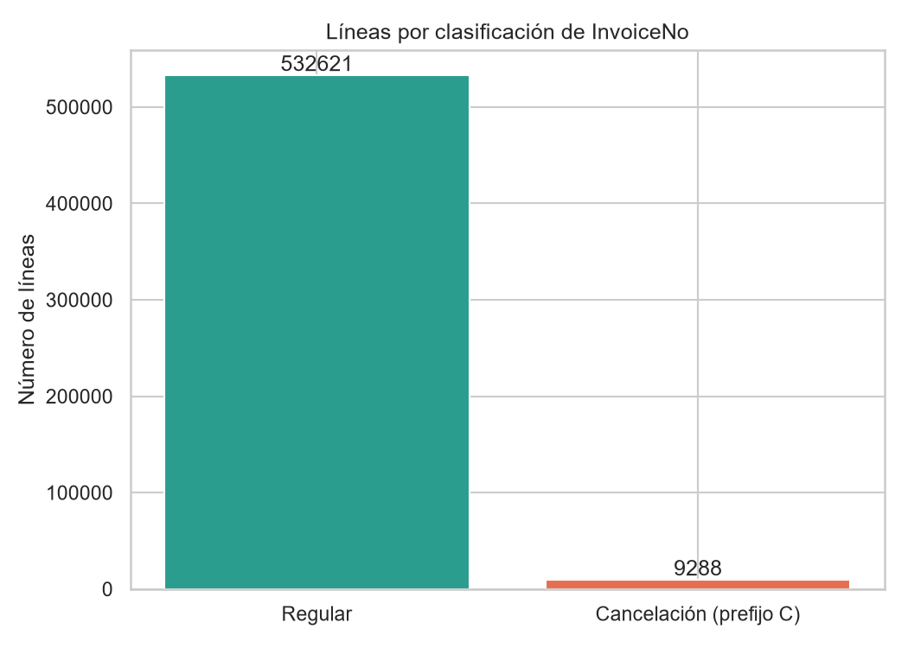
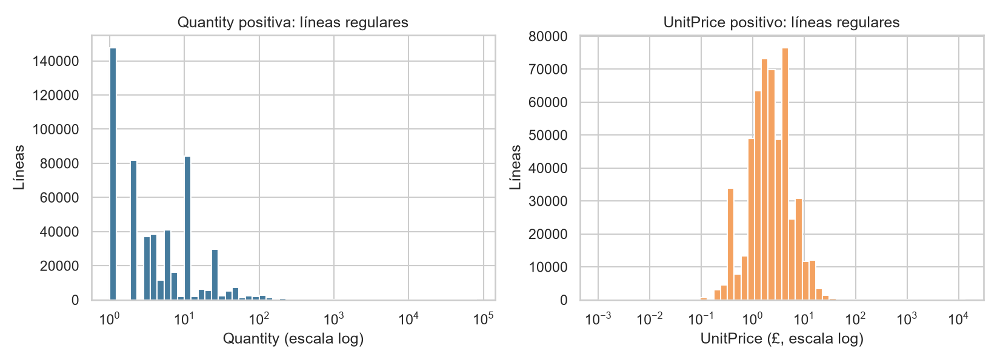
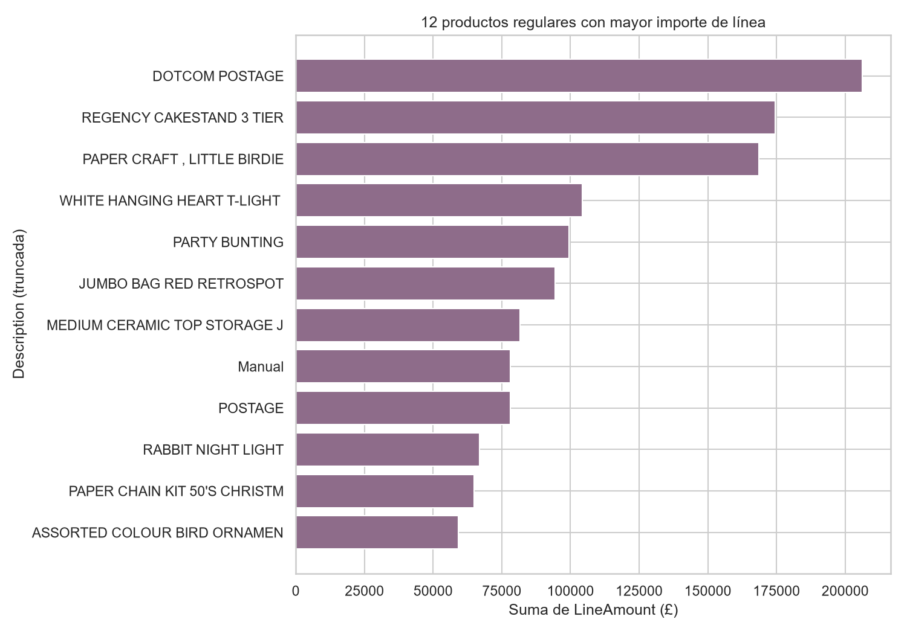

# Resumen ejecutivo

El archivo contiene 541.909 líneas de factura, correspondientes a 25.900 valores distintos de `InvoiceNo`, durante el intervalo observado entre el 1 de diciembre de 2010 y el 9 de diciembre de 2011. La unidad analítica es una línea de factura, por lo que ni una fila ni un `InvoiceNo` representan necesariamente una compra completa. [STAT-001] [STAT-004]

Se preparó una copia de trabajo con las 541.909 líneas retenidas, conversiones de identificadores a texto nominal y tres variables derivadas: `IsCancellation`, `LineAmount` e `InvoiceMonth`. No se eliminaron cancelaciones, duplicados exactos, ausencias ni valores extremos, porque la documentación disponible no permite clasificarlos con certeza como errores. [STAT-007] [ISSUE-002] [ISSUE-003]

El importe neto descriptivo de líneas (`LineAmount = Quantity × UnitPrice`) suma £9.747.747,93. Esta medida incluye registros regulares y cancelaciones, y no debe interpretarse como ingreso definitivo o cobro confirmado. [STAT-005]

Las líneas con `InvoiceNo` que comienza por `C`, clasificadas conforme a la documentación como cancelaciones, representan 9.288 líneas (1,71 %). Su suma de `LineAmount` es negativa (£−896.812,49), frente a £10.644.560,42 para las líneas no clasificadas como cancelación. [STAT-008] [STAT-012]

La actividad está muy concentrada en `United Kingdom`, que acumula £8.187.806,36 de importe neto de línea, equivalente al 84,0 % del total neto registrado. Noviembre de 2011 fue el mes con más líneas (84.711) y mayor importe neto (£1.461.756,25), aunque debe considerarse que los meses de borde pueden tener cobertura parcial. [STAT-010] [STAT-011] [ISSUE-005]

# Dataset y alcance

El dataset se cargó desde el archivo `xlsx`, hoja `Online Retail`, con ocho columnas originales: `InvoiceNo`, `StockCode`, `Description`, `Quantity`, `InvoiceDate`, `UnitPrice`, `CustomerID` y `Country`. Los tipos observados inicialmente fueron coherentes en lo esencial con el diccionario: fecha-hora para `InvoiceDate`, numéricos para `Quantity` y `UnitPrice`, y representaciones mixtas o nominales para los identificadores. [STAT-001]

Según la documentación pública, el periodo cubierto por el archivo se refiere a transacciones de una empresa británica de comercio electrónico, y cada fila es una línea de factura. El análisis es exclusivamente descriptivo y exploratorio; no se entrenaron modelos ni se realizaron inferencias causales.

El alcance incluye calidad de los registros, distribución de cantidades, precios e importes de línea, comparación descriptiva entre registros regulares y cancelaciones, agregación temporal, concentración por país, productos y clientes identificados. `LineAmount` se utiliza solo como importe aritmético de línea, calculado como `Quantity × UnitPrice`. [STAT-007]

# Inspección, calidad y preparación

La tabla original tiene 541.909 filas y 8 columnas; la copia preparada tiene el mismo número de filas y 11 columnas. Se añadieron `IsCancellation`, que identifica `InvoiceNo` con prefijo `C`; `LineAmount`, producto de `Quantity` y `UnitPrice`; e `InvoiceMonth`, derivado de `InvoiceDate`. [STAT-007]

Los identificadores `InvoiceNo`, `StockCode` y `CustomerID` se convirtieron a texto nominal para evitar tratarlos como variables continuas. En particular, `CustomerID` se serializó sin el sufijo decimal introducido por su representación original de punto flotante. También se quitaron espacios periféricos de `Description` y `Country`, sin imputar valores ausentes. [STAT-007]

Las ausencias se concentran en `CustomerID`: 135.080 líneas, el 24,93 % del archivo. `Description` falta en 1.454 líneas, el 0,27 %; no hay ausencias en los demás campos originales. [STAT-002] Esta ausencia limita específicamente los análisis de clientes y descripciones. [ISSUE-001]

Se detectaron 5.268 filas duplicadas exactas, el 0,97 % del archivo. Se conservaron porque, al no existir un identificador propio de línea ni una regla documental de deduplicación, una fila idéntica puede corresponder a un registro comercial separado. La repetición de `InvoiceNo`, `StockCode` o `CustomerID` no se trató como duplicación, ya que es esperable a esta granularidad. [STAT-003] [ISSUE-002]

La cobertura efectiva de `InvoiceDate` va desde `2010-12-01T08:26:00` hasta `2011-12-09T12:50:00`, sin fechas ausentes. [STAT-004] Diciembre de 2010 y diciembre de 2011 pueden ser periodos parciales, por lo que sus valores mensuales no deben compararse mecánicamente con meses completos. [ISSUE-005]

# Estadística descriptiva

El archivo contiene 25.900 facturas distintas, 4.070 valores de `StockCode`, 4.372 `CustomerID` no ausentes y 38 países. De las 541.909 líneas, 532.621 no se clasifican como cancelación y 9.288 sí lo hacen según el prefijo documentado. [STAT-003] [STAT-008]

En todas las líneas, `Quantity` tiene mediana 3, cuartil inferior 1 y cuartil superior 10; su mínimo es −80.995 y su máximo 80.995. `UnitPrice` tiene mediana £2,08, cuartiles £1,25 y £4,13, mínimo £−11.062,06 y máximo £38.970. `LineAmount` presenta mediana £9,75, cuartiles £3,40 y £17,40, con un intervalo de £−168.469,60 a £168.469,60. [STAT-005]

Las distribuciones tienen colas amplias: el percentil 99 de `Quantity` es 100, el de `UnitPrice` es £18,00 y el de `LineAmount` es £180,00. Por ello, las medias son sensibles a los extremos y se complementaron con mediana y cuantiles. [STAT-005]

Se observaron 10.624 líneas con `Quantity` negativa, 2 con `UnitPrice` negativo, 2.515 con `UnitPrice` igual a cero y 11.805 con `LineAmount` no positivo. Estos registros se retuvieron: la documentación disponible no permite decidir si son devoluciones, ajustes, errores o conceptos comerciales válidos. [STAT-005] [ISSUE-003]

La separación por clasificación de factura muestra una diferencia de signo esperable en los agregados: las líneas regulares suman 5.454.024 unidades y £10.644.560,42 de `LineAmount`; las líneas de cancelación suman −277.574 unidades y £−896.812,49. La mediana de `LineAmount` es £9,90 en líneas regulares y £−8,50 en cancelaciones. [STAT-009] [STAT-012]

# Variables, agregaciones y relaciones

La actividad mensual varía de forma marcada. Noviembre de 2011 concentra 84.711 líneas, 3.462 facturas, 740.286 unidades netas y £1.461.756,25 de importe neto de línea: es el máximo mensual observado en líneas e importe. [STAT-011] No se atribuye esta variación a una causa concreta.

La participación de líneas de cancelación varía por mes entre aproximadamente 1,27 % y 1,99 %; en noviembre de 2011 fue 1,27 %, mientras que en enero de 2011 fue 1,99 %. Estas son diferencias descriptivas de registros clasificados por prefijo, no una medida del motivo ni de la tasa de devolución comercial. [STAT-011] [STAT-012]

`United Kingdom` concentra 495.478 líneas, 23.494 facturas y £8.187.806,36 de importe neto de línea. Los siguientes países por importe neto son `Netherlands` (£284.661,54), `EIRE` (£263.276,82), `Germany` (£221.698,21) y `France` (£197.403,90). [STAT-010] Esta concentración condiciona cualquier comparación internacional agregada.

En líneas regulares, el ranking de combinaciones `StockCode`–`Description` por importe de línea está encabezado por `DOT` / `DOTCOM POSTAGE` (£206.248,77), `22423` / `REGENCY CAKESTAND 3 TIER` (£174.484,74) y `23843` / `PAPER CRAFT , LITTLE BIRDIE` (£168.469,60). El tercer caso procede de una sola línea con 80.995 unidades, por lo que ilustra la influencia de extremos sobre los rankings por importe. [STAT-013]

El análisis de clientes se restringió a 397.924 líneas regulares con `CustomerID` disponible, agrupadas en 4.339 clientes. El importe de línea regular por cliente tiene mediana £674,45, frente a media £2.053,79; el número de facturas por cliente tiene mediana 2 y media 4,27. La diferencia entre media y mediana es consistente con concentración y cola alta en la actividad identificada. [STAT-014] No es válido extender estos resultados a líneas sin `CustomerID`. [ISSUE-001]

Para 530.104 líneas regulares con `Quantity` y `UnitPrice` positivos, la correlación de Spearman entre ambas variables es −0,403. Es una asociación monotónica negativa moderada en la población filtrada; no identifica un mecanismo causal y no resume los registros excluidos del filtro, como cancelaciones, ceros o valores negativos. [STAT-015]

La correspondencia entre `StockCode` y `Description` no es estrictamente única: 647 códigos tienen más de una descripción no nula y el máximo observado para un código es ocho descripciones. Por ello, los productos se clasificaron en el ranking mediante la combinación de ambos campos, no imponiendo una correspondencia uno a uno. [STAT-006] [ISSUE-004]

# Visualizaciones y hallazgos

La evolución mensual muestra el incremento del importe neto de línea hacia septiembre, octubre y noviembre de 2011, y el máximo registrado en noviembre. La figura presenta importes netos que incluyen cancelaciones y los meses de borde deben interpretarse con cautela. [FIG-001] [STAT-011] [ISSUE-005]

La comparación de los diez países principales visualiza el fuerte predominio de `United Kingdom` en el importe neto de línea y permite contextualizar los importes mucho menores de los demás países. [FIG-002] [STAT-010]

El gráfico de clasificación confirma visualmente que las líneas con prefijo `C` son una minoría del total de líneas. Esta clasificación procede de la definición documental y no prueba que todas las operaciones asociadas tengan la misma naturaleza comercial. [FIG-003] [STAT-008] [STAT-012]

Las distribuciones de `Quantity` y `UnitPrice` se muestran en escala logarítmica y solo para líneas regulares con valores positivos. Esta decisión visual evita mezclar signos y permite mostrar concentración y cola sin eliminar los registros de la copia preparada. [FIG-004] [STAT-005] [STAT-015]

El gráfico de productos utiliza las doce combinaciones `StockCode`–`Description` con mayor importe agregado en líneas regulares. La figura debe interpretarse junto con el número de líneas y unidades, porque algunos resultados pueden estar dominados por un número reducido de observaciones extremas. [FIG-005] [STAT-013]

# Problemas, riesgos y anomalías

Las ausencias de `CustomerID` afectan a 135.080 líneas y son el principal riesgo para los análisis a nivel cliente. No se imputaron identificadores, y los resultados de clientes se declararon explícitamente sobre la población identificada. [ISSUE-001]

Los 5.268 duplicados exactos se mantuvieron para preservar la población original. Si una fracción de ellos fuese duplicación técnica, los conteos y sumas de líneas podrían estar sobreestimados; no es posible determinarlo con la evidencia disponible. [ISSUE-002]

Los valores no positivos y extremos de `Quantity`, `UnitPrice` y `LineAmount` se registraron como riesgo de interpretación, no como errores confirmados. Se mantuvieron en los agregados generales y se aplicaron filtros explícitos solamente a la correlación y visualización de valores positivos regulares. [ISSUE-003]

La relación no única entre `StockCode` y `Description` puede afectar agregaciones que usen solo uno de los dos campos. Para reducir este riesgo en el ranking, se utilizó la combinación de código y descripción. [ISSUE-004]

La cobertura empieza el 1 de diciembre de 2010 y termina el 9 de diciembre de 2011; no hay evidencia para afirmar que los meses extremos sean completos. No se realizaron anualizaciones ni extrapolaciones. [ISSUE-005]

# Limitaciones e incertidumbres

`LineAmount` es un producto aritmético de línea y no una medida confirmada de pago, ingreso neto, rentabilidad, descuento, envío o valor final de una compra. Sus sumas incorporan cancelaciones, precios cero, conceptos no convencionales y extremos. [STAT-005] [STAT-012]

La documentación identifica el prefijo `C` como cancelación, pero no proporciona una relación verificable entre una cancelación y una factura original, ni explica el proceso operativo que genera cada registro. Por ello, las comparaciones entre clases de factura son descriptivas. [STAT-008] [ISSUE-003]

Los resultados de clientes están limitados por la ausencia de `CustomerID` en casi una cuarta parte de las líneas. La falta de identificador no se puede suponer aleatoria ni puede resolverse mediante imputación sin evidencia adicional. [STAT-002] [ISSUE-001]

No se dispone de reglas operativas para decidir qué duplicados exactos, códigos especiales, precios no positivos o extremos son errores. La decisión conservadora fue preservar estas filas, documentar su alcance y usar medidas robustas y filtros analíticos explícitos cuando eran necesarios. [ISSUE-002] [ISSUE-003] [STAT-007]

# Conclusiones

El EDA confirma que se trata de una tabla de líneas de factura con alta concentración geográfica y heterogeneidad marcada en cantidades, precios e importes. La población completa incluye 541.909 líneas, 25.900 facturas distintas y 38 países; `United Kingdom` concentra aproximadamente el 84,0 % del importe neto de línea. [STAT-008] [STAT-010]

La actividad mensual registrada alcanza su mayor nivel observado en noviembre de 2011, tanto por líneas como por importe neto; esta descripción debe contextualizarse por la posible parcialidad temporal de los meses extremos. [STAT-011] [ISSUE-005]

Las cancelaciones son minoritarias por número de líneas, pero afectan a las sumas netas y deben mantenerse separadas de las líneas regulares para interpretar cantidades e importes. [STAT-008] [STAT-009] [STAT-012]

La copia preparada conserva el universo original y hace explícitas las transformaciones analíticas, sin convertir incertidumbres de calidad en exclusiones automáticas. Los resultados más sensibles son los análisis por cliente, por las ausencias de `CustomerID`, y las medias, sumas o rankings dominados potencialmente por valores extremos o duplicados exactos. [STAT-007] [ISSUE-001] [ISSUE-002] [ISSUE-003]