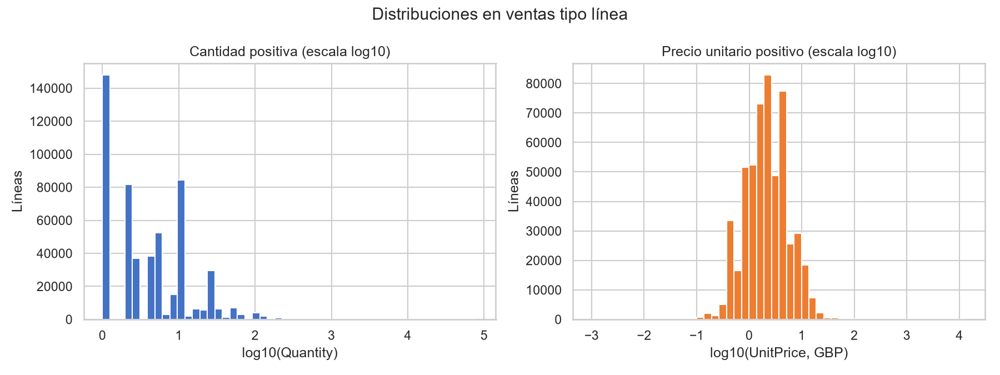
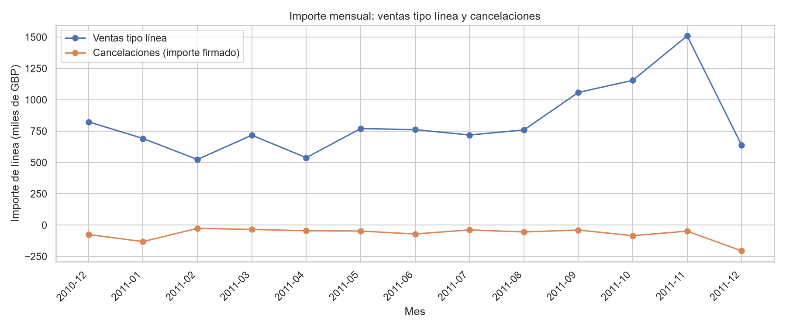
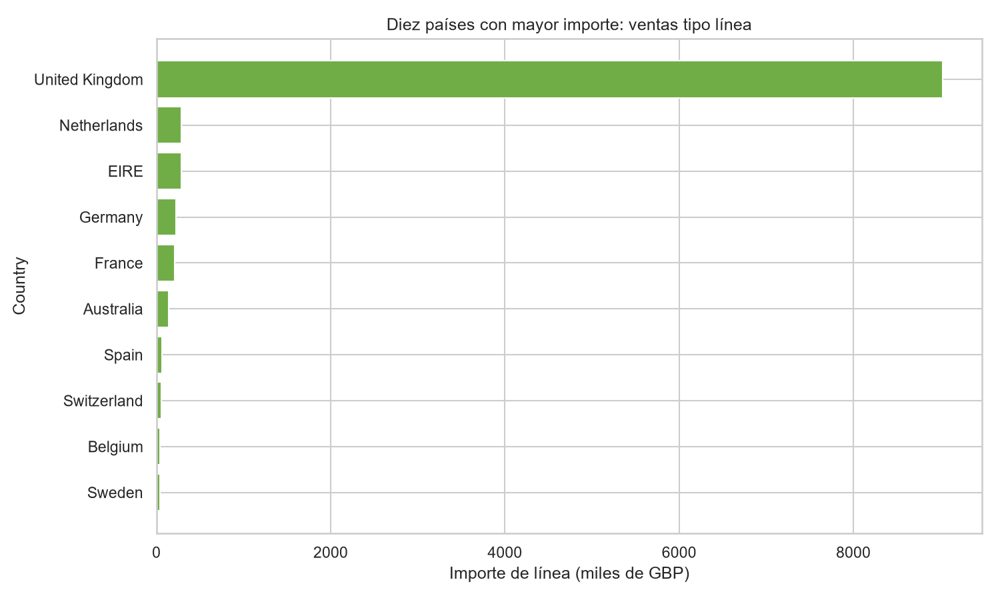
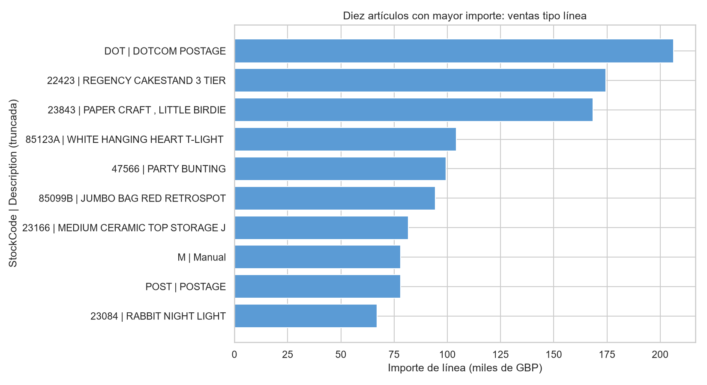
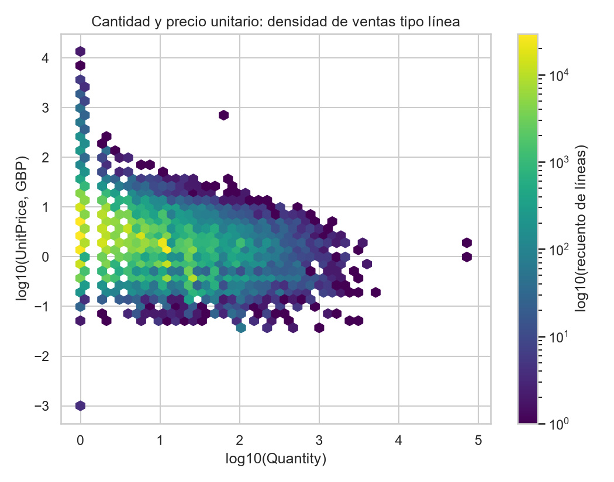

# Resumen ejecutivo

El archivo `Online Retail` contiene 541.909 líneas de factura y ocho variables fuente; el periodo observado va desde 2010-12-01 08:26 hasta 2011-12-09 12:50. La documentación disponible establece que una fila es una **línea de factura**, no una factura completa ni una compra completa. [STAT-001]

Se generó una copia preparada de 541.909 filas y 11 columnas, sin eliminar registros. Se estabilizaron como texto los identificadores nominales y se añadieron `IsCancellation`, `LineAmount` (`Quantity × UnitPrice`) y `YearMonth`. [STAT-001] [STAT-009] [STAT-010]

Para describir actividad comercial se definió el subconjunto de **ventas tipo línea**: `IsCancellation=False`, `Quantity>0` y `UnitPrice>0`. Este subconjunto contiene 530.104 líneas, 19.960 facturas y un importe de línea acumulado de £10.666.684,54; no sustituye a la población íntegra. [STAT-010] [STAT-011]

La actividad de ventas tipo línea está muy concentrada en `United Kingdom`, con £9.025.222,08 (84,61% del importe de ese subconjunto). El mayor importe mensual de ventas tipo línea se observó en noviembre de 2011, £1.509.496,33; diciembre de 2011 sólo está cubierto hasta el día 9. [STAT-012] [STAT-013] [ISSUE-004]

# Dataset y alcance

El dataset procede de un libro `xlsx`, hoja `Online Retail`, con las columnas `InvoiceNo`, `StockCode`, `Description`, `Quantity`, `InvoiceDate`, `UnitPrice`, `CustomerID` y `Country`. La documentación pública indica que representa líneas de facturas de una empresa británica de comercio electrónico y que un `InvoiceNo` que empieza por `C` identifica una cancelación. [STAT-001] [STAT-004]

El análisis se limita a descripción tabular, calidad, agregaciones y asociaciones. Los importes presentados son `LineAmount = Quantity × UnitPrice`, expresados en libras esterlinas según la unidad documentada de `UnitPrice`; no se interpretan como estados financieros auditados ni como ingreso neto definitivo. [STAT-007] [STAT-009]

Las unidades se distinguen explícitamente: la observación básica es una línea; las facturas se cuentan por `InvoiceNo` distinto y las métricas de clientes se restringirían a registros con `CustomerID` disponible. Se identificaron 25.900 valores distintos de `InvoiceNo`, 4.372 clientes identificados, 4.070 `StockCode` y 38 países. [STAT-003] [STAT-010]

# Inspección, calidad y preparación

La carga no produjo fechas inválidas: `InvoiceDate` cubre desde 2010-12-01 hasta 2011-12-09. Se observan 13 meses calendario; diciembre de 2010 empieza el día 1, mientras que diciembre de 2011 termina el día 9. [STAT-001] [STAT-008]

Las principales ausencias están en `CustomerID`: faltan 135.080 valores, equivalentes a que el 75,07% de las líneas tenga cliente identificado. `Description` falta en 1.454 líneas, y esas 1.454 líneas también carecen de `CustomerID`; no hay casos de `Description` ausente con cliente disponible. [STAT-002] [ISSUE-001]

La copia preparada preserva todas las filas y columnas fuente. `InvoiceNo`, `StockCode` y `CustomerID` se serializaron como texto estable para impedir que se traten como medidas numéricas; `InvoiceDate` se exportó con formato ISO 8601. Se añadieron:

- `IsCancellation`: indicador basado exclusivamente en el prefijo `C` documentado de `InvoiceNo`.
- `LineAmount`: producto de `Quantity` y `UnitPrice`.
- `YearMonth`: mes calendario derivado de `InvoiceDate`.

La identidad de `LineAmount` se verificó con diferencia absoluta máxima igual a cero. [STAT-009]

No se deduplicaron filas: hay 5.268 duplicados exactos en las ocho variables fuente, pero el dataset no dispone de un identificador de línea que permita decidir si son duplicaciones de carga o líneas legítimas repetidas. [STAT-003] [ISSUE-002]

# Estadística descriptiva

En el total de líneas hay 9.288 líneas de cancelación, el 1,71% del dataset, asociadas a 3.836 valores distintos de `InvoiceNo` con prefijo `C`. [STAT-004] [STAT-010]

La distribución completa de `Quantity` tiene mediana 3, primer y tercer cuartil de 1 y 10, respectivamente, y rango de -80.995 a 80.995 unidades. Hay 10.624 cantidades negativas y ninguna cantidad igual a cero. [STAT-005]

`UnitPrice` presenta mediana de £2,08 y rango de -£11.062,06 a £38.970,00; hay 2 precios negativos y 2.515 precios iguales a cero. El importe de línea completo tiene mediana de £9,75, rango de -£168.469,60 a £168.469,60, 9.290 líneas negativas y 2.515 iguales a cero. [STAT-006] [STAT-007]

En ventas tipo línea, la mediana de `Quantity` es 3 unidades, la de `UnitPrice` £2,08 y la de `LineAmount` £9,90. El tercer cuartil de importe es £17,70, frente a una media de £20,12 y un máximo de £168.469,60, lo que evidencia asimetría y justifica priorizar mediana y cuantiles. [STAT-011]

La Figura 2 representa las distribuciones positivas de cantidad y precio en escala logarítmica, para hacer visibles simultáneamente la concentración de valores bajos y las colas. [FIG-002]

# Variables, agregaciones y relaciones

La serie mensual separa ventas tipo línea de cancelaciones. Noviembre de 2011 fue el mes con mayor importe de ventas tipo línea, £1.509.496,33, y 83.369 líneas. En diciembre de 2011 se registraron £638.792,68 de ventas tipo línea, pero este dato corresponde sólo a los primeros nueve días observados y no debe compararse como total mensual completo. [STAT-013] [ISSUE-004]

La comparación por `Country` en ventas tipo línea muestra una concentración elevada: `United Kingdom` representa £9.025.222,08 y 485.123 líneas, un 84,61% del importe del subconjunto. A continuación aparecen `Netherlands` (£285.446,34), `EIRE` (£283.453,96), `Germany` (£228.867,14) y `France` (£209.715,11). Estas diferencias son descriptivas y reflejan tamaños de segmento y mezclas de operaciones potencialmente distintos. [STAT-012]

Los diez pares `StockCode`–`Description` de mayor importe concentran el 10,80% del importe de ventas tipo línea. El primer par es `DOT` / `DOTCOM POSTAGE` con £206.248,77; también aparecen conceptos como `M` / `Manual` y `POST` / `POSTAGE`. Por tanto, el ranking no debe interpretarse estrictamente como un ranking de mercancías físicas homogéneas. [STAT-014] [ISSUE-006]

La asociación de rangos entre `Quantity` y `UnitPrice` en ventas tipo línea es negativa (`rho` de Spearman = -0,403; 530.104 líneas). Es una asociación descriptiva, no una relación causal. [STAT-015]

Una regla de Tukey sobre `LineAmount` en ventas tipo línea sitúa el umbral superior en £38,63; 42.651 líneas lo superan y acumulan el 52,13% del importe de ventas tipo línea. Esta concentración confirma que medias y totales pueden depender sustancialmente de una parte minoritaria de registros, pero no prueba que esas líneas sean erróneas. [STAT-015] [ISSUE-005]

# Visualizaciones y hallazgos

La evolución mensual de importes separa visualmente ventas tipo línea y cancelaciones. La figura permite observar el máximo de noviembre de 2011 y la cobertura parcial de diciembre de 2011, sin confundir el importe de cancelaciones con ventas positivas. [STAT-013] [FIG-001]

La comparación geográfica confirma la dominancia de `United Kingdom` en el importe de ventas tipo línea. Se muestran únicamente los diez países de mayor importe para mantener legibilidad; la selección se basa en el orden descendente de `LineAmount` agregado. [STAT-012] [FIG-003]

El gráfico de artículos usa pares `StockCode`–`Description` y muestra los diez de mayor importe. La presencia de `DOTCOM POSTAGE`, `Manual` y `POSTAGE` respalda la cautela de no asumir que todo `StockCode` representa necesariamente un producto físico comparable. [STAT-014] [FIG-004]

El hexbin de cantidad y precio usa logaritmos para evitar que los extremos oculten la densidad central. Es coherente con la asociación negativa de rangos calculada, aunque no identifica mecanismos ni causalidad. [STAT-015] [FIG-005]

# Problemas, riesgos y anomalías

- **Ausencias de identificación.** `CustomerID` falta en 135.080 líneas y `Description` en 1.454. Las filas se conservaron, pero las conclusiones por cliente deben restringirse explícitamente a clientes identificados; no se imputaron identificadores. [STAT-002] [ISSUE-001]
- **Duplicados exactos.** Se detectaron 5.268 filas idénticas. Se mantuvieron porque no hay una clave de línea ni documentación que permita distinguir duplicación técnica de repetición transaccional válida. Si fuesen errores de carga, los conteos e importes podrían estar sobreestimados. [STAT-003] [ISSUE-002]
- **Valores no positivos.** Hay 11.805 líneas con `Quantity` o `UnitPrice` no positivo; 9.288 corresponden a cancelaciones y 2.517 no son cancelaciones. Por ello se conservó la población total y se declaró el filtro de ventas tipo línea sólo cuando se utilizó. [STAT-016] [ISSUE-003]
- **Extremos.** Los máximos y mínimos de cantidades, precios e importes son muy alejados de los cuantiles centrales. Se conservaron, usando estadísticas robustas y escalas logarítmicas, porque la rareza estadística no demuestra un error de captura. [STAT-005] [STAT-006] [STAT-011] [ISSUE-005]
- **Categorías y códigos especiales.** Hay 3.385 `StockCode` que no siguen un patrón de número con letra final opcional y 113.452 descripciones no nulas cambiarían si se eliminaran espacios periféricos. Para preservar trazabilidad, no se normalizó `Description` de forma irreversible ni se convirtieron códigos a números. [STAT-004] [ISSUE-006]
- **Cobertura temporal.** La última fecha es 2011-12-09; diciembre de 2011 es parcial y puede subestimar la actividad mensual si se compara con periodos completos. [STAT-008] [ISSUE-004]

# Limitaciones e incertidumbres

El dataset no incluye un identificador único de línea, por lo que la naturaleza de los duplicados exactos permanece indeterminada. [STAT-003] [ISSUE-002]

La causa de las ausencias de `CustomerID` y `Description` no está documentada. En consecuencia, los análisis de clientes identificados no son automáticamente representativos de las líneas sin identificación. [STAT-002] [ISSUE-001]

El prefijo `C` se utilizó únicamente con el significado documental de cancelación. No permite determinar por sí solo si una línea corresponde a devolución, corrección, reversión o el tratamiento contable final de una operación. [STAT-004]

`LineAmount` es una multiplicación reproducible de las dos columnas disponibles, pero no incorpora posibles descuentos, impuestos, gastos, conciliaciones ni otros elementos no documentados. [STAT-009]

Las asociaciones, agregaciones geográficas y rankings de artículos son descriptivos. No permiten atribuir causalidad ni comparar mercados, clientes o productos como si tuvieran exposiciones y coberturas idénticas. [STAT-012] [STAT-014] [STAT-015]

# Conclusiones

La copia preparada conserva íntegramente la población de 541.909 líneas y añade variables que permiten segmentar cancelaciones, calcular importes de línea y analizar meses sin alterar el archivo original. [STAT-001] [STAT-010]

El patrón dominante es una alta concentración geográfica en `United Kingdom`, junto con distribuciones fuertemente asimétricas de cantidades, precios e importes. Por ello, medianas, cuantiles, segmentación por cancelación y gráficos en escala logarítmica resultan más informativos que medias aisladas. [STAT-011] [STAT-012] [STAT-015]

Los resultados comerciales deben leerse bajo dos poblaciones distintas: el total de líneas conserva cancelaciones, ceros, negativos y casos especiales; las ventas tipo línea son un subconjunto analítico explícito para describir actividad con cantidad y precio positivos. Esta distinción, junto con las ausencias de cliente, los duplicados no resueltos y el mes final incompleto, es esencial para una interpretación prudente. [STAT-002] [STAT-010] [STAT-016] [ISSUE-001] [ISSUE-002] [ISSUE-004]