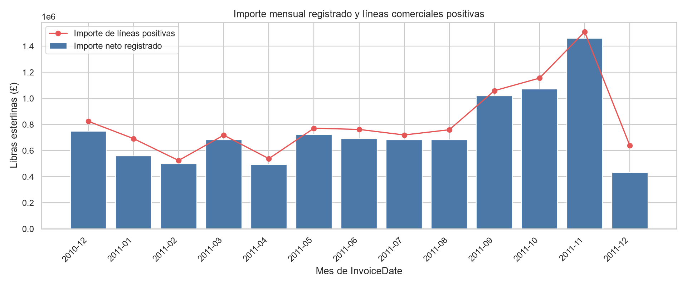
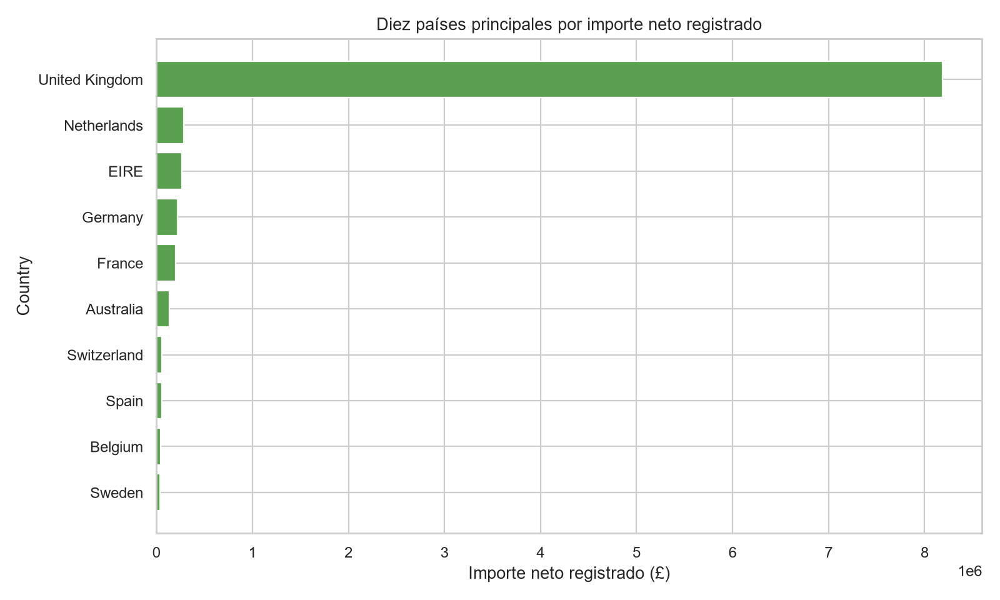
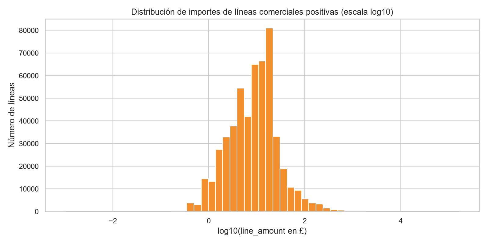

# Resumen ejecutivo

El libro `Online Retail` contiene 541.909 líneas de factura y ocho variables de origen. La unidad de análisis es la línea de factura, por lo que los conteos de líneas, facturas y clientes no son intercambiables. Se conservaron todas las filas y se creó una copia preparada con 11 columnas, incluyendo `is_cancelled`, `line_amount` e `invoice_month`. [STAT-001] [STAT-007]

La cobertura observada va desde el 1 de diciembre de 2010 a las 08:26 hasta el 9 de diciembre de 2011 a las 12:50. Se identificaron 9.288 líneas cuyo `InvoiceNo` comienza por `C`, criterio documentado de cancelación; representan el 1,71% de las líneas. [STAT-004]

El importe neto registrado, definido como la suma de `line_amount = Quantity × UnitPrice` sobre todas las líneas, es £9.747.747,93. Esta cifra describe valores registrados y no debe interpretarse como ingreso realizado, pago o rentabilidad. [STAT-005] [STAT-012]

La calidad condiciona especialmente los análisis de clientes: `CustomerID` falta en 135.080 líneas (24,93%), mientras que `Description` falta en 1.454 (0,27%). Por ello, los resultados por cliente se limitan explícitamente a las líneas identificadas. [STAT-002] [ISSUE-001] [ISSUE-002]

# Dataset y alcance

Se analizó el archivo `xlsx` en su hoja `Online Retail`, con las columnas `InvoiceNo`, `StockCode`, `Description`, `Quantity`, `InvoiceDate`, `UnitPrice`, `CustomerID` y `Country`. La documentación disponible indica que cada fila representa una línea de factura y que una factura cuyo `InvoiceNo` comienza por `C` corresponde a una cancelación. [STAT-001]

El análisis es descriptivo y se limita a los registros incluidos en el archivo. Se distinguen las líneas de factura de las facturas: se observaron 25.900 valores distintos de `InvoiceNo`, 4.070 `StockCode`, 4.372 clientes identificados y 38 países. [STAT-002] [STAT-010]

Los identificadores `InvoiceNo`, `StockCode` y `CustomerID` se trataron como categorías nominales, no como variables numéricas continuas. En particular, una agregación por `CustomerID` solo describe el subconjunto con identificador disponible. [STAT-010] [STAT-014]

# Inspección, calidad y preparación

La tabla original tiene 541.909 filas y 8 columnas; la copia preparada conserva las mismas 541.909 filas y añade tres variables derivadas, resultando en 11 columnas. [STAT-001] [STAT-007]

Las transformaciones fueron conservadoras:

- `InvoiceNo`, `StockCode` y `CustomerID` se serializaron como identificadores nominales; `CustomerID` conserva sus ausencias y evita el sufijo decimal procedente de su lectura numérica original.
- `InvoiceDate` se confirmó como fecha-hora, y `Quantity` y `UnitPrice` como numéricos.
- Se creó `is_cancelled` mediante el prefijo `C` de `InvoiceNo`; `line_amount` se calculó como `Quantity × UnitPrice`; e `invoice_month` permite agregaciones mensuales.
- No se imputaron ausencias ni se eliminaron filas idénticas, cantidades negativas, precios cero o valores extremos. [STAT-007]

`CustomerID` falta en 135.080 líneas y `Description` en 1.454; las demás variables originales no presentan ausencias. [STAT-002] Las líneas sin `CustomerID` están muy concentradas en `United Kingdom`: 133.600 de 135.080, equivalentes al 98,90% de las ausencias de identificador. Esto refuerza que el subconjunto de clientes identificados puede no representar al total de líneas. [STAT-017] [ISSUE-001]

Se hallaron 5.268 filas exactamente repetidas en los ocho campos originales, el 0,97% de la tabla. Se retuvieron porque, sin un identificador de línea independiente ni evidencia de carga duplicada, no es posible distinguir con seguridad duplicados técnicos de líneas transaccionales legítimas. [STAT-003] [ISSUE-003]

En la comprobación de consistencia, 647 `StockCode` con descripción disponible se asociaron a más de una `Description` tras recortar espacios exclusivamente para inspección. No se forzó una correspondencia única entre código y texto. [STAT-006] [ISSUE-005]

# Estadística descriptiva

En todas las líneas, `Quantity` tiene mediana 3, rango entre -80.995 y 80.995, y percentil 99 de 100 unidades. `UnitPrice` presenta mediana £2,08 y rango entre -£11.062,06 y £38.970. El importe de línea (`line_amount`) tiene mediana £9,75, percentil 99 £180 y rango entre -£168.469,60 y £168.469,60. Estas diferencias entre mediana, percentiles y máximos reflejan distribuciones marcadamente asimétricas. [STAT-005] [STAT-008]

Para una población de “líneas comerciales positivas”, definida como no cancelada, con `Quantity > 0` y `UnitPrice > 0`, se obtienen 530.104 líneas. En este subconjunto, la mediana de `line_amount` es £9,90, el percentil 99 es £183,60 y la suma alcanza £10.666.684,54. [STAT-008]

Las 9.288 líneas marcadas como cancelación corresponden a 3.836 facturas y acumulan -277.574 unidades y -£896.812,49 de importe registrado. Las líneas no canceladas suman 5.454.024 unidades y £10.644.560,42, pero incluyen además 1.336 líneas con cantidades negativas y 2.515 líneas con precio cero. Por tanto, separar cancelaciones es útil, pero no elimina todas las particularidades de signo y precio. [STAT-009]

La tabla contiene 406.829 líneas con `CustomerID`, equivalentes al 75,07% del total. En el subconjunto identificado, el importe agregado por cliente tiene mediana £648,08, media £1.898,46 y máximo £279.489,02, otra señal de concentración y asimetría. [STAT-010] [STAT-014]

# Variables, agregaciones y relaciones

La agregación mensual muestra un aumento del importe neto registrado durante el otoño de 2011: £1.019.687,62 en septiembre, £1.070.704,67 en octubre y £1.461.756,25 en noviembre. Diciembre de 2010 y diciembre de 2011 no deben compararse directamente con meses completos, porque la ventana comienza el día 1 de diciembre de 2010 y termina el día 9 de diciembre de 2011. [STAT-004] [STAT-011]

`United Kingdom` concentra £8.187.806,36 de importe neto registrado, el 84,00% del total. Le siguen `Netherlands` (£284.661,54), `EIRE` (£263.276,82), `Germany` (£221.698,21) y `France` (£197.403,90). Esta concentración geográfica describe la composición observada; no identifica sus causas. [STAT-012]

Entre las líneas comerciales positivas, el ranking por importe incluye tanto artículos como conceptos facturados. Los primeros registros son `DOT` / `DOTCOM POSTAGE` (£206.248,77), `22423` / `REGENCY CAKESTAND 3 TIER` (£174.484,74) y `23843` / `PAPER CRAFT , LITTLE BIRDIE` (£168.469,60). Este último importe procede de una sola línea con 80.995 unidades, por lo que ilustra la sensibilidad de rankings y medias a pedidos de gran tamaño. [STAT-013] [STAT-016]

En las líneas comerciales positivas, la correlación de rangos de Spearman entre `Quantity` y `UnitPrice` es -0,403 sobre 530.104 líneas. Es una asociación monotónica negativa de rango en este subconjunto, no una relación causal ni una estimación de elasticidad o comportamiento de demanda. [STAT-015]

# Visualizaciones y hallazgos

La serie mensual distingue el importe neto registrado —que incorpora cancelaciones y otros ajustes— de la suma de líneas comerciales positivas. La figura permite observar el incremento de actividad registrado en septiembre–noviembre de 2011 y, a la vez, la necesidad de interpretar con cautela los meses de diciembre incompletos. [FIG-001] [STAT-011]

La composición geográfica es altamente concentrada: `United Kingdom` domina la escala visual, con aproximadamente el 84% del importe neto registrado. La representación se limita transparentemente a los diez países con mayor importe para conservar legibilidad. [FIG-002] [STAT-012]

La distribución de `line_amount` para líneas comerciales positivas se representa en escala `log10`, evitando que la cola superior oculte la masa de importes pequeños y medianos. El percentil 99 es £183,60, pero 5.279 líneas superan ese valor y el máximo llega a £168.469,60; estas observaciones se preservaron, no se eliminaron automáticamente. [FIG-003] [STAT-008] [STAT-016]

# Problemas, riesgos y anomalías

- **Ausencias de `CustomerID`:** afectan a 135.080 líneas. Los análisis por cliente excluyen estas filas en lugar de imputarlas; la ausencia está concentrada en `United Kingdom`, por lo que puede introducir diferencias entre el subconjunto identificado y el total. [ISSUE-001] [STAT-017]
- **Ausencias de `Description`:** afectan a 1.454 líneas. No se reconstruyeron desde `StockCode` porque no existe un catálogo de correspondencia fiable y algunos códigos se asocian a múltiples descripciones. [ISSUE-002] [ISSUE-005]
- **Filas idénticas:** se detectaron 5.268 repeticiones exactas. Se conservaron debido a la incertidumbre sobre si constituyen duplicados técnicos o líneas legítimas; si fueran duplicados de carga, los conteos, unidades e importes podrían estar sobreestimados. [ISSUE-003] [STAT-003]
- **Signos, precios cero y conceptos especiales:** se detectaron 10.624 cantidades negativas, 2.515 precios cero y 2 precios negativos. Las cantidades negativas se concentran en cancelaciones, aunque existen 1.336 líneas negativas fuera de facturas con prefijo `C`. Se retuvieron y se definieron poblaciones positivas explícitas cuando eran necesarias. [ISSUE-004] [STAT-005] [STAT-009]
- **Cobertura temporal parcial:** el primer y último mes de la serie no son meses calendario completos, por lo que sus totales no deben usarse como medidas comparables de actividad mensual plena. [ISSUE-006] [STAT-004]
- **Cola alta de importes:** 5.279 líneas comerciales positivas superan el percentil 99 de £183,60. Se consideran observaciones para revisión, no errores confirmados; podrían ser pedidos mayoristas u otros registros válidos. [ISSUE-007] [STAT-016]

# Limitaciones e incertidumbres

La ausencia de `CustomerID` impide observar el comportamiento de cliente para aproximadamente una cuarta parte de las líneas y no se conoce el mecanismo que produce esa falta de datos. [ISSUE-001]

La documentación solo define explícitamente el prefijo `C` de `InvoiceNo` como cancelación. No permite clasificar con certeza todos los precios cero, cantidades negativas fuera de cancelaciones, códigos especiales o importes extremos. [ISSUE-004] [ISSUE-007]

`line_amount` es una derivada aritmética de cantidad y precio unitario registrados. No incorpora información sobre pagos, descuentos no registrados, costes, margen, devoluciones emparejadas ni estado final de la transacción; por tanto, no equivale necesariamente a ventas realizadas o ingresos contables. [STAT-007] [STAT-009]

Las filas completamente idénticas y la correspondencia no unívoca entre `StockCode` y `Description` introducen incertidumbre adicional al agregar productos o conceptos. Se evitó eliminar o normalizar estos registros sin evidencia documental suficiente. [ISSUE-003] [ISSUE-005]

# Conclusiones

El dataset permite describir una operación de comercio electrónico a nivel de línea de factura, con 25.900 facturas distintas, 4.070 códigos facturados y una actividad registrada concentrada en `United Kingdom`. [STAT-010] [STAT-012]

Las cancelaciones documentadas son minoritarias en número de líneas, pero tienen importe agregado negativo y deben separarse de las líneas positivas para interpretar adecuadamente sumas, distribuciones y rankings. [STAT-004] [STAT-009]

La actividad mensual registrada alcanza su mayor importe neto en noviembre de 2011 dentro de los meses completos observados, aunque la comparación temporal debe mantener la advertencia sobre los límites parciales de diciembre. [STAT-011] [ISSUE-006]

Finalmente, la preparación conserva la población original y hace explícitas las derivadas y filtros analíticos. Esta decisión prioriza trazabilidad y evita convertir ausencias, extremos, repeticiones o signos inusuales en errores confirmados sin información adicional. [STAT-007] [ISSUE-003] [ISSUE-004]