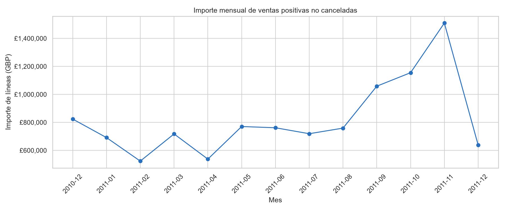
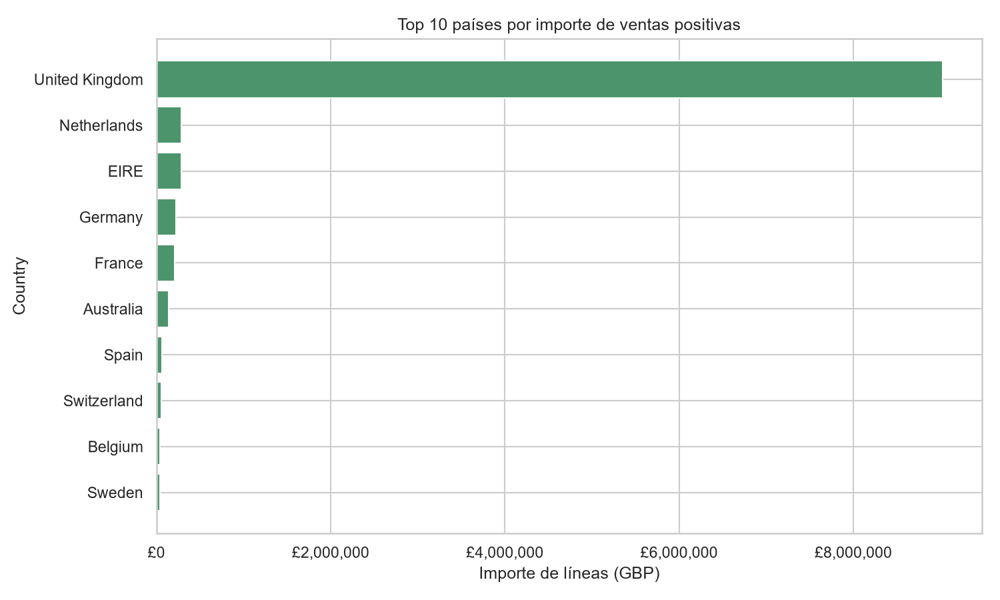
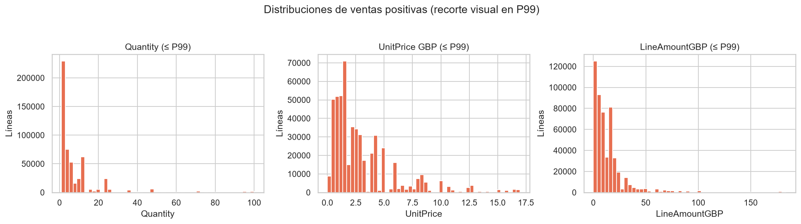
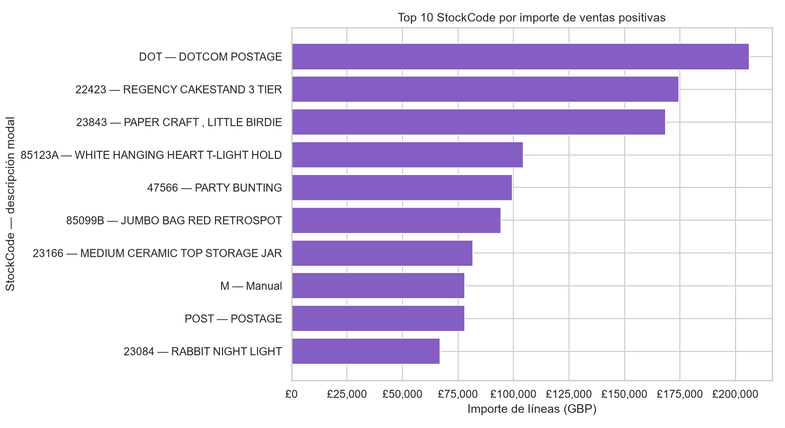

# Resumen ejecutivo

El libro `Online Retail` contiene 541.909 líneas de factura y ocho campos originales; cada fila es una línea, no una compra o factura agregada. La cobertura observada va de `2010-12-01 08:26` a `2011-12-09 12:50`. [STAT-001]

Se preparó una copia con las 541.909 filas retenidas, tipos nominales explícitos para identificadores y cuatro variables derivadas: `IsCancellation`, `LineAmountGBP`, `Month` y `CustomerIDAvailable`. Para describir actividad positiva se usó, sin eliminarla de la copia, la población `IsCancellation=False`, `Quantity>0` y `UnitPrice>0`, con 530.104 líneas. [STAT-007]

En dicha población, el importe registrado total de líneas es £10.666.684,54 en 19.960 facturas distintas; la mediana de `LineAmountGBP` es £9,90 y el percentil 99 es £183,60, evidenciando una distribución marcadamente asimétrica. [STAT-009] `United Kingdom` concentra el 84,61 % de ese importe registrado, y noviembre de 2011 es el mes con mayor importe (£1.509.496,33), aunque la comparación de los meses extremos requiere cautela por cobertura parcial. [STAT-012] [STAT-011]

# Dataset y alcance

Se analizó la hoja `Online Retail` del archivo original `xlsx`, sin modificarla. La tabla incluye `InvoiceNo`, `StockCode`, `Description`, `Quantity`, `InvoiceDate`, `UnitPrice`, `CustomerID` y `Country`. La documentación disponible define la unidad de observación como una línea de factura, por lo que las facturas repetidas en varias filas son esperables y no representan duplicados por sí mismas. [STAT-001] [STAT-003]

El análisis se limita a las transacciones registradas en el archivo y el intervalo temporal observado. `Country` se interpreta únicamente como el país asociado al cliente conforme a la documentación; no permite confirmar el destino del envío, país de consumo o residencia definitiva.

El importe derivado `LineAmountGBP = Quantity × UnitPrice` representa el valor registrado de una línea en libras esterlinas. Se comprobó la identidad aritmética en la copia preparada, con diferencia absoluta máxima igual a cero. Este importe no equivale automáticamente a cobro, ingreso contable, margen ni beneficio. [STAT-007]

# Inspección, calidad y preparación

La carga identificó 541.909 filas, ocho columnas originales y fechas sin ausencias. Los identificadores aparecían con tipos heterogéneos: `InvoiceNo` y `StockCode` como objetos, y `CustomerID` como número decimal pese a ser un identificador nominal. [STAT-001]

La preparación no descartó filas. `InvoiceNo` y `StockCode` se convirtieron a texto nominal, `CustomerID` a entero nullable, y `InvoiceDate` se preservó como fecha-hora y se serializó en ISO 8601 en `prepared_data.csv`. Se conservaron las ocho columnas fuente y se añadieron `IsCancellation`, `LineAmountGBP`, `Month` y `CustomerIDAvailable`. [STAT-007]

La decisión de conservar duplicados exactos, cancelaciones, valores cero, ausencias y extremos fue deliberada: sin un identificador externo de línea, catálogo de productos o reglas de negocio adicionales, no es posible demostrar que sean errores. Los análisis que describen líneas positivas no canceladas usan un subconjunto explícito, pero el archivo preparado conserva la población completa. [STAT-003] [STAT-004] [STAT-007]

# Estadística descriptiva

En el archivo original, `CustomerID` tiene 135.080 ausencias (24,927 %) y `Description` 1.454 (0,268 %); las demás columnas originales no presentan valores ausentes. [STAT-002]

Se identificaron 25.900 valores distintos de `InvoiceNo`, 4.070 `StockCode`, 4.372 `CustomerID` no ausentes y 38 países. Existen 5.268 filas exactamente duplicadas en las ocho variables originales; se retuvieron por la incertidumbre sobre si corresponden a líneas comerciales legítimas repetidas o a duplicación de registro. [STAT-003] [ISSUE-003]

En las 530.104 líneas positivas no canceladas, la mediana de `Quantity` es 3 unidades, con percentil 99 de 100 y máximo de 80.995. La mediana de `UnitPrice` es £2,08, mientras que su percentil 99 es £16,98 y máximo £13.541,33. Para `LineAmountGBP`, la mediana es £9,90, el intervalo intercuartílico va de £3,75 a £17,70, y el máximo alcanza £168.469,60. [STAT-009]

Estas diferencias entre mediana, percentiles altos y máximos muestran colas largas. Las vallas IQR clasifican descriptivamente 56.363 líneas por encima de la valla superior de `Quantity`, 37.999 en `UnitPrice` y 42.651 en `LineAmountGBP`; ello no confirma que sean registros erróneos. [STAT-010] [ISSUE-007]

# Variables, agregaciones y relaciones

La documentación indica que un `InvoiceNo` con prefijo `C` representa una cancelación. Se observaron 9.288 líneas de este tipo (1,714 %), y todas tienen `Quantity` negativa. También hay 1.336 líneas con cantidad negativa cuyo `InvoiceNo` no comienza por `C`, 2 precios unitarios negativos y 2.515 precios unitarios iguales a cero. [STAT-004] Estas situaciones se separaron de las líneas positivas no canceladas para evitar mezclar devoluciones, cancelaciones, ajustes o líneas gratuitas con la descripción de actividad positiva. [ISSUE-004]

La evolución mensual de líneas positivas no canceladas aumenta hacia el último trimestre completo observado: septiembre de 2011 registra £1.058.590,17, octubre £1.154.979,30 y noviembre £1.509.496,33. El último mes observado, diciembre de 2011, comprende solo hasta el día 9; por tanto, su importe de £638.792,68 no es directamente comparable con un mes completo. [STAT-011] [ISSUE-006]

La actividad está muy concentrada en `United Kingdom`, con 485.123 líneas positivas, 18.019 facturas y £9.025.222,08 de importe registrado. Le siguen, por importe, `Netherlands` (£285.446,34), `EIRE` (£283.453,96), `Germany` (£228.867,14) y `France` (£209.715,11). [STAT-012] Esta concentración describe la composición de este archivo según país asociado al cliente, sin establecer explicaciones sobre demanda o mercados.

Al agrupar por `StockCode`, el mayor importe corresponde a `DOT` (`DOTCOM POSTAGE`), con £206.248,77. `22423` (`REGENCY CAKESTAND 3 TIER`) alcanza £174.484,74. El código `23843` (`PAPER CRAFT , LITTLE BIRDIE`) suma £168.469,60 en una sola línea de 80.995 unidades, por lo que contribuye de forma importante a los extremos de cantidad e importe. [STAT-013] Estos resultados se muestran como importes facturados de líneas, no como una medida de margen o rentabilidad.

Las líneas positivas sin `CustomerID` disponible representan 132.220 filas (24,942 %) y tienen una mediana de importe de £4,96, frente a £11,80 entre las líneas con identificador disponible. Esta es una diferencia descriptiva condicionada por disponibilidad de identidad; no prueba que se trate de tipos de cliente distintos. [STAT-014] [ISSUE-001]

La correlación de rangos de Spearman entre `Quantity` y `UnitPrice` es -0,403 en la población positiva no cancelada. Es una asociación inversa moderada en los rangos observados, no una relación causal ni una regla de precios. [STAT-015]

# Visualizaciones y hallazgos

La evolución mensual del importe de líneas positivas no canceladas se muestra en la Figura 1. La figura documenta el aumento registrado hacia noviembre de 2011 y permite ver el carácter parcial de diciembre de 2011 en el intervalo observado. [FIG-001] [STAT-011]

La Figura 2 representa los diez países con mayor importe. La barra de `United Kingdom` domina la escala, coherentemente con su participación de 84,61 % del importe de líneas positivas no canceladas. [FIG-002] [STAT-012]

La Figura 3 muestra la masa central de `Quantity`, `UnitPrice` y `LineAmountGBP`, recortando la visualización en el percentil 99 de cada variable. El recorte es solamente gráfico: los extremos se conservaron en los cálculos y se cuantifican por separado. [FIG-003] [STAT-009] [STAT-010]

La Figura 4 compara los diez `StockCode` con mayor importe y utiliza una descripción modal como etiqueta auxiliar. Esta decisión evita tratar variantes textuales de `Description` como productos distintos cuando comparten código. [FIG-004] [STAT-013] [STAT-006]

# Problemas, riesgos y anomalías

- **Ausencias de identidad.** `CustomerID` falta en 135.080 filas originales y limita cualquier análisis a nivel de cliente. Se preservó como ausencia y no se imputó. [ISSUE-001] [STAT-002]
- **Ausencias de descripción.** Hay 1.454 filas sin `Description`. Por ello, los rankings de producto se apoyan en `StockCode`, no exclusivamente en el texto descriptivo. [ISSUE-002] [STAT-002]
- **Duplicados exactos.** Las 5.268 filas exactamente duplicadas se retuvieron porque no hay evidencia suficiente para eliminarlas sin riesgo de retirar líneas legítimas. [ISSUE-003] [STAT-003]
- **Cancelaciones, cantidades negativas y precios cero.** Las cancelaciones identificadas mediante prefijo `C`, otras cantidades negativas y precios no positivos pueden representar devoluciones, ajustes o incidencias; se conservaron y se separaron analíticamente de las líneas positivas no canceladas. [ISSUE-004] [STAT-004]
- **Inconsistencia o variación textual.** De los 3.958 códigos con alguna descripción, 650 (16,42 %) tienen más de una `Description` literal. No puede determinarse si son cambios legítimos de etiqueta, espacios, variantes de texto o reutilización de código. [ISSUE-005] [STAT-006]
- **Cobertura temporal desigual.** El rango comienza en diciembre de 2010 y termina el 9 de diciembre de 2011, por lo que los meses extremos no deben compararse como meses calendario completos. [ISSUE-006] [STAT-001]
- **Extremos.** Las observaciones fuera de vallas IQR se registran como valores extremos descriptivos, no como errores confirmados. Su presencia puede afectar medias, totales y escalas, y requeriría validación comercial externa antes de excluirlas o modificarlas. [ISSUE-007] [STAT-010]

# Limitaciones e incertidumbres

La unidad observada es una línea de factura; por ello, los resultados no equivalen automáticamente a compras, pedidos, clientes o facturas completas. [STAT-001]

La ausencia de `CustomerID` impide atribuir una parte sustancial de las líneas a clientes identificables y condiciona los análisis basados en esos identificadores. [STAT-002] [ISSUE-001]

No se proporcionó un catálogo de productos, reglas contables, comprobantes de envío ni criterios de validación para precios, cantidades y duplicados. En consecuencia, no es posible confirmar si los extremos, códigos especiales como `DOT`, `POST` o `M`, duplicados exactos y líneas no positivas corresponden a errores o a operaciones válidas. [STAT-013] [ISSUE-003] [ISSUE-007]

La serie temporal está limitada al período registrado y tiene meses extremos potencialmente incompletos. Las comparaciones mensuales describen registros presentes, sin inferir estacionalidad, demanda generalizable ni cambios causales. [ISSUE-006] [STAT-011]

# Conclusiones

El archivo ofrece una base amplia para describir líneas de facturación: 541.909 registros, 38 países y cobertura desde diciembre de 2010 hasta diciembre de 2011. La copia preparada preserva íntegramente esa evidencia y hace explícitas las variables necesarias para distinguir cancelaciones, importes de línea, período y disponibilidad de identificación. [STAT-001] [STAT-007]

Bajo la población analítica de líneas positivas no canceladas, la actividad registrada presenta fuerte asimetría, concentración en `United Kingdom` y un máximo mensual observado en noviembre de 2011. [STAT-009] [STAT-011] [STAT-012] Los importes y rankings deben interpretarse con cautela por los valores extremos, los productos o conceptos especiales, las cancelaciones y los meses parciales. [ISSUE-004] [ISSUE-006] [ISSUE-007]

La principal limitación estructural es la falta de `CustomerID` en aproximadamente una cuarta parte de las líneas, junto con la imposibilidad de validar externamente duplicados, extremos y variantes de producto. Por ello, las conclusiones son descriptivas del archivo entregado y no establecen relaciones causales, resultados contables definitivos ni comportamientos fuera del período observado.